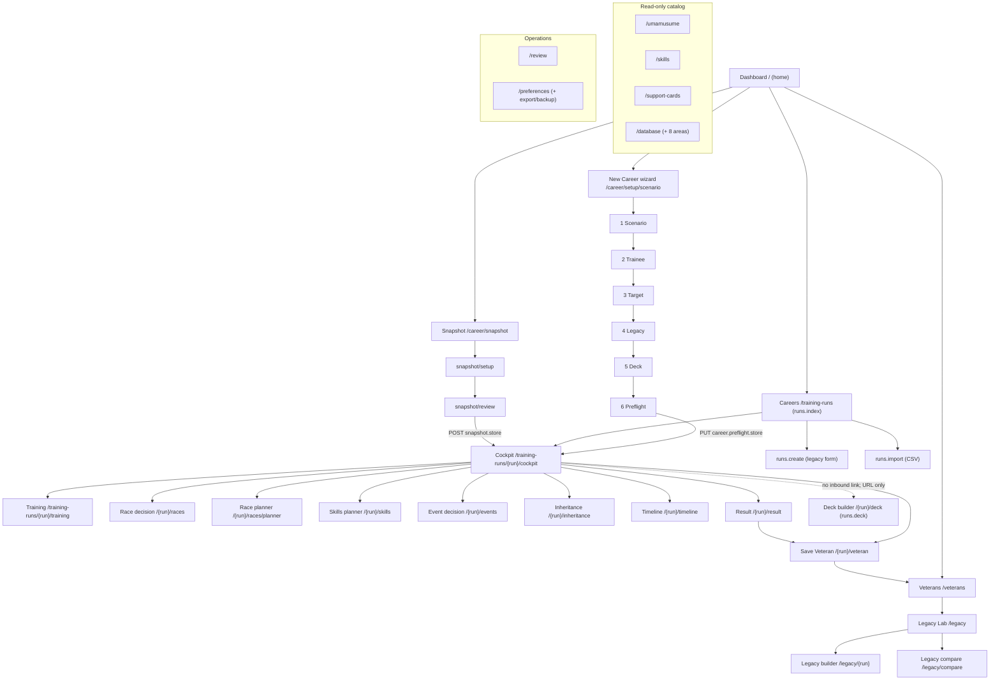

# UI/UX Application Context Brief — Trainer Desk (`umamusume-laravel13`)

| Field | Value |
| --- | --- |
| Purpose | Give an external reviewer (ChatGPT) a repository-grounded mental model of the application's UI/UX, IA, navigation, user flows, domain concepts, screen responsibilities, interaction patterns, and known usability issues. |
| Method | Static repository inspection (routes, controllers, models, Vue pages/components/layouts, config, migrations, tests) plus the repository's own UX audits. No application code was modified. |
| Date of writing | 2026-10-10 |
| HEAD at writing | `9777531` (`fix(scenario): name the ruleset version and the rule family apart`) |
| Branch | `master` |
| Working tree at writing | Carries an **uncommitted, in-flight R2-06 remediation** (deck-ownership copy + tests) and two untracked audit files. See §9 and §12. |
| Reading conventions | Every claim is labelled **CONFIRMED** (read from code/routes/persistence/tests), **DOCUMENTED** (authoritative doc), **HISTORICAL** (audit/older claim), **INFERRED** (reasoned, not directly proven), or **PROPOSED** (design/plan, not built). Line numbers are accurate only at the time of writing. |

---

## 1. Executive overview

**CONFIRMED.** Trainer Desk is a local-only, single-Trainer Laravel 13 application for the Global English release of *Umamusume Pretty Derby*. It runs on loopback, has no auth surface and no deploy path, and stores everything in one SQLite file (`database/database.sqlite`). The web surface is Inertia + Vue 3 (TypeScript, Tailwind v4, Vite); Blade survives only as the `resources/views/app.blade.php` shell and error pages. There is a read-only JSON surface under `/api/v1`. (`AGENTS.md` §1; `routes/web.php`.)

**CONFIRMED.** The application is organized around **career runs** (`training_runs`). A run is one Trainer's playthrough of one trainee in one scenario. The user's core loop is:

1. Start a career (six-step setup wizard, or snapshot an in-progress career, or import a CSV).
2. Enter the career workspace: a **Cockpit** hub plus run-scoped decision screens (training, races, skills, events, inheritance).
3. Record turns, make planning decisions, plan races, plan skills.
4. Finish the career: read the **Result** screen, save a **Veteran** (a permanent record of the finished career).
5. Reuse Veterans in the **Legacy Lab** (record the ancestry/parents used at the start of a new career) and compare them.

**CONFIRMED.** Beside the career loop sit four read-only catalog surfaces — trainees, support cards, skills, and a Database hub of eight reference areas — plus a Review queue for the fetch pipeline's ambiguous matches and a Preferences/Settings screen with export and backup.

**CONFIRMED.** There are effectively **two "homes"**:
- the **Dashboard** (`/`, `home`), the Trainer Desk 2.0 front door (`ADR-0020` §1), which shows the newest active career, recent Veterans, quick actions and data status; and
- the **Cockpit** (`/training-runs/{run}/cockpit`, `runs.cockpit`), the run's own workspace.

**CONFIRMED.** The single most important navigation fact for a newcomer: the old run-record screen is retired. `GET /training-runs/{run}` (`runs.show`) is a **redirect to the Cockpit** (`routes/web.php:132`; `TrainingRunController::redirect()`), not a screen. Everything the old record screen owned now lives in the Cockpit or a run-scoped decision screen.

---

## 2. Repository and evidence guide

### 2.1 Stack (CONFIRMED)

| Concern | Value | Evidence |
| --- | --- | --- |
| Framework | Laravel 13 | `composer.json`; `AGENTS.md` §1 |
| Language | PHP 8.5 | `AGENTS.md` §1; audit headers |
| Database | SQLite (WAL, `busy_timeout`), file `database/database.sqlite` | `AGENTS.md` §1 |
| Frontend | Inertia.js + Vue 3 + TypeScript, Tailwind v4, Vite | `resources/js/`; `AGENTS.md` §1 |
| Tests | Pest 4 (feature-first), Playwright (browser) | `tests/`; `AGENTS.md` §9 |
| Static analysis | PHPStan level 6, Pint (`laravel` preset) | `AGENTS.md` §7, §9 |
| Scale at writing | 48 Vue pages, 51 Vue components, 3 layouts; 165 Feature tests, 7 Unit tests, 49 browser specs | measured on this tree |

### 2.2 Evidence hierarchy used in this brief

Per the task's own ordering, strongest first:

1. **Requirements / designated authoritative docs** — `PRD.md`, `SCREEN_SPEC.md`, `ARCHITECTURE.md`, accepted ADRs.
2. **Actual routes, backend logic, persistence, and current frontend implementation** — `routes/web.php`, `app/Http/Controllers/**`, `app/Models/**`, `database/migrations/**`, `resources/js/**`.
3. **Automated tests and verified browser behavior** — `tests/Feature/**`, `tests/browser/**`.
4. **UX audits, reconciliation, screenshot research** — `docs/audits/**`, `docs/research-scratch/**`.
5. **Proposals, design concepts, historical notes, assumptions** — `docs/proposals/**`, `docs/research-scratch/**`.

Where (2) and (1) disagree, this brief reports the disagreement rather than silently choosing one (see §9, R2-01).

### 2.3 Authoritative document map (CONFIRMED existence)

| Document | Owns | Authority |
| --- | --- | --- |
| `PRD.md` | users, stories, FR-A..FR-E, NFRs, §6 non-goals | Product truth |
| `ARCHITECTURE.md` | schema, pipeline, API contract, security, testing strategy | System design |
| `SCREEN_SPEC.md` | screen inventory, per-screen states, §8 authority table | Screen behavior |
| `DESIGN.md` | tokens, components, surfaces, motion | Visual system |
| `KNOWN-ISSUES.md` | live defect register `KI-nn` (KI-57 onward) | Defect register |
| `config/scenarios.php` | the **only** place scenario names enter the layout path | Scenario composition |
| `docs/audits/rice-shower-unity-cup-ux-walk.md` | first browser walk (Round 1) | HISTORICAL evidence |
| `docs/audits/rice-shower-unity-cup-ux-walk-2.md` | second browser walk (Round 2) | HISTORICAL evidence |
| `docs/audits/rice-shower-unity-cup-ux-walk-resolutions.md` | remediation record | HISTORICAL evidence |
| `docs/audits/rice-shower-unity-cup-round2-reconciliation.md` | R2-01..R2-15 classification vs code | HISTORICAL evidence (in-flight) |
| `docs/UMAMUSUME_REFERENCE.md` | source-cited mechanics corpus | Reference (not a spec) |

**Not authoritative / do not cite as a spec:** `docs/deprecated/**` (retired legacy PDFs; display text must never be copied), `PRODUCT.md` and `SKILL.md` (generator-owned), and the `docs/design-research/` prototypes.

### 2.4 Code map (CONFIRMED)

| Layer | Location | Note |
| --- | --- | --- |
| Routes | `routes/web.php` (browser), `routes/api.php` (JSON, read-only) | all browser routes named |
| Controllers | `app/Http/Controllers/` + `app/Http/Controllers/Career/` + `Api/V1/` | thin; logic in Actions/Services |
| Models | `app/Models/` (22 + `Advisor/`, `Legacy/`, `TurnEvents/` payloads) | catalog + trainer-data + support-card |
| Domain | `app/Domain/Career/CareerPosition.php`, `app/Domain/Training/StatCeilings.php` | position + ceilings arithmetic |
| Enums | `app/Enums/` (19) | TitleCase cases; DB stores the backed value |
| Services | `app/Services/` (`ScenarioCaps`, `SkillSpendCoverage`, `Career/SetupDraft`, `Advisor/TrainerAdvisor`, ...) | shared arithmetic/ownership |
| Layouts | `resources/js/layouts/AppLayout.vue`, `CareerLayout.vue`, `SetupLayout.vue` | three navigation shells |
| Pages | `resources/js/pages/` (48) | grouped by area |
| Components | `resources/js/components/` (51) | incl. `career/`, `scenario/`, `support/` |

---

## 3. Information architecture and navigation map

### 3.1 Primary navigation — `AppLayout.vue`

**CONFIRMED.** The sidebar is a single flat list of **ten live destinations** (`AppLayout.vue:105-121`). There are zero "not built" (named-absence) items now. The list:

| # | Label | Route target | Mobile slot | `spa` |
| --- | --- | --- | --- | --- |
| 1 | Dashboard | `/` (`home`) | Home | yes |
| 2 | New Career | `/career/setup/scenario` (`career.scenario`) | (More) | yes |
| 3 | Careers | `/training-runs` (`runs.index`) | Career | yes |
| 4 | Legacy Lab | `/legacy` (`legacy.index`) | Legacy | yes |
| 5 | Veterans | `/veterans` (`veterans.index`) | (More) | yes |
| 6 | Support Cards | `/support-cards` (`support-cards.index`) | Deck | yes |
| 7 | Skills | `/skills` (`skills.index`) | (More) | yes |
| 8 | Review | `/review` (`review.index`) | (More) | yes |
| 9 | Database | `/database` (`database.index`) | (More) | yes |
| 10 | Settings | `/preferences` (`preferences.edit`) | (More) | yes |

**CONFIRMED.** Mobile uses a bottom bar of four slots + a native `
` "More" disclosure (`AppLayout.vue:303-364`). The desktop rail collapses to icons only; the choice is stored in `localStorage` key `trainer-desk.nav-rail` (`AppLayout.vue:146-167`) — a **browser** preference, not a stored `Preference` row. Active state uses prefix matching and strips the query string (`isCurrent()`, `AppLayout.vue:47-51`), so `/legacy/12` still highlights Legacy Lab.

**DOCUMENTED / minor breach.** The ten-item count exceeds the frontend plan's "at or under eight" guideline; the code comment (`AppLayout.vue:116-118`) states the breach predates the Database slice and its repair is the owner's ruling, not a quiet merge.

### 3.2 Career shell — `CareerLayout.vue`

**CONFIRMED.** Run-scoped screens render inside a career bar showing the trainee, scenario and status, with doors to the Cockpit and the Dashboard. The run's URL is provided by the server as `run_url`, which lands on the Cockpit through the `runs.show` redirect; no browser file addresses `runs.show` literally (enforced by `tests/Feature/NoStaleRunRecordLinksTest.php`).

### 3.3 Setup shell — `SetupLayout.vue`

**CONFIRMED.** The six-step wizard renders a step rail: **Scenario → Trainee → Target → Legacy → Support deck → Preflight** (`SetupLayout.vue:33`). Every step writes to a **session draft** (`app/Services/Career/SetupDraft.php`), not to a run; the run is created once, at Preflight.

### 3.4 Route / navigation map (CONFIRMED)

### 3.5 Global vs run-scoped

**CONFIRMED.** Global (not tied to a run): Dashboard, Careers list, catalog (trainees/skills/support cards), Database hub, Review, Preferences, Veterans, Legacy Lab index/compare, and the setup wizard (draft state). **Run-scoped** (require `{run}`): Cockpit, Training, Race decision, Race planner, Skills planner, Event decision, Inheritance, Timeline, Result, Save Veteran, and the run-scoped Deck builder. **Legacy Lab builder** is run-scoped (`/legacy/{run}`) but reads a run only as the anchor for recording ancestry.

### 3.6 Navigation dead ends and cross-screen links (CONFIRMED)

- **The run-scoped Deck builder (`/training-runs/{run}/deck`, `runs.deck`) has no inbound in-app link from any Vue page.** `Support/Builder.vue` *is* that screen (rendered by `TrainingRunController::deck()`), and its only self-reference (`Support/Builder.vue:168-169`) is a same-page reload for filter/page/equip, not an inbound door. A user reaches it only by typing the URL. **INFERRED:** this is a discoverability defect.
- **`resources/js/pages/Career/TrainingDetail.vue:603` links to `/career/setup/deck`** — the *wizard's* deck step — when the run has no deck recorded. From a run-scoped screen this drops the user into the setup wizard (draft flow), which is a cross-screen navigation defect: the correct target for "this run's deck" is `/training-runs/{run}/deck`.
- `runs.show` is a redirect, not a screen (`routes/web.php:132`). No browser file addresses it (`NoStaleRunRecordLinksTest`).

---

## 4. Complete screen inventory

The table below covers the significant user-facing surfaces. "States" is condensed; the authoritative per-screen state list is `SCREEN_SPEC.md`. Absent/unsupported features are marked.

### 4.1 Global screens

| Screen | Route (name) | Purpose | Entry points | Primary actions | Data owner | UX concerns / evidence |
| --- | --- | --- | --- | --- | --- | --- |
| Dashboard | `/` (`home`) | Front door: active career, recent Veterans, quick actions, data status | Sidebar; logo; any "Home" | Open active career; start new; browse | `DashboardController`; `TrainingRun` (newest `Active`), `Veteran` | Multiple runs supported; shows newest Active only (CONFIRMED, `DashboardController`). |
| Careers list | `/training-runs` (`runs.index`) | List/manage runs | Sidebar "Careers" | Open, delete, create, import | `TrainingRunController::index` | No clickable inbound link existed before 2.0; now the sidebar owns it (`AppLayout.vue:69-71`). |
| Create run (legacy form) | `/training-runs/create` (`runs.create`) | Pre-2.0 one-combobox create | Catalog page carrying a chosen trainee | Create run | `TrainingRunController::store`; `StoreTrainingRunRequest` | Transitional; not the primary path (the wizard is). |
| Import runs (CSV) | `/training-runs/import` (`runs.import`, `.store`, `.preview`) | Import historical runs from CSV | Careers list | Preview, confirm commit | `ImportHistoricalRun` action | Confirm step once always failed in-browser (KI-64, **CLOSED** `851ed51`). |
| Catalog index/detail (trainees) | `/umamusume`, `/umamusume/{slug}` (`catalog.index`, `.show`) | Browse trainee catalog | Sidebar/Database | View; start a career with a chosen trainee | `CatalogController`; `Umamusume`, `UmamusumeProfile`, `CharacterCard` | Artwork via `ArtworkSlot.vue` + loopback `artwork.show`. |
| Skills catalog | `/skills`, `/skills/{skill}` (`skills.index`, `.show`) | Browse skills | Sidebar/Database | View | `SkillController`; `Skill` | Read-only. |
| Support cards | `/support-cards`, `/support-cards/{card}` (`support-cards.index`, `.show`) | Browse support cards | Sidebar/Database | View | `SupportCardController`; `SupportCard`, `SupportEffect` | Read-only. |
| Review queue | `/review` (`review.index`, `review.resolve`) | Resolve ambiguous fetch matches | Sidebar | Resolve candidate | `ReviewController`; `MatchCandidate` | Pipeline-facing, not career-facing. |
| Preferences | `/preferences` (`preferences.edit`, `.update`, `.export`, `.backup`) | Two UI preferences; data export/backup | Sidebar "Settings" | Change theme/failure estimate; export JSON; back up | `PreferenceController`; `Preference` (`theme`, `failure_estimate` only) | Restore/Reset deliberately absent (destructive, owner-scoped). |
| Database hub | `/database` + 8 areas (`database.*`) | Read-only reference tables | Sidebar "Database" | Browse 8 areas | `DatabaseController`, plus `CatalogController`/`SupportCardController`/`SkillController` for 3 ported areas | Eight areas: trainees, supports, skills, races, scenarios, events, shop-items, sparks. |

### 4.2 Career setup screens

| Screen | Route (name) | Purpose | Inputs | Output | Evidence |
| --- | --- | --- | --- | --- | --- |
| Step 1 Scenario | `/career/setup/scenario` (`career.scenario`) | Choose scenario | scenario key | session draft | `ScenarioSelectController`; `ScenarioSelect.vue` |
| Step 2 Trainee | `/career/setup/trainee` (`career.trainee`), profile `career.trainee.profile` | Choose trainee | umamusume id | session draft | `TraineeSelectController`, `TraineeProfileController` |
| Step 3 Target | `/career/setup/target` (`career.target`) | Enter build target | target stats (clamped to ceilings) | draft `build_target` | `BuildTargetController`; `StoreBuildTargetRequest`/`StoreDraftBuildTargetRequest` |
| Step 4 Legacy | `/career/setup/legacy` (`career.legacy`) | Record ancestry/parents | legacy selection + parents | draft `legacy_selection`, `legacy_parents` | `LegacySelectController`; `StoreLegacySelectionRequest`/`StoreDraftLegacyRequest` |
| Step 5 Deck | `/career/setup/deck` (`career.deck`) | Configure six-slot support deck + owned/rented flag | 6 positions, card, ownership | draft `deck` | `DeckSelectController`; `StoreDeckRequest`/`StoreDraftDeckRequest` |
| Step 6 Preflight | `/career/setup/preflight` (`career.preflight`) | Review contract; **Start Career** (the wizard's one write) | — | creates the run | `PreflightController`; `StartCareerRequest` |
| Snapshot entry/setup/review | `/career/snapshot`, `/career/snapshot/setup`, `/career/snapshot/review`, `POST /career/snapshot` (`career.snapshot*`) | Record an in-progress career in one pass | position + current state | creates the run | `SnapshotController` |

### 4.3 Run-scoped screens (the career workspace)

| Screen | Route (name) | Purpose | Write | Evidence |
| --- | --- | --- | --- | --- |
| Cockpit | `/training-runs/{run}/cockpit` (`runs.cockpit`) | Run hub: header, identity, state, advisor, race strip, scenario panel, turn correction | Correction + header forms post to `runs.turns.update` / `runs.update` | `CockpitController`; `Cockpit.vue` |
| Training decision | `/training-runs/{run}/training` (`runs.training`) | Guided turn entry / detail | posts to `runs.turns.store` | `TrainingDecisionController` |
| Race decision | `/training-runs/{run}/races` (`runs.races.decision`) | Run's race calendar | posts to `runs.races.store` | `RaceDecisionController` |
| Race planner | `/training-runs/{run}/races/planner` (`runs.races.planner`) | Whole calendar grouped (obligations, ahead, reached-unrecorded, rivals) | `runs.races.store` | `RacePlannerController` |
| Skills planner | `/training-runs/{run}/skills` (`runs.skills.planner`) | Skill coverage vs build target | `runs.build-target.update` (priorities live there) | `SkillsPlannerController`; `SkillSpendCoverage` |
| Event decision | `/training-runs/{run}/events` (`runs.events.decision`, `.store`) | Record event choices | `runs.events.store` | `EventDecisionController` |
| Inheritance event | `/training-runs/{run}/inheritance` (`runs.inheritance`, `.store`) | Record-only inheritance event | `runs.inheritance.store` | `InheritanceEventController` |
| Timeline | `/training-runs/{run}/timeline` (`runs.timeline`) | Flattened ordered rail of turns/races/events | none | `TimelineController` |
| Result | `/training-runs/{run}/result` (`runs.result`) | Finished-run summary | none | `ResultController` |
| Save Veteran | `/training-runs/{run}/veteran` (`runs.veteran`, `.store`) | File a finished career as a Veteran | `runs.veteran.store` | `SaveVeteranController`; `RecordVeteran` |
| Deck builder | `/training-runs/{run}/deck` (`runs.deck`) | Run-scoped support deck editor | posts to `runs.deck.sync` | `TrainingRunController::deck`; `Support/Builder.vue` |
| Run record | `/training-runs/{run}` (`runs.show`) | **Retired** — redirects to Cockpit | — | `routes/web.php:132` |

### 4.4 Legacy Lab and Veterans

| Screen | Route (name) | Purpose | Evidence |
| --- | --- | --- | --- |
| Legacy Lab index | `/legacy` (`legacy.index`) | Browse recorded ancestries | `LegacyController` |
| Legacy builder | `/legacy/{run}` (`legacy.builder`, `legacy.update`) | Record ancestry for a run | `LegacyController`; `LegacySelectionPayload` |
| Legacy compare | `/legacy/compare` (`legacy.compare`) | Compare recorded ancestries | `LegacyController` |
| Veterans index | `/veterans` (`veterans.index`) | Library of finished careers | `VeteranController`; `ListVeterans` |
| Veteran detail | `/veterans/{veteran}` (`veterans.show`) | One Veteran | `ShowVeteran`; `VeteranRow` |
| Veterans compare | `/veterans/compare` (`veterans.compare`) | Compare Veterans | `VeteranController` |

**CONFIRMED (record-only boundary).** The Legacy Lab computes no inheritance, affinity payout, star-roll chance, or recommended combination; it records what the Trainer entered and aligns stored rows. The boundary is stated in `routes/web.php:210-219` and the controller docblock.

**Not present / unsupported (CONFIRMED by absence):** no public deploy/hosting, no auth/login, no multi-user, no image uploads (only tool-fetched artwork, `ADR-0021`), no race-outcome prediction, no simulation, no dual storage (PRD §6).

---

## 5. End-to-end user journeys

Each journey gives: (1) observed UI behavior, (2) backend behavior, (3) persistence/ownership, (4) documented intent, (5) discrepancies.

### A. Start a new career (wizard)

1. **UI.** Sidebar "New Career" → `career.scenario`. Steps 1–5 write to the session draft; each step's PUT returns to its own screen with a flash. Step 6 Preflight composes the draft into one contract and offers **Start Career**.
2. **Backend.** `ScenarioSelectController`/`TraineeSelectController`/`BuildTargetController`/`LegacySelectController`/`DeckSelectController` each `PUT` into `SetupDraft` (session). `PreflightController::store()` re-runs each step's Form Request via `StartCareerRequest`, then creates the run in one write, including the six `deck_slots` rows with their `ownership` flag.
3. **Persistence.** Session draft until Preflight; then `training_runs` + `deck_slots` (+ ancestry, target) rows. `SetupDraft` is the only owner of pre-run state (`app/Services/Career/SetupDraft.php`).
4. **Documented.** `SCREEN_SPEC.md` SCR-CAR-002..009; `routes/web.php:40-93`; plan §8 D2–D7.
5. **Discrepancies.** R2-02 (legacy save appeared to vanish in the audit) is **not reproducible in code**; the persistence path is covered and passes (see §9). Cause of the browser observation is **unidentified** (HISTORICAL, preserved).

### B. Continue an existing career

1. **UI.** Dashboard shows the newest `Active` run; Careers list shows all. Opening a run goes to the Cockpit.
2. **Backend.** `TrainingRunController::redirect()` sends `runs.show` → `runs.cockpit`. `CockpitController` composes header, identity, state, advisor, race strip, scenario panel, and the turn-correction block.
3. **Persistence.** Reads `training_runs`, `turn_entries`, `turn_events`, `deck_slots`, `race_entries`, `scenario_slots`.
4. **Documented.** `SCREEN_SPEC.md` SCREEN-009 / SCR-CAR-011.
5. **Discrepancies.** See R2-01/R2-04 (position display) in §9.

### C. Record a training turn

1. **UI.** Guided entry on `/training-runs/{run}/training` (posts to `runs.turns.store`); the Cockpit's correction disclosure edits the latest (or a chosen) turn and posts to `runs.turns.update`.
2. **Backend.** `TrainingRunController::storeTurn()` / `updateTurn()`; validated by `StoreTurnEntryRequest` (five stats required; energy numeric; mood from the client set).
3. **Persistence.** `turn_entries` (+ related `turn_events`). **CONFIRMED:** the Cockpit correction form posts `energy` (numeric) only — it does **not** post the `energy_state`/`energy_band` columns that the table carries (migration `2026_10_09_170000_add_energy_state_to_turn_entries.php`). The band therefore cannot be displayed or edited from that form; absent keys are preserved by `validated()`.
4. **Documented.** plan §9.6 ruling 2 (arbitrary-turn correction).
5. **Discrepancies.** Overlapping write paths: the guided turn and the Cockpit correction both write the same `turn_entries`; they share the Form Request, which is the mitigation.

### D. Use a scenario planner or Cockpit

1. **UI.** The Cockpit renders scenario-specific widgets (config-driven) and a scenario panel; the advisor shows one recommendation with reasons, an alternative and a risk.
2. **Backend.** `CockpitController` reads the run's scenario key, resolves widgets/panels from `config/scenarios.php`, and composes the advisor (`app/Services/Advisor/TrainerAdvisor.php`).
3. **Persistence.** Stored scenario state (`scenario_slots`, scenario counters on `training_runs`); the panel renders stored values read-only where no input exists.
4. **Documented.** `SCREEN_SPEC.md` SCREEN-009; plan §8 D8.
5. **Discrepancies.** Unity Cup team/counter state is stored and rendered but has **no UI input** (see §6, §8).

### E. Plan and record races

1. **UI.** Race decision (`/races`) is the run's calendar; Race planner (`/races/planner`) groups the whole calendar into obligations, races ahead, reached-and-unrecorded, and the rival set.
2. **Backend.** Both read `race_entries`/`race_catalog_slots`/`scenario_races`; the one write is `runs.races.store` (no second race-write route).
3. **Persistence.** `race_entries`.
4. **Documented.** `SCREEN_SPEC.md` SCREEN-011/SCREEN-017.
5. **Discrepancies.** R2-12: the planner is dense with repeated `N/A` for placeholder races lacking catalog data (data-completeness, not a UI defect). **HISTORICAL / open as a known limitation.**

### F. Review, complete, abandon, or revisit a career

1. **UI.** Status is changed from the Cockpit header (`statusForm` → `runs.update`). Finished careers surface on `/result`; Save Veteran files them. Abandoned/finished runs remain in the Careers list and the Dashboard's recent Veterans.
2. **Backend.** `RunStatus` transitions; `ResultController`; `SaveVeteranController` → `RecordVeteran`.
3. **Persistence.** `training_runs.status`; `veterans`.
4. **Documented.** `SCREEN_SPEC.md` SCREEN-019/020/021.
5. **Discrepancies.** None confirmed at writing beyond the shared identity-form gap (§6).

### G. Navigate between overlapping or legacy screens

1. **UI.** The retired run record redirects to the Cockpit. The pre-2.0 `runs.create` form still exists and is reached from a catalog page carrying a chosen trainee. The wizard's deck step (`/career/setup/deck`) and the run-scoped builder (`/training-runs/{run}/deck`) are two different deck surfaces.
2. **Backend.** Both deck surfaces share `StoreDeckRequest`/`StoreDraftDeckRequest`, so a draft value and a saved one obey the same dictionary (`routes/web.php:72-85`).
3. **Persistence.** Wizard deck → session draft until Preflight; run-scoped deck → `deck_slots` via `runs.deck.sync`.
4. **Documented.** `routes/web.php`; `SCREEN_SPEC.md` SCREEN-007 / SCR-CAR-009.
5. **Discrepancies.** `TrainingDetail.vue:603` links the run-scoped context into the wizard deck step; the run-scoped builder has no inbound link (§3.6). **CONFIRMED defects.**

---

## 6. Core domain concepts and data ownership

### 6.1 Models (CONFIRMED)

| Concept | Model | Created/edited by | Read by |
| --- | --- | --- | --- |
| Career run | `TrainingRun` | Preflight, snapshot, import, `runs.create`, `runs.update` | Dashboard, Careers, Cockpit, all run-scoped screens, Legacy Lab |
| Trainee (catalog) | `Umamusume`, `UmamusumeProfile`, `CharacterCard`, `UmamusumeAlias` | fetch pipeline (engine-owned) | Catalog, wizard, Cockpit |
| Support card | `SupportCard`, `SupportEffect` | fetch pipeline | Support Cards, deck surfaces |
| Deck slot | `DeckSlot` | Preflight (`store`), `runs.deck.sync` | Cockpit, deck builder, analysis |
| Turn record | `TurnEntry` | `runs.turns.store`/`update` | Cockpit, Timeline, Result |
| Turn event | `TurnEvent` (+ `TurnEvents/*` payloads) | `runs.events.store`, `runs.inheritance.store` | Cockpit, Event/Inheritance decision, Timeline |
| Skill acquisition | `RunSkill`, `Skill` | `runs.skills.sync`, build target | Skills planner, Result |
| Race entry | `RaceEntry`, `RaceCatalogSlot`, `ScenarioRace` | `runs.races.store` | Race decision/planner, Timeline, Result |
| Scenario slot | `ScenarioSlot`, `Scenario` | run lifecycle | Cockpit scenario panel |
| Veteran | `Veteran` | `runs.veteran.store` | Veterans library, Legacy Lab |
| Preferences | `Preference` | `preferences.update` | shell, planner |

### 6.2 Lifecycle and position

- **CONFIRMED.** `RunStatus` enum drives status; the Cockpit header form writes it via `runs.update`.
- **CONFIRMED.** `app/Domain/Career/CareerPosition.php` + `CareerPositionCast.php` model "where in the career" the run is (year/phase/turn). `TrainingRun::careerPosition()` and `hasImportedPosition()` distinguish a **snapshot/imported** position from a **new career** derived from turn count. The Cockpit reads `careerPosition` when `hasImportedPosition()` is true, else derives from turn count (`CockpitController` ~`:263-277`).
- **HISTORICAL / open.** R2-01/R2-04: an audit walked a *source* describing an existing career but created a *new* career through the wizard, so the UI correctly showed Turn 1. The mismatch is a methodology/documentation issue, not a code defect (see §9).

### 6.3 Stat denominators (CONFIRMED, with a live inconsistency)

- **CONFIRMED.** `app/Domain/Training/StatCeilings.php` and `app/Services/ScenarioCaps.php` own per-stat ceiling arithmetic; `ADR-0015` makes `ScenarioCaps` the single owner.
- **CONFIRMED.** The Cockpit prints `current / target` (`N/A` when no target) via `components/career/CareerStatePanel.vue`. The Event decision prints `current / cap`. Both controllers carry target **and** cap. This is **R2-09**, an open cross-screen consistency defect: the same stat shows different denominators on different screens.

### 6.4 Deck ownership semantics (CONFIRMED)

- `DeckSlot::POSITIONS` is the one owner of "what a deck is"; `DeckSlot::OWNERSHIP` bounds the two words (owned/rented).
- `deck_slots.ownership` is a nullable column (migration `2026_10_09_120000_add_ownership_to_deck_slots_table.php`; `ADR-0023` D3). Both writers record it: Preflight carries the draft flag onto the slot row; `runs.deck.sync` writes it per slot.
- A slot with no card carries no flag (renders `N/A`, never "Owned").
- **Domain distinction to preserve.** In the Rice Shower Unity Cup source material, Super Creek occupies the **Friends (rented) slot** (Slot 6), while **Haru Urara** is the Unity Cup scenario-linked support card (Slot 5). They are not interchangeable.

### 6.5 Identity, team, and Unity Cup state — a persistence-vs-UI gap (CONFIRMED)

`StoreTrainingRunRequest` validates `trainee_rarity`, `potential_level`, `growth_rate`, `team_name`, `team_motto`, `team_league_placement`, `team_preseason_wins`, `unity_trainings_count`, `spirit_bursts_count`, `extreme_bursts_count`, `facility_level`, `spirit_gauge_state`, and more. `TrainingRunController::update()` persists `$request->validated()` through `runs.update`.

**But no shipped Cockpit form posts them.** The Cockpit's identity edit section (`Cockpit.vue:345-421`) contains exactly three writes — **Status**, **Scenario**, **Grade Point period** — all through `runs.update`. Rarity/potential/growth-rate are passed read-only to `components/career/CareerHeader.vue` (`Cockpit.vue:337-338, 454`); team identity and Unity Cup counters render read-only in `components/scenario/UnityCupPanel.vue` (no `v-model`, `<input>`, `<select>` or form). So these columns are **writable only by non-UI paths** (seeders/imports/other callers) and are **display-only** in the shipped UI. This is the substance behind R2-13/R2-14, which the reconciliation marks "previously fixed" for the *column + rendering* but whose UI write path is still missing.

---

## 7. Scenario-specific UI/UX comparison

**CONFIRMED** from `config/scenarios.php` (baseline `ura_finale`; `verified_at` `2026-09-27`; source `GameTora scenarios.json`; `stale => false`). Four `[Global]` scenarios are modelled; a fifth guide (`docs/scenarios/08`) is `[JP-Only]` and must not be imported.

| Scenario key | Label | Widgets | `metadata.ruleset` | Notes |
| --- | --- | --- | --- | --- |
| `ura_finale` | URA Finale | turn, energy, fans | `null` | **Baseline** composition. |
| `unity_cup` | Unity Cup | turn, energy, fans, **team_rank**, **spirit_bursts** | `'Team'` | Only scenario with a rule **family**; team/counter state exists but has no UI input (§6.5). |
| `trackblazer` | Trackblazer | turn, energy, fans, **grade_points**, **shop_coins** | `null` | Grade-point objectives + Pro Shop + epithet routes. |
| `our_grand_concert` | Our Grand Concert | turn, energy, fans | `null` | Finale-title nuance tracked as KI-82. |

**CONFIRMED.** Widget and panel labels are config-driven (`widget_labels`, `panel_labels`): Turn, Energy, Fans, Team Rank, Spirit Bursts, Grade Points, Shop Coins; Race calendar, Team races, Grade Point objectives, Pro Shop, Epithet routes, Team Rank ladder, Career goals. A scenario panel is registered per scenario (`components/scenario/ScenarioPanel.vue` + Ura/UnityCup/Trackblazer/Our Grand Concert renderers); the Cockpit forwards the panel bundle untouched.

**CONFIRMED.** `config/scenarios.php` is the **only** place scenario names enter the layout path. Scenario-driven components take the resolved label from the server as a required prop with no default; a scenario name hardcoded in a page is a defect (`AGENTS.md` §7).

**R2-05 (fixed).** The Unity Cup card once printed two different facts under one heading `Ruleset`. Fixed at `9777531`: grid heading `Ruleset version` (tool-wide, null by ruling) vs block heading `Rule family` (the scenario's `'Team'`). Pinned by `ScenarioMetadataTest` and `tests/browser/career-scenario-select.spec.ts`.

**Residual (CONFIRMED, not covered by R2-05).** `components/scenario/ScenarioPanel.vue:160` still heads the tool-wide version row plain `Ruleset` on the Cockpit's scenario strip. There it is the only ruleset fact, so nothing contradicts it; recorded as "not covered" in the reconciliation slice log.

---

## 8. Cross-screen consistency and UX findings

**Confirmed current behavior / defects (CONFIRMED unless marked):**

1. **R2-09 — stat denominators disagree across screens.** Cockpit `current / target` (N/A when unset) vs Event decision `current / cap`. Same stat, different denominator, no label distinguishing them. Open.
2. **R2-10 — skills planner reports a meaningful result over an empty set.** With no priorities (`required === []`), `app/Services/SkillSpendCoverage.php` `sum([], $sp)` returns `['total_cost' => 0, 'remaining' => $sp]`, so `pages/Career/SkillsPlanner.vue` renders "0 SP" as though a real coverage answer were computed. Open; the fix is to distinguish "no priorities configured" from "all covered".
3. **Identity/team/Unity-Cup fields are display-only.** §6.5. The columns and read-only rendering exist; no Cockpit form posts them. This is the true state behind R2-13/R2-14.
4. **Energy band cannot be edited or shown.** `energy_state`/`energy_band` are stored on `turn_entries`, but the Cockpit correction form posts only numeric `energy`. §5.C.
5. **Run-scoped deck builder is undiscoverable.** No page links to `/training-runs/{run}/deck`; only reachable by URL. §3.6.
6. **Cross-screen deck link.** `TrainingDetail.vue:603` sends a run-scoped context into the wizard deck step `/career/setup/deck`. §3.6.

**Consistency that holds (CONFIRMED):**

- Deck ownership copy now matches persistence on every surface (wizard step 5, Preflight, run-scoped builder, slot component) — **the R2-06 fix is present in the working tree at writing but not yet committed** (see §9/§12).
- Scenario labels are server-resolved and never hardcoded in pages (`config/scenarios.php`).
- No browser file addresses the retired `runs.show` route or renders a `Run record` label (`NoStaleRunRecordLinksTest`).

**Interaction conventions (CONFIRMED):** design tokens only (no `dark:` utilities); every data view renders empty/loading/error states (`ADR-0007`); unrecorded values render `N/A` with a `title`, never a default or a dash; advisory recommendations are separate from enforced constraints; minimum 44px (11 Tailwind units) target sizes on interactive controls; flash `role="status"` for success; a refused write focuses an alert (WCAG 2.2 SC 3.3.1).

---

## 9. Known defects, resolved findings, and open questions

### 9.1 Round-2 reconciliation status at this tree (`9777531`)

Source: `docs/audits/rice-shower-unity-cup-round2-reconciliation.md`. Status below reflects the **code at writing**; where the working tree carries a fix not yet committed, that is stated.

| ID | Finding | Status at this tree | Evidence |
| --- | --- | --- | --- |
| R2-01 | Existing-career position rendered as Turn 1 | **Confirmed fixed for snapshot mode; new careers correctly start at Turn 1.** Doc-vs-UI mismatch, not a code defect. | `CockpitController` reads `careerPosition` when `hasImportedPosition()`. |
| R2-02 | Legacy selections appeared to vanish in the wizard | **Not a code defect.** Persistence path read end-to-end and passes; browser cause **unidentified** (preserved). | `CareerLegacyDeckStepsTest` R2-02 case (working tree). |
| R2-03 | Preflight permits a contract with unresolved warnings | **Confirmed known limitation.** Warnings inform; they do not block. | `CareerPreflightTest`. |
| R2-04 | Snapshot state conflated with subsequent turn state | **Same as R2-01** (wizard creates a new career). | `SnapshotTrainingDecisionTest`. |
| R2-05 | Scenario card printed duplicate `Ruleset` rows | **FIXED** at `9777531` (heading split: `Ruleset version` / `Rule family`). | `ScenarioMetadataTest`; browser spec. |
| R2-06 | Deck-ownership copy contradicted persisted behavior | **FIX present in working tree (uncommitted).** Copy corrected on all surfaces; cites `ADR-0023` D3. | `DeckSelect.vue`, `Preflight.vue`, `SupportSlot.vue`; `SupportDeckBuilderTest` (WT). |
| R2-07 | Retired run-record references remained visible | **Addressed.** No `run record` labels or `runs.show` in the browser surface; only a historical docblock remains in `domain/turnEntryFields.ts`. | `NoStaleRunRecordLinksTest`. |
| R2-08 | Target save confirmation is misleading | **Fixed, residual UX ambiguity** ("saved" vs "configured"). | `CareerBuildTargetTest`. |
| R2-09 | Stat denominators disagree across screens | **NEW CONFIRMED DEFECT, open.** | §6.3. |
| R2-10 | Skills planner over empty set | **NEW CONFIRMED DEFECT, open.** | §8.2. |
| R2-11 | Hint discounts discrepancy | **Known limitation (intentional).** `ADR-0001` withdrew the ladder. | resolution record. |
| R2-12 | Race planner dense with empty details | **Known limitation (catalog data gap).** | `RacePlannerTest`. |
| R2-13 | Run identity incomplete (rarity/potential) | **Columns + read-only rendering exist; no UI write path.** See §6.5. | `Cockpit.vue`, `StoreTrainingRunRequest`. |
| R2-14 | Unity Cup scenario state incomplete | **Columns + read-only rendering exist; no UI input.** See §6.5. | `UnityCupPanel.vue`. |
| R2-15 | Dashboard + active career context | **Known limitation (multi-run by design).** | `DashboardController`. |

### 9.2 Relevant open `KI-nn` entries (from `KNOWN-ISSUES.md`)

- **KI-60** — dev DB migrations vs the `:memory:` test DB (partially remediated; prevention half open).
- **KI-61** — D7 wizard halves landed red (browser-spec gate missing at commit time).
- **KI-63** — Inertia's NProgress `role="bar"` invalid ARIA (axe WCAG 2.2 A 4.1.2).
- **KI-69** — browser suite has no fixture-data contract (classes 1, 3, 4 remain).
- **KI-70** — four shared files edited by concurrent sessions in one worktree (process hazard).
- **KI-82** — Our Grand Concert finale title unchanged (owner decision owed).
- **KI-84** — owner ruling on deletions owed.
- **KI-87** — Cockpit finale read via two queries not reconciled; label partially fixed.

Closed and worth knowing: **KI-64** (import confirm), **KI-65** (wizard D5/D6), **KI-66** (deck friend-slot chip), **KI-67** (race catalog refresh), **KI-71** (career files now tracked), **KI-81**, **KI-85**, **KI-88**.

### 9.3 Disagreements preserved

- **R2-01:** the audit's expectation (an existing career) conflicts with the UI's behavior (a new career). Both are reported; the resolution is a documentation/methodology note, not a code change.
- **R2-02:** the audit observed data loss; the code path is correct and passes. The cause is unidentified and no reproduction was demonstrated.
- **R2-13/R2-14:** the reconciliation marks them "previously fixed"; the columns and rendering exist, but the UI write path does not. Both readings are true of different halves.

---

## 10. Screenshot corpus and research references

**CONFIRMED.** The repository carries a large screenshot corpus and a reduced notes index:

| Artifact | Count / location | What it establishes | What it does NOT establish |
| --- | --- | --- | --- |
| Game screenshots | `docs/game-screenshots/` (1159 files) | In-game client frames the tool mirrors | Application behavior, persistence, routing |
| Research notes | `docs/research-scratch/screenshot-notes/` (11 files incl. `PHASE-B-REPORT.md`, CSVs) | Grouped analysis of the corpus | Current implementation status |
| Design research images | `docs/vibe_images/` (9) | Visual references | Shipped UI |
| Source walk doc | `docs/[Rosy_Dreams]Rice_Shower_Unity-Cup.md` | 67 `[Global]` client frames (2026-10-03) | Tool behavior |

**Method used here:** the reduced notes/index were used rather than manually processing >1000 images, per the task's efficiency rule. Screenshots supplement, never replace, code inspection. A screenshot alone cannot prove persistence, validation, routing, or current implementation status.

---

## 11. Testing and verification map

**CONFIRMED counts at writing:** 165 Feature tests, 7 Unit tests, 49 browser specs.

| Journey | Primary coverage | Notes |
| --- | --- | --- |
| A. New career (wizard) | `CareerScenarioSelectTest`, `CareerLegacyDeckStepsTest`, `CareerPreflightTest` | Backend-heavy; browser specs exist per step. |
| B. Continue career | `CockpitRunIdentityTest`, `CockpitTeamPanelTest`, `CockpitUnityCupCountersTest`, `SnapshotCockpitTest` | Cockpit identity/team/counter rendering. |
| C. Record a turn | `StoreTurnEntry` tests; `SnapshotTrainingDecisionTest` | Correction and guided paths share the Form Request. |
| D. Scenario cockpit | `ScenarioMetadataTest`, scenario panel tests | Config-driven composition. |
| E. Races | `RacePlannerTest`, race decision tests | Placeholder-data density is a data gap, not a UI test. |
| F. Lifecycle | Result/SaveVeteran/Veteran tests | — |
| G. Legacy/overlap | `NoStaleRunRecordLinksTest`, `SupportDeckBuilderTest`, `CareerLegacyDeckStepsTest` | Pins the retired-route and deck-copy invariants. |

**Verification actually performed in preparing this brief (CONFIRMED, in-memory SQLite only):** focused feature tests and the journey-mapped feature set were run and passed in the prior reconnaissance session; `ScenarioMetadataTest` (R2-05) passed. **The browser/Playwright suite was NOT run for this brief** (it needs a session-private port and scratch DB per `KI-73`/`KI-80`). No destructive command was run.

**Evidence gaps / not verified:**
- Browser rendering of the R2-06 copy fix (source- and test-verified, not browser-run here).
- The unidentified cause of R2-02's browser observation.
- `runs.create` (legacy form) end-to-end UX.
- Any run-scoped screen's behavior with a *second* concurrent active career beyond what `DashboardController` states.

---

## 12. Implementation maturity and legacy/transition boundaries

**CONFIRMED.**

| Area | Maturity |
| --- | --- |
| Dashboard, Careers, catalog, Database hub, Review, Preferences | Shipped 2.0 (Inertia/Vue). |
| Setup wizard (6 steps) + Snapshot | Shipped; both create runs; the wizard writes session-draft state. |
| Cockpit + run-scoped decision screens | Shipped; read-heavy with narrow writes. |
| Result / Save Veteran / Veterans library | Shipped. |
| Legacy Lab | Shipped but **record-only** by design. |
| Run record (`runs.show`) | **Retired** — redirect to Cockpit. |
| `runs.create` (one-combobox form) | **Transitional/legacy**; kept and reachable from a catalog page. |
| CSV import | Shipped; confirm step fixed (KI-64). |
| Deck surfaces | **Two**: wizard step 5 (draft) and run-scoped builder (persisted); the latter is URL-only reachable. |

**Boundaries an editor must respect:** `config/scenarios.php` owns scenario names; `ScenarioCaps` owns ceiling arithmetic (`ADR-0015`); `DeckSlot::POSITIONS`/`OWNERSHIP` own deck shape; `SetupDraft` owns pre-run state; the Legacy Lab records but never computes.

### 12.1 Concurrent workstream at writing (CONFIRMED)

The working tree carries an **uncommitted R2-06 remediation** (copy in `DeckSelect.vue`/`Preflight.vue`/`SupportSlot.vue`, write-path comments in `DeckSelectController.php`/`SetupDraft.php`/`StoreDraftDeckRequest.php`/`StoreDeckRequest.php`, and tests in `CareerLegacyDeckStepsTest.php`/`SupportDeckBuilderTest.php`/browser specs). It also modifies `app/Http/Controllers/TrainingRunController.php`. The reconciliation document's slice log still lists R2-06 as the *next* action, so it has not yet been updated to reflect the code. **This brief did not touch any of those files.** Two audit files are untracked (`rice-shower-unity-cup-ux-walk-2.md`, `rice-shower-unity-cup-round2-reconciliation.md`) and one (`rice-shower-unity-cup-ux-walk.md`) has a one-line date edit — all belong to that workstream, not this one.

---

## 13. Priorities and dependencies for future UI/UX work

Ordered by the reconciliation's proposed slices, annotated with dependencies and owner decisions:

1. **R2-09 stat denominators** (Priority 1) — pick one denominator policy or label the two clearly; depends on `ScenarioCaps`/`StatCeilings` ownership (`ADR-0015`). Cross-screen test required.
2. **R2-10 skills planner empty set** (Priority 1) — distinguish "no priorities" from "covered"; local to `SkillsPlannerController` + `SkillSpendCoverage`.
3. **R2-06 deck-ownership copy** — **already in the working tree**; land it (owner/landing decision), then update the reconciliation slice log.
4. **R2-07 remaining stale copy** — largely done (`NoStaleRunRecordLinksTest`); sweep for any prose that still says "run record".
5. **R2-12 race planner density** — presentation-only; needs a product call on collapsing data-less races.
6. **R2-13/R2-14 identity & Unity-Cup inputs** — the real gap is a **UI write path** for rarity/potential/growth-rate/team/counters through `runs.update`. This is the largest of the remaining items and touches `Cockpit.vue` + `UnityCupPanel.vue`.
7. **Deck-builder discoverability + `TrainingDetail.vue:603`** — add an inbound link to `/training-runs/{run}/deck` and repoint the cross-screen link; small, high-value.
8. **R2-15 Dashboard multi-run clarity** — optional copy.

**Dependencies / constraints:** any schema change travels with a digest + PRD citation + ADR; `pint --dirty` is forbidden in this shared tree (KI-75); browser runs need session-private port + scratch DB (KI-73/KI-80); the suite cannot see the dev database (KI-60).

---

## 14. Concise ChatGPT handoff context

> **What this is.** Trainer Desk (`umamusume-laravel13`) is a local-only, single-Trainer Laravel 13 + Inertia/Vue 3 tool for Global *Umamusume Pretty Derby*. SQLite, loopback, no auth, no deploy. Its job is to plan and record **career runs** and to keep a **Veterans** library of finished careers that feed a record-only **Legacy Lab**.
>
> **Two homes.** Dashboard (`/`) is the 2.0 front door (newest active career, recent Veterans, quick actions). The **Cockpit** (`/training-runs/{run}/cockpit`) is the run workspace. The old run-record screen (`runs.show`) is retired and **redirects to the Cockpit**.
>
> **Navigation.** Sidebar has 10 destinations (Dashboard, New Career, Careers, Legacy Lab, Veterans, Support Cards, Skills, Review, Database, Settings); mobile uses 4 slots + More. The 6-step **New Career wizard** (Scenario → Trainee → Target → Legacy → Deck → Preflight) writes a **session draft** (`SetupDraft`) and creates the run only at Preflight. A **Snapshot** path records an in-progress career in one pass. A CSV import exists.
>
> **Run-scoped screens.** Cockpit, Training, Race decision, Race planner, Skills planner, Event decision, Inheritance, Timeline, Result, Save Veteran, and a run-scoped Deck builder.
>
> **Critical terminology / ownership.** `config/scenarios.php` is the only source of scenario names. `ScenarioCaps` is the only owner of stat-ceiling arithmetic. `DeckSlot::POSITIONS`/`OWNERSHIP` define decks; `deck_slots.ownership` is a real nullable column (ADR-0023 D3). `SetupDraft` owns pre-run state. The Legacy Lab **records** ancestry and computes nothing.
>
> **Scenarios (4 Global).** `ura_finale` (baseline), `unity_cup` (adds team rank + spirit bursts; only one with a rule *family* `Team`), `trackblazer` (grade points + shop coins), `our_grand_concert`. Config-driven widgets/panels; labels come from the server, never hardcoded.
>
> **High-impact issues (verified).** (1) Stat denominators disagree: Cockpit shows `current / target`, Event decision shows `current / cap` (R2-09, open). (2) Skills planner reports "0 SP" over an empty priority set (R2-10, open). (3) Rarity/potential/growth-rate/team/Unity-Cup counters are validated and stored but have **no UI input** — display-only (R2-13/14). (4) The energy band is stored but not editable/displayed by the Cockpit correction form. (5) The run-scoped deck builder has **no inbound link**; `TrainingDetail.vue:603` mislinks a run to the wizard deck step.
>
> **Fixed vs open.** Fixed: R2-05 (ruleset label split, `9777531`), R2-07 (retired run-record copy), R2-08, and **R2-06 (deck-ownership copy) — fixed in the working tree but not yet committed at writing**. Open: R2-09, R2-10, R2-13/14 UI writes, deck-builder discoverability.
>
> **Active workstream / protected files.** A concurrent session holds an uncommitted R2-06 fix in `DeckSelect.vue`, `Preflight.vue`, `SupportSlot.vue`, `TrainingRunController.php`, `SetupDraft.php`, the deck Form Requests, and their tests. Do not overwrite; do not run `pint --dirty`.
>
> **Key references.** `SCREEN_SPEC.md` (screen authority), `PRD.md`, `ARCHITECTURE.md`, `DESIGN.md`, `KNOWN-ISSUES.md`, `config/scenarios.php`, `routes/web.php`, `docs/audits/rice-shower-unity-cup-*`, `docs/research-scratch/screenshot-notes/PHASE-B-REPORT.md`.
>
> **Assumptions ChatGPT must NOT make.** That the run-record screen still exists; that the four scenarios are cosmetic variants; that the wizard and the snapshot create equivalent careers; that Super Creek and Haru Urara are interchangeable (Super Creek is the rented Friends-slot card, Haru Urara the scenario-linked card); that the Legacy Lab computes inheritance; that the browser suite is green (it was not run for this brief); that a "previously fixed" reconciliation label means a UI write path exists (columns/rendering ≠ input).
