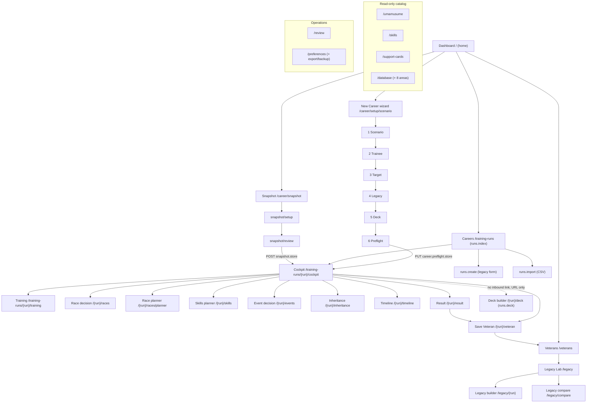

# UI/UX Application Context Brief — Trainer Desk (`umamusume-laravel13`)

| Field | Value |
| --- | --- |
| Purpose | Give an external reviewer (ChatGPT) a repository-grounded mental model of the application's UI/UX, IA, navigation, user flows, domain concepts, screen responsibilities, interaction patterns, and known usability issues. |
| Method | Static repository inspection (routes, controllers, models, Vue pages/components/layouts, config, migrations, tests) plus the repository's own UX audits. No application code was modified. |
| Date of writing | 2026-10-17 |
| HEAD at writing | `dfef6c7` (`fix(wizard): wrap the facts grid's dt/dd pair in a dl`) |
| Branch | `master` |
| Working tree at writing | Clean except uncommitted changes to 12 files (Dashboard and Veterans identity surfaces: `DashboardController.php`, `VeteranController.php`, `VeteranRow.php`, `VeteranRow.vue`, `Dashboard.vue`, `Legacy/Index.vue`, `Veterans/Compare.vue`, `Veterans/Index.vue`, error blade views, `ErrorPageViewsTest.php`) plus one untracked proposal (`docs/proposals/implementation-backlog-2026-10-17.md`). See §9 and §12. |
| Reading conventions | Every claim is labelled **CONFIRMED** (read from code/routes/persistence/tests), **DOCUMENTED** (authoritative doc), **HISTORICAL** (audit/older claim), **INFERRED** (reasoned, not directly proven), or **PROPOSED** (design/plan, not built). Line numbers are accurate only at the time of writing. |

---

## 1. Executive overview

**CONFIRMED.** Trainer Desk is a local-only, single-Trainer Laravel 13 application for the Global English release of *Umamusume Pretty Derby*. It runs on loopback, has no auth surface and no deploy path, and stores everything in one SQLite file (`database/database.sqlite`). The web surface is Inertia + Vue 3 (TypeScript, Tailwind v4, Vite); Blade survives only as the `resources/views/app.blade.php` shell and error pages. There is a read-only JSON surface under `/api/v1`. (`AGENTS.md` §1; `routes/web.php`.)

**CONFIRMED.** The application is organized around **career runs** (`training_runs`). A run is one Trainer's playthrough of one trainee in one scenario. The user's core loop is:

1. Start a career (six-step setup wizard, or snapshot an in-progress career, or import a CSV).
2. Enter the career workspace: a **Cockpit** hub plus run-scoped decision screens (training, races, skills, events, inheritance).
3. Record turns, make planning decisions, plan races, plan skills.
4. Finish the career: read the **Result** screen, save a **Veteran** (a permanent record of the finished career).
5. Reuse Veterans in the **Legacy Lab** (record the ancestry/parents used at the start of a new career) and compare them.

**CONFIRMED.** Beside the career loop sit four read-only catalog surfaces — trainees, support cards, skills, and a Database hub of eight reference areas — plus a Review queue for the fetch pipeline's ambiguous matches and a Preferences/Settings screen with export and backup.

**CONFIRMED.** There are effectively **two "homes"**:
- the **Dashboard** (`/`, `home`), the Trainer Desk 2.0 front door (`ADR-0020` §1), which shows the newest active career, recent Veterans, quick actions and data status; and
- the **Cockpit** (`/training-runs/{run}/cockpit`, `runs.cockpit`), the run's own workspace.

**CONFIRMED.** The single most important navigation fact for a newcomer: the old run-record screen is retired. `GET /training-runs/{run}` (`runs.show`) is a **redirect to the Cockpit** (`routes/web.php:132`; `TrainingRunController::redirect()`), not a screen. Everything the old record screen owned now lives in the Cockpit or a run-scoped decision screen.

---

## 2. Repository and evidence guide

### 2.1 Stack (CONFIRMED)

| Concern | Value | Evidence |
| --- | --- | --- |
| Framework | Laravel 13 | `composer.json`; `AGENTS.md` §1 |
| Language | PHP 8.5 | `AGENTS.md` §1; audit headers |
| Database | SQLite (WAL, `busy_timeout`), file `database/database.sqlite` | `AGENTS.md` §1 |
| Frontend | Inertia.js + Vue 3 + TypeScript, Tailwind v4, Vite | `resources/js/`; `AGENTS.md` §1 |
| Tests | Pest 4 (feature-first), Playwright (browser) | `tests/`; `AGENTS.md` §9 |
| Static analysis | PHPStan level 6, Pint (`laravel` preset) | `AGENTS.md` §7, §9 |
| Scale at writing | 59 Vue pages, 78 Vue components, 3 layouts; 196 Feature tests, 8 Unit tests, 65 browser specs | measured on this tree |

### 2.2 Evidence hierarchy used in this brief

Per the task's own ordering, strongest first:

1. **Requirements / designated authoritative docs** — `PRD.md`, `SCREEN_SPEC.md`, `ARCHITECTURE.md`, accepted ADRs.
2. **Actual routes, backend logic, persistence, and current frontend implementation** — `routes/web.php`, `app/Http/Controllers/**`, `app/Models/**`, `database/migrations/**`, `resources/js/**`.
3. **Automated tests and verified browser behavior** — `tests/Feature/**`, `tests/browser/**`.
4. **UX audits, reconciliation, screenshot research** — `docs/audits/**`, `docs/research-scratch/**`.
5. **Proposals, design concepts, historical notes, assumptions** — `docs/proposals/**`, `docs/research-scratch/**`.

Where (2) and (1) disagree, this brief reports the disagreement rather than silently choosing one (see §9, R2-01).

### 2.3 Authoritative document map (CONFIRMED existence)

| Document | Owns | Authority |
| --- | --- | --- |
| `PRD.md` | users, stories, FR-A..FR-E, NFRs, §6 non-goals | Product truth |
| `ARCHITECTURE.md` | schema, pipeline, API contract, security, testing strategy | System design |
| `SCREEN_SPEC.md` | screen inventory, per-screen states, §8 authority table | Screen behavior |
| `DESIGN.md` | tokens, components, surfaces, motion | Visual system |
| `KNOWN-ISSUES.md` | live defect register `KI-nn` (KI-57 through KI-106) | Defect register |
| `config/scenarios.php` | the **only** place scenario names enter the layout path | Scenario composition |
| `docs/audits/rice-shower-unity-cup-ux-walk.md` | first browser walk (Round 1) | HISTORICAL evidence |
| `docs/audits/rice-shower-unity-cup-ux-walk-2.md` | second browser walk (Round 2) | HISTORICAL evidence |
| `docs/audits/rice-shower-unity-cup-ux-walk-3.md` | third browser walk (Round 3) | HISTORICAL evidence |
| `docs/audits/rice-shower-unity-cup-round2-reconciliation.md` | R2-01..R2-21 classification vs code | HISTORICAL evidence |
| `docs/audits/rice-shower-unity-cup-round3-reconciliation.md` | R3-01..R3-29 classification vs code | HISTORICAL evidence |
| `docs/audits/rice-shower-unity-cup-ux-walk-resolutions.md` | remediation record | HISTORICAL evidence |
| `docs/UMAMUSUME_REFERENCE.md` | source-cited mechanics corpus | Reference (not a spec) |

**Not authoritative / do not cite as a spec:** `docs/deprecated/**` (retired legacy PDFs; display text must never be copied), `PRODUCT.md` and `SKILL.md` (generator-owned), the `docs/design-research/` prototypes, and the folded root stubs `CONSTRAINTS.md` and `PLAN.md` (their content moved into `docs/research-scratch/GOVERNANCE.md` and `docs/research-scratch/PROCESS-PLANS.md`; `AGENTS.md` §3 still names them and is itself stale on those two rows).

### 2.4 Code map (CONFIRMED)

| Layer | Location | Note |
| --- | --- | --- |
| Routes | `routes/web.php` (browser), `routes/api.php` (JSON, read-only) | all browser routes named |
| Controllers | `app/Http/Controllers/` + `app/Http/Controllers/Career/` + `Api/V1/` | thin; logic in Actions/Services |
| Models | `app/Models/` (catalog + trainer-data + support-card) | incl. `TraineeGoal`, `TurnEntry` (energy band), `DeckSlot` |
| Domain | `app/Domain/Career/CareerPosition.php`, `app/Domain/Training/StatCeilings.php` | position + ceilings arithmetic |
| Enums | `app/Enums/` (TitleCase cases; DB stores the backed value) | incl. `TraineeGoalType`, `TurnChoice` |
| Services | `app/Services/` (`ScenarioCaps`, `SkillSpendCoverage`, `Career/SetupDraft`, `Advisor/TrainerAdvisor`, `Advisor/NextDecision`, `Career/{RaceStrip,ScenarioSection,TeamPanel,TrackblazerPanel}Builder`, ...) | shared arithmetic/ownership |
| Layouts | `resources/js/layouts/AppLayout.vue`, `CareerLayout.vue`, `SetupLayout.vue` | three navigation shells |
| Pages | `resources/js/pages/` (59 Vue files) | grouped by area, incl. `Career/Cockpit/Panels/` |
| Components | `resources/js/components/` (78 Vue files) | incl. `career/`, `scenario/`, `support/`, `Form/` |

---

## 3. Information architecture and navigation map

### 3.1 Primary navigation — `AppLayout.vue`

**CONFIRMED.** The sidebar is a single flat list of **ten live destinations** (`AppLayout.vue:105-121`). There are zero "not built" (named-absence) items now. The list:

| # | Label | Route target | Mobile slot | `spa` |
| --- | --- | --- | --- | --- |
| 1 | Dashboard | `/` (`home`) | Home | yes |
| 2 | New Career | `/career/setup/scenario` (`career.scenario`) | (More) | yes |
| 3 | Careers | `/training-runs` (`runs.index`) | Career | yes |
| 4 | Legacy Lab | `/legacy` (`legacy.index`) | Legacy | yes |
| 5 | Veterans | `/veterans` (`veterans.index`) | (More) | yes |
| 6 | Support Cards | `/support-cards` (`support-cards.index`) | Deck | yes |
| 7 | Skills | `/skills` (`skills.index`) | (More) | yes |
| 8 | Review | `/review` (`review.index`) | (More) | yes |
| 9 | Database | `/database` (`database.index`) | (More) | yes |
| 10 | Settings | `/preferences` (`preferences.edit`) | (More) | yes |

**CONFIRMED.** Mobile uses a bottom bar of four slots + a native `
` "More" disclosure (`AppLayout.vue:303-364`). The desktop rail collapses to icons only; the choice is stored in `localStorage` key `trainer-desk.nav-rail` (`AppLayout.vue:146-167`) — a **browser** preference, not a stored `Preference` row. Active state uses prefix matching and strips the query string (`isCurrent()`, `AppLayout.vue:47-51`), so `/legacy/12` still highlights Legacy Lab.

**DOCUMENTED / minor breach.** The ten-item count exceeds the frontend plan's "at or under eight" guideline; the code comment (`AppLayout.vue:116-118`) states the breach predates the Database slice and its repair is the owner's ruling, not a quiet merge.

### 3.2 Career shell — `CareerLayout.vue`

**CONFIRMED.** Run-scoped screens render inside a career bar showing the trainee, scenario and status, with doors to the Cockpit and the Dashboard. The run's URL is provided by the server as `run_url`, which lands on the Cockpit through the `runs.show` redirect; no browser file addresses `runs.show` literally (enforced by `tests/Feature/NoStaleRunRecordLinksTest.php`).

### 3.3 Setup shell — `SetupLayout.vue`

**CONFIRMED.** The six-step wizard renders a step rail: **Scenario → Trainee → Target → Legacy → Support deck → Preflight** (`SetupLayout.vue:33`). Every step writes to a **session draft** (`app/Services/Career/SetupDraft.php`), not to a run; the run is created once, at Preflight.

### 3.4 Route / navigation map (CONFIRMED)

### 3.5 Global vs run-scoped

**CONFIRMED.** Global (not tied to a run): Dashboard, Careers list, catalog (trainees/skills/support cards), Database hub, Review, Preferences, Veterans, Legacy Lab index/compare, and the setup wizard (draft state). **Run-scoped** (require `{run}`): Cockpit, Training, Race decision, Race planner, Skills planner, Event decision, Inheritance, Timeline, Result, Save Veteran, and the run-scoped Deck builder. **Legacy Lab builder** is run-scoped (`/legacy/{run}`) but reads a run only as the anchor for recording ancestry.

### 3.6 Navigation dead ends and cross-screen links (CONFIRMED)

- **The run-scoped Deck builder (`/training-runs/{run}/deck`, `runs.deck`) now has a Cockpit door** (`5d26b49`, R2-17): `Cockpit.vue` renders a link to `props.run.deck_url` in its export/deck section. `Support/Builder.vue` *is* that screen (rendered by `TrainingRunController::deck()`), and its only self-reference (`Support/Builder.vue:168-169`) is a same-page reload for filter/page/equip, not an inbound door. No **other** page links to it.
- **`TrainingDetail.vue` no longer links to `/career/setup/deck`** (`e2889ff`, fixed). The deck door at this run's scope now uses `props.run.deck_url` (`/training-runs/{run}/deck`), the run-scoped target. The cross-screen link is corrected.
- `runs.show` is a redirect, not a screen (`routes/web.php:132`). No browser file addresses it (`NoStaleRunRecordLinksTest`).

---

## 4. Complete screen inventory

The table below covers the significant user-facing surfaces. "States" is condensed; the authoritative per-screen state list is `SCREEN_SPEC.md`. Absent/unsupported features are marked.

### 4.1 Global screens

| Screen | Route (name) | Purpose | Entry points | Primary actions | Data owner | UX concerns / evidence |
| --- | --- | --- | --- | --- | --- | --- |
| Dashboard | `/` (`home`) | Front door: active career, recent Veterans, quick actions, data status | Sidebar; logo; any "Home" | Open active career; start new; browse | `DashboardController`; `TrainingRun` (newest `Active`), `Veteran` | Multiple runs supported; shows newest Active only (CONFIRMED, `DashboardController`). |
| Careers list | `/training-runs` (`runs.index`) | List/manage runs | Sidebar "Careers" | Open, delete, create, import | `TrainingRunController::index` | No clickable inbound link existed before 2.0; now the sidebar owns it (`AppLayout.vue:69-71`). |
| Create run (legacy form) | `/training-runs/create` (`runs.create`) | Pre-2.0 one-combobox create | Catalog page carrying a chosen trainee | Create run | `TrainingRunController::store`; `StoreTrainingRunRequest` | Transitional; not the primary path (the wizard is). |
| Import runs (CSV) | `/training-runs/import` (`runs.import`, `.store`, `.preview`) | Import historical runs from CSV | Careers list | Preview, confirm commit | `ImportHistoricalRun` action | Confirm step once always failed in-browser (KI-64, **CLOSED** `851ed51`). |
| Catalog index/detail (trainees) | `/umamusume`, `/umamusume/{slug}` (`catalog.index`, `.show`) | Browse trainee catalog | Sidebar/Database | View; start a career with a chosen trainee | `CatalogController`; `Umamusume`, `UmamusumeProfile`, `CharacterCard` | Artwork via `ArtworkSlot.vue` + loopback `artwork.show`. |
| Skills catalog | `/skills`, `/skills/{skill}` (`skills.index`, `.show`) | Browse skills | Sidebar/Database | View | `SkillController`; `Skill` | Read-only. |
| Support cards | `/support-cards`, `/support-cards/{card}` (`support-cards.index`, `.show`) | Browse support cards | Sidebar/Database | View | `SupportCardController`; `SupportCard`, `SupportEffect` | Read-only. |
| Review queue | `/review` (`review.index`, `review.resolve`) | Resolve ambiguous fetch matches | Sidebar | Resolve candidate | `ReviewController`; `MatchCandidate` | Pipeline-facing, not career-facing. |
| Preferences | `/preferences` (`preferences.edit`, `.update`, `.export`, `.backup`) | Two UI preferences; data export/backup | Sidebar "Settings" | Change theme/failure estimate; export JSON; back up | `PreferenceController`; `Preference` (`theme`, `failure_estimate` only) | Restore/Reset deliberately absent (destructive, owner-scoped). |
| Database hub | `/database` + 8 areas (`database.*`) | Read-only reference tables | Sidebar "Database" | Browse 8 areas | `DatabaseController`, plus `CatalogController`/`SupportCardController`/`SkillController` for 3 ported areas | Eight areas: trainees, supports, skills, races, scenarios, events, shop-items, sparks. |

### 4.2 Career setup screens

| Screen | Route (name) | Purpose | Inputs | Output | Evidence |
| --- | --- | --- | --- | --- | --- |
| Step 1 Scenario | `/career/setup/scenario` (`career.scenario`) | Choose scenario | scenario key | session draft | `ScenarioSelectController`; `ScenarioSelect.vue` |
| Step 2 Trainee | `/career/setup/trainee` (`career.trainee`), profile `career.trainee.profile` | Choose trainee | umamusume id | session draft | `TraineeSelectController`, `TraineeProfileController` |
| Step 3 Target | `/career/setup/target` (`career.target`) | Enter build target | target stats (clamped to ceilings) | draft `build_target` | `BuildTargetController`; `StoreBuildTargetRequest`/`StoreDraftBuildTargetRequest` |
| Step 4 Legacy | `/career/setup/legacy` (`career.legacy`) | Record ancestry/parents | legacy selection + parents | draft `legacy_selection`, `legacy_parents` | `LegacySelectController`; `StoreLegacySelectionRequest`/`StoreDraftLegacyRequest` |
| Step 5 Deck | `/career/setup/deck` (`career.deck`) | Configure six-slot support deck + owned/rented flag | 6 positions, card, ownership | draft `deck` | `DeckSelectController`; `StoreDeckRequest`/`StoreDraftDeckRequest` |
| Step 6 Preflight | `/career/setup/preflight` (`career.preflight`) | Review contract; **Start Career** (the wizard's one write) | — | creates the run | `PreflightController`; `StartCareerRequest` |
| Snapshot entry/setup/review | `/career/snapshot`, `/career/snapshot/setup`, `/career/snapshot/review`, `POST /career/snapshot` (`career.snapshot*`) | Record an in-progress career in one pass | position + current state | creates the run | `SnapshotController` |

### 4.3 Run-scoped screens (the career workspace)

| Screen | Route (name) | Purpose | Write | Evidence |
| --- | --- | --- | --- | --- |
| Cockpit | `/training-runs/{run}/cockpit` (`runs.cockpit`) | Run hub: header, identity, state, advisor, race strip, scenario panel, turn correction, next decision, deck door | Correction + header + identity forms post to `runs.turns.update` / `runs.update` | `CockpitController`; `Cockpit.vue`; panels under `Career/Cockpit/Panels/` |
| Training decision | `/training-runs/{run}/training` (`runs.training`) | Guided turn entry / detail; energy band now editable and prefillable on create (R2-16) | posts to `runs.turns.store` | `TrainingDecisionController` |
| Race decision | `/training-runs/{run}/races` (`runs.races.decision`) | Run's race calendar | posts to `runs.races.store` | `RaceDecisionController` |
| Race planner | `/training-runs/{run}/races/planner` (`runs.races.planner`) | Whole calendar grouped (obligations, ahead, reached-unrecorded, rivals) | `runs.races.store` | `RacePlannerController` |
| Skills planner | `/training-runs/{run}/skills` (`runs.skills.planner`) | Skill coverage vs build target; empty priority list refused (R2-10) | `runs.build-target.update` (priorities live there) | `SkillsPlannerController`; `SkillSpendCoverage` |
| Event decision | `/training-runs/{run}/events` (`runs.events.decision`, `.store`) | Record event choices | `runs.events.store` | `EventDecisionController` |
| Inheritance event | `/training-runs/{run}/inheritance` (`runs.inheritance`, `.store`) | Record-only inheritance event; grandparent Sparks counted, grandparent ranks added (R3-02, R3-09) | `runs.inheritance.store` | `InheritanceEventController` |
| Timeline | `/training-runs/{run}/timeline` (`runs.timeline`) | Flattened ordered rail of turns/races/events | none | `TimelineController` |
| Result | `/training-runs/{run}/result` (`runs.result`) | Finished-run summary | none | `ResultController` |
| Save Veteran | `/training-runs/{run}/veteran` (`runs.veteran`, `.store`) | File a finished career as a Veteran | `runs.veteran.store` | `SaveVeteranController`; `RecordVeteran` |
| Deck builder | `/training-runs/{run}/deck` (`runs.deck`) | Run-scoped support deck editor; now reachable via a Cockpit door (R2-17) | posts to `runs.deck.sync` | `TrainingRunController::deck`; `Support/Builder.vue` |
| Run record | `/training-runs/{run}` (`runs.show`) | **Retired** — redirects to Cockpit | — | `routes/web.php:132` |

### 4.4 Legacy Lab and Veterans

| Screen | Route (name) | Purpose | Evidence |
| --- | --- | --- | --- |
| Legacy Lab index | `/legacy` (`legacy.index`) | Browse recorded ancestries | `LegacyController` |
| Legacy builder | `/legacy/{run}` (`legacy.builder`, `legacy.update`) | Record ancestry for a run | `LegacyController`; `LegacySelectionPayload` |
| Legacy compare | `/legacy/compare` (`legacy.compare`) | Compare recorded ancestries | `LegacyController` |
| Veterans index | `/veterans` (`veterans.index`) | Library of finished careers | `VeteranController`; `ListVeterans` |
| Veteran detail | `/veterans/{veteran}` (`veterans.show`) | One Veteran | `ShowVeteran`; `VeteranRow` |
| Veterans compare | `/veterans/compare` (`veterans.compare`) | Compare Veterans | `VeteranController` |

**CONFIRMED (record-only boundary).** The Legacy Lab computes no inheritance, affinity payout, star-roll chance, or recommended combination; it records what the Trainer entered and aligns stored rows. Grandparent rank fields were added to the ancestor nodes (R3-09 fixed, `3e136a0`); grandparent Sparks are counted in the Predicted Sparks total (R3-02 closed, `2470a4c`). The boundary is stated in `routes/web.php:210-219` and the controller docblock.

**Not present / unsupported (CONFIRMED by absence):** no public deploy/hosting, no auth/login, no multi-user, no image uploads (only tool-fetched artwork, `ADR-0021`), no race-outcome prediction, no simulation, no dual storage (PRD §6).

---

## 5. End-to-end user journeys

Each journey gives: (1) observed UI behavior, (2) backend behavior, (3) persistence/ownership, (4) documented intent, (5) discrepancies.

### A. Start a new career (wizard)

1. **UI.** Sidebar "New Career" → `career.scenario`. Steps 1–5 write to the session draft; each step's PUT returns to its own screen with a flash. Step 6 Preflight composes the draft into one contract and offers **Start Career**.
2. **Backend.** `ScenarioSelectController`/`TraineeSelectController`/`BuildTargetController`/`LegacySelectController`/`DeckSelectController` each `PUT` into `SetupDraft` (session). `PreflightController::store()` re-runs each step's Form Request via `StartCareerRequest`, then creates the run in one write, including the six `deck_slots` rows with their `ownership` flag.
3. **Persistence.** Session draft until Preflight; then `training_runs` + `deck_slots` (+ ancestry, target) rows. `SetupDraft` is the only owner of pre-run state (`app/Services/Career/SetupDraft.php`).
4. **Documented.** `SCREEN_SPEC.md` SCR-CAR-002..009; `routes/web.php:40-93`; plan §8 D2–D7.
5. **Discrepancies.** R2-02 (legacy save appeared to vanish in the audit) is **not reproducible in code**; the persistence path is covered and passes (see §9). Cause of the browser observation is **unidentified** (HISTORICAL, preserved). R2-06 deck-ownership copy is now **committed** (see §9); the reconciliation slice log still lists it as next action at the older tree but the fix has landed (`dd179ba` and siblings).

### B. Continue an existing career

1. **UI.** Dashboard shows the newest `Active` run; Careers list shows all. Opening a run goes to the Cockpit.
2. **Backend.** `TrainingRunController::redirect()` sends `runs.show` → `runs.cockpit`. `CockpitController` composes header, identity, state, advisor, race strip, scenario panel, and the turn-correction block.
3. **Persistence.** Reads `training_runs`, `turn_entries`, `turn_events`, `deck_slots`, `race_entries`, `scenario_slots`, `trainee_goals`.
4. **Documented.** `SCREEN_SPEC.md` SCREEN-009 / SCR-CAR-011.
5. **Discrepancies.** R2-01/R2-04 (position display) in §9 are now resolved for snapshot mode and by design for wizard careers. The Cockpit identity form now writes rarity, potential, growth-rate, and entered caps through `runs.update` (R2-13); the Unity Cup editor writes team state through `runs.update` (R2-14). Both were display-only at the earlier tree. The energy band is now editable on the correction form (R2-16). The run-scoped deck builder now has a Cockpit door (R2-17).

### C. Record a training turn

1. **UI.** Guided entry on `/training-runs/{run}/training` (posts to `runs.turns.store`); the Cockpit's correction disclosure edits the latest (or a chosen) turn and posts to `runs.turns.update`.
2. **Backend.** `TrainingRunController::storeTurn()` / `updateTurn()`; validated by `StoreTurnEntryRequest` (five stats required; energy numeric; mood from the client set).
3. **Persistence.** `turn_entries` (+ related `turn_events`). **CONFIRMED:** the Cockpit correction form now posts `energy` (numeric), `energy_state`, and `energy_band`; `StoreTurnEntryRequest` accepts all three and `TurnEntry` casts them. The band can be displayed and edited from the form (R2-16 fixed). Absent keys are preserved by `validated()`.
4. **Documented.** plan §9.6 ruling 2 (arbitrary-turn correction).
5. **Discrepancies.** Overlapping write paths: the guided turn and the Cockpit correction both write the same `turn_entries`; they share the Form Request, which is the mitigation.

### D. Use a scenario planner or Cockpit

1. **UI.** The Cockpit renders scenario-specific widgets (config-driven) and a scenario panel; the advisor shows one recommendation with reasons, an alternative and a risk.
2. **Backend.** `CockpitController` reads the run's scenario key, resolves widgets/panels from `config/scenarios.php`, and composes the advisor (`app/Services/Advisor/TrainerAdvisor.php`).
3. **Persistence.** Stored scenario state (`scenario_slots`, scenario counters on `training_runs`); the panel renders stored values read-only where no input exists.
4. **Documented.** `SCREEN_SPEC.md` SCREEN-009; plan §8 D8.
5. **Discrepancies.** R2-09 (stat denominators) is **fixed**: each strip names its own denominator (`44a7b13`). Unity Cup team/counter state now has a UI write path via `UnityCupEditor.vue` rendered in the Cockpit (R2-14 fixed). The residual R2-13 reading (identity writes) is also addressed: rarity, potential, growth-rate, and entered caps now post through the identity form (R2-13 fixed).

### E. Plan and record races

1. **UI.** Race decision (`/races`) is the run's calendar; Race planner (`/races/planner`) groups the whole calendar into obligations, races ahead, reached-and-unrecorded, and the rival set.
2. **Backend.** Both read `race_entries`/`race_catalog_slots`/`scenario_races`; the one write is `runs.races.store` (no second race-write route).
3. **Persistence.** `race_entries`.
4. **Documented.** `SCREEN_SPEC.md` SCREEN-011/SCREEN-017.
5. **Discrepancies.** R2-12: the planner is dense with repeated `N/A` for placeholder races lacking catalog data (data-completeness, not a UI defect). **HISTORICAL / open as a known limitation.**

### F. Review, complete, abandon, or revisit a career

1. **UI.** Status is changed from the Cockpit header (`statusForm` → `runs.update`). Finished careers surface on `/result`; Save Veteran files them. Abandoned/finished runs remain in the Careers list and the Dashboard's recent Veterans.
2. **Backend.** `RunStatus` transitions; `ResultController`; `SaveVeteranController` → `RecordVeteran`.
3. **Persistence.** `training_runs.status`; `veterans`.
4. **Documented.** `SCREEN_SPEC.md` SCREEN-019/020/021.
5. **Discrepancies.** None confirmed at writing. The identity-form gap (§6.5) is closed — rarity, potential, growth-rate, and entered caps now post through `runs.update` (R2-13 fixed).

### G. Navigate between overlapping or legacy screens

1. **UI.** The retired run record redirects to the Cockpit. The pre-2.0 `runs.create` form still exists and is reached from a catalog page carrying a chosen trainee. The wizard's deck step (`/career/setup/deck`) and the run-scoped builder (`/training-runs/{run}/deck`) are two different deck surfaces.
2. **Backend.** Both deck surfaces share `StoreDeckRequest`/`StoreDraftDeckRequest`, so a draft value and a saved one obey the same dictionary (`routes/web.php:72-85`).
3. **Persistence.** Wizard deck → session draft until Preflight; run-scoped deck → `deck_slots` via `runs.deck.sync`.
4. **Documented.** `routes/web.php`; `SCREEN_SPEC.md` SCREEN-007 / SCR-CAR-009.
5. **Discrepancies.** The `TrainingDetail.vue` deck link is fixed (now uses `props.run.deck_url`, R2-17); the run-scoped builder has a Cockpit door but still has no inbound link from any page **other than the Cockpit** (§3.6). **CONFIRMED defect (limited).**

---

## 6. Core domain concepts and data ownership

### 6.1 Models (CONFIRMED)

| Concept | Model | Created/edited by | Read by |
| --- | --- | --- | --- |
| Career run | `TrainingRun` | Preflight, snapshot, import, `runs.create`, `runs.update` | Dashboard, Careers, Cockpit, all run-scoped screens, Legacy Lab |
| Trainee (catalog) | `Umamusume`, `UmamusumeProfile`, `CharacterCard`, `UmamusumeAlias` | fetch pipeline (engine-owned) | Catalog, wizard, Cockpit |
| Trainee career goal | `TraineeGoal` | sourced import | Cockpit career-goals panel |
| Support card | `SupportCard`, `SupportEffect` | fetch pipeline | Support Cards, deck surfaces |
| Deck slot | `DeckSlot` | Preflight (`store`), `runs.deck.sync` | Cockpit, deck builder, analysis |
| Turn record | `TurnEntry` | `runs.turns.store`/`update` | Cockpit, Timeline, Result |
| Turn event | `TurnEvent` (+ `TurnEvents/*` payloads) | `runs.events.store`, `runs.inheritance.store` | Cockpit, Event/Inheritance decision, Timeline |
| Skill acquisition | `RunSkill`, `Skill` | `runs.skills.sync`, build target | Skills planner, Result |
| Race entry | `RaceEntry`, `RaceCatalogSlot`, `ScenarioRace` | `runs.races.store` | Race decision/planner, Timeline, Result |
| Scenario slot | `ScenarioSlot`, `Scenario` | run lifecycle | Cockpit scenario panel |
| Veteran | `Veteran` | `runs.veteran.store` | Veterans library, Legacy Lab |
| Preferences | `Preference` | `preferences.update` | shell, planner |

### 6.2 Lifecycle and position

- **CONFIRMED.** `RunStatus` enum drives status; the Cockpit header form writes it via `runs.update`.
- **CONFIRMED.** `app/Domain/Career/CareerPosition.php` + `CareerPositionCast.php` model "where in the career" the run is (year/phase/turn). `TrainingRun::careerPosition()` and `hasImportedPosition()` distinguish a **snapshot/imported** position from a **new career** derived from turn count. The Cockpit reads `careerPosition` when `hasImportedPosition()` is true, else derives from turn count (`CockpitController` ~`:285`).
- **R2-01/R2-04 resolved** (per Round 3). An audit walked a *source* describing an existing career but created a *new* career through the wizard; the UI correctly showed Turn 1. The mismatch is a methodology/documentation issue, not a code defect. The snapshot path now carries and reads the imported position (verified by `SnapshotCockpitTest` and `dashboard.spec.ts`).

### 6.3 Stat denominators (CONFIRMED)

- **CONFIRMED.** `app/Domain/Training/StatCeilings.php` and `app/Services/ScenarioCaps.php` own per-stat ceiling arithmetic; `ADR-0015` makes `ScenarioCaps` the single owner.
- **CONFIRMED.** R2-09 is **fixed**: each screen names its own denominator — Cockpit `current / target`, Event decision `current / cap` — with a `denominatorLabel` distinguishing them (`44a7b13`). The same stat no longer shows different denominators without a distinguishing label.

### 6.4 Deck ownership semantics (CONFIRMED)

- `DeckSlot::POSITIONS` is the one owner of "what a deck is"; `DeckSlot::OWNERSHIP` bounds the two words (owned/rented).
- `deck_slots.ownership` is a nullable column (migration `2026_10_09_120000_add_ownership_to_deck_slots_table.php`; `ADR-0023` D3). Both writers record it: Preflight carries the draft flag onto the slot row; `runs.deck.sync` writes it per slot.
- A slot with no card carries no flag (renders `N/A`, never "Owned").
- **Domain distinction to preserve.** In the Rice Shower Unity Cup source material, Super Creek occupies the **Friends (rented) slot** (Slot 6), while **Haru Urara** is the Unity Cup scenario-linked support card (Slot 5). They are not interchangeable.
- **R2-06 deck-ownership copy is now committed.** Copy corrected on all surfaces (wizard step 5, Preflight, run-scoped builder, slot component); cites `ADR-0023` D3.

### 6.5 Identity, team, and Unity Cup state — UI write paths now exist (CONFIRMED)

`StoreTrainingRunRequest` validates `trainee_rarity`, `potential_level`, `growth_rate`, `team_name`, `team_motto`, `team_league_placement`, `team_presason_wins`, `unity_trainings_count`, `spirit_bursts_count`, `extreme_bursts_count`, `facility_level`, `spirit_gauge_state`, and more. `TrainingRunController::update()` persists `$request->validated()` through `runs.update`.

**R2-13 and R2-14 are fixed.** The Cockpit's identity edit section (`Cockpit.vue:662-747`) now posts rarity, potential level, growth rate, and entered stat caps through `runs.update` via `identityForm` (R2-13). The Unity Cup team state writes through `UnityCupEditor.vue` rendered in the Cockpit (R2-14). These columns were writable only by non-UI paths at the earlier tree; they now have UI input.

---

## 7. Scenario-specific UI/UX comparison

**CONFIRMED** from `config/scenarios.php` (baseline `ura_finale`; `verified_at` `2026-09-27`; source `GameTora scenarios.json`; `stale => false`). Four `[Global]` scenarios are modelled; a fifth guide (`docs/scenarios/08`) is `[JP-Only]` and must not be imported. The config is now 1145 lines and carries per-scenario `cap_bonus`, `widgets`, `steps`, `panels`, `scenario_links`, `fan_gates`, `ruleset_version`, `training_tables`, `shop` (Trackblazer), `risk_absence`, and `grade_objectives`/`grade_objective_labels` (Trackblazer).

| Scenario key | Label | Widgets | `metadata.ruleset` | Panels | Notes |
| --- | --- | --- | --- | --- | --- |
| `ura_finale` | URA Finale | turn, energy, fans | `null` | race_calendar, team_race, grade_objectives, shop, epithet_routes, team_rank_ladder | **Baseline** composition. |
| `unity_cup` | Unity Cup | turn, energy, fans, **team_rank**, **spirit_bursts** | `'Team'` | team_rank_ladder | Only scenario with a rule **family**; team/counter state now has a UI write path via `UnityCupEditor.vue` (R2-14 fixed; §6.5). |
| `trackblazer` | Trackblazer | turn, energy, fans, **grade_points**, **shop_coins** | `null` | grade_objectives, shop, epithet_routes | Grade-point objectives + Pro Shop + epithet routes; shop items and worth ratings sourced from Game8 (D-240/D-241). |
| `our_grand_concert` | Our Grand Concert | turn, energy, fans | `null` | career_goals | `panel_absence` renders a single absence line on the strip; `performance_input` flag enables the resource on the turn rail. Finale-title nuance tracked as KI-82. |

**CONFIRMED.** Widget and panel labels are config-driven (`widget_labels`, `panel_labels`): Turn, Energy, Fans, Team Rank, Spirit Bursts, Grade Points, Shop Coins; Race calendar, Team races, Grade Point objectives, Pro Shop, Epithet routes, Team Rank ladder, Career goals. A scenario panel is registered per scenario (`components/scenario/ScenarioPanel.vue` + Ura/UnityCup/Trackblazer/Our Grand Concert renderers, plus dedicated components under `components/scenario/` and `pages/Career/Cockpit/Panels/`); the Cockpit forwards the panel bundle untouched. The scenario section is built by `ScenarioSectionBuilder` (`app/Services/Career/ScenarioSectionBuilder.php`), injected by `CockpitController`.

**CONFIRMED.** `config/scenarios.php` is the **only** place scenario names enter the layout path. Scenario-driven components take the resolved label from the server as a required prop with no default; a scenario name hardcoded in a page is a defect (`AGENTS.md` §7).

**R2-05 (fixed).** The Unity Cup card once printed two different facts under one heading `Ruleset`. Fixed at `9777531`: grid heading `Ruleset version` (tool-wide, null by ruling) vs block heading `Rule family` (the scenario's `'Team'`). Pinned by `ScenarioMetadataTest` and `tests/browser/career-scenario-select.spec.ts`.

**Residual (CONFIRMED, not covered by R2-05).** `components/scenario/ScenarioPanel.vue:160` still heads the tool-wide version row plain `Ruleset` on the Cockpit's scenario strip. There it is the only ruleset fact, so nothing contradicts it; recorded as "not covered" in the reconciliation slice log. R3-13 classifies this as **Known limitation** — the two headings are two different facts, both correct.

---

## 8. Cross-screen consistency and UX findings

**Confirmed current behavior / defects at HEAD `dfef6c7` (CONFIRMED unless marked):**

1. **R3-31 — trainee-step keyboard flash.** `career-trainee-select.spec.ts` keyboard case may fail to find the one-shot flash line even though the visit completes. **Confirmed, open.**
2. **R3-17 — window title fallback.** The title settles only after first re-render on some arrivals. **Cosmetic, unverified.**
3. **R2-12 — race planner dense with empty details.** Repeats `N/A` for placeholder races lacking catalog data. **Known limitation (data gap).**

**Fixed at this tree (CONFIRMED):**

- **R2-09 — stat denominators.** Fixed (`44a7b13`): each strip names its own denominator via `denominatorLabel`.
- **R2-10 — skills planner empty priority set.** Fixed (`d95da07`): refuses to price a priority list that does not exist.
- **R2-13 — rarity/potential/growth/cap inputs.** Fixed (`8e51b9f`): Cockpit identity form writes all through `runs.update`.
- **R2-14 — Unity Cup team state.** Fixed (`d8fb234`): `UnityCupEditor.vue` writes team state through `runs.update`.
- **R2-16 — energy band editable.** Fixed (`c3583f0`, `d21fcc1`): both guided create and Cockpit correction post `energy_state`/`energy_band`; strip reads the band (`3a1ba9b`).
- **R2-17 — deck builder door.** Fixed (`5d26b49`): Cockpit links to the run-scoped deck builder.
- **R3-01 — Energy band strip read.** Fixed (`3a1ba9b`): strip reads `energy_band` alongside `energy`; `CockpitEnergyBandDisplayTest` pins it.
- **R3-02 — Grandparent Spark count.** Fixed (`2470a4c`): `predictedSection()` now includes `ancestors_sparks`.
- **R3-03 — Deck-slot query lag.** Fixed (`d7f41dc`): query tracks retarget in the same render.
- **R3-04 — Correction save feedback.** Fixed (`3a1ba9b`): correction form carries `recentlySuccessful` line.
- **R3-06 — Costume picker.** Fixed (`f08ac63`): costume form selector added.
- **R3-09 — Grandparent rank fields.** Fixed (`3e136a0`): rank inputs on ancestor nodes.
- **R3-16 — Accessible names.** Fixed (`e02537e`): band select named; Legacy `Target` selects already named.
- **R3-30 — Definition-list provenance fix.** Fixed (`f6f393f`): read date inside its `dd`.
- **R3-32 — Inertia DevTools fatal.** Mitigated (`696f444`): DevTools disabled in browser role.
- **R3-08 / R3-12 / R3-26.** Re-verified on current build as **does not reproduce**.

**Consistency that holds (CONFIRMED):**

- Deck ownership copy matches persistence on every surface — R2-06 fix is now **committed** (see §9).
- Scenario labels are server-resolved and never hardcoded in pages (`config/scenarios.php`).
- No browser file addresses the retired `runs.show` route or renders a `Run record` label (`NoStaleRunRecordLinksTest`).

**Interaction conventions (CONFIRMED):** design tokens only (no `dark:` utilities); every data view renders empty/loading/error states (`ADR-0007`); unrecorded values render `N/A` with a `title`, never a default or a dash; advisory recommendations are separate from enforced constraints; minimum 44px (11 Tailwind units) target sizes on interactive controls; flash `role="status"` for success; a refused write focuses an alert (WCAG 2.2 SC 3.3.1).

---

## 9. Known defects, resolved findings, and open questions

### 9.1 Round-2 reconciliation status at this tree (`dfef6c7`)

Source: `docs/audits/rice-shower-unity-cup-round2-reconciliation.md`, with Round 3 findings classified in `docs/audits/rice-shower-unity-cup-round3-reconciliation.md`. Status below reflects the **code at writing**.

| ID | Finding | Status at this tree | Evidence |
| --- | --- | --- | --- |
| R2-01 | Existing-career position rendered as Turn 1 | **Resolved.** Doc-vs-UI mismatch, not a code defect. R3-11. | `CockpitController` reads `careerPosition` when `hasImportedPosition()`. |
| R2-02 | Legacy selections appeared to vanish in the wizard | **Not a code defect.** Persistence path read end-to-end and passes; browser cause **unidentified** (preserved). | `CareerLegacyDeckStepsTest` R2-02 case. |
| R2-03 | Preflight permits a contract with unresolved warnings | **Confirmed known limitation.** Warnings inform; they do not block. | `CareerPreflightTest`. |
| R2-04 | Snapshot state conflated with subsequent turn state | **Same as R2-01** (wizard creates a new career). R3-11/R3-19. | `SnapshotTrainingDecisionTest`. |
| R2-05 | Scenario card printed duplicate `Ruleset` rows | **FIXED** at `9777531`. R3-13 classifies the residual asymmetry as known limitation. | `ScenarioMetadataTest`; browser spec. |
| R2-06 | Deck-ownership copy contradicted persisted behavior | **FIXED and committed** (`dd179ba` and siblings). Copy corrected on all surfaces; cites `ADR-0023` D3. | `DeckSelect.vue`, `Preflight.vue`, `SupportSlot.vue`; `SupportDeckBuilderTest`. |
| R2-07 | Retired run-record references remained visible | **Addressed.** No `run record` labels or `runs.show` in the browser surface. | `NoStaleRunRecordLinksTest`. |
| R2-08 | Target save confirmation is misleading | **Fixed, residual UX ambiguity** ("saved" vs "configured"). | `CareerBuildTargetTest`. |
| R2-09 | Stat denominators disagree across screens | **FIXED** (`44a7b13`): each strip names its own denominator via `denominatorLabel`. | `StatDenominatorConsistencyTest`. |
| R2-10 | Skills planner over empty set | **FIXED** (`d95da07`): refuses to price a priority list that does not exist. | `CareerSkillsPlannerTest`. |
| R2-11 | Hint discounts discrepancy | **Known limitation (intentional).** `ADR-0011` and `ADR-0014` withdrew the ladder; corrected citation from R3. | resolution record; R3-15. |
| R2-12 | Race planner dense with empty details | **Known limitation (catalog data gap).** R3-27 partially represented. | `RacePlannerTest`. |
| R2-13 | Run identity incomplete (rarity/potential/growth/caps) | **FIXED** (`8e51b9f`): Cockpit identity form writes all through `runs.update`. | `TraineeRarityPotentialTest`; `career-cockpit-forms` spec. |
| R2-14 | Unity Cup scenario state incomplete | **FIXED** (`d8fb234`): `UnityCupEditor.vue` writes team state through `runs.update`. | `CockpitTeamPanelTest`, `CockpitUnityCupCountersTest`, `UnityCupSurfacesTest`. |
| R2-15 | Dashboard + active career context | **Known limitation (multi-run by design).** Dashboard now surfaces a multi-active-career count. | `DashboardController`; `b0c536f`. |
| R2-16 | Energy band not editable/displayed | **FIXED** (`c3583f0`, `d21fcc1`, `3a1ba9b`): both guided create and Cockpit correction post and read `energy_state`/`energy_band`. | `CockpitEnergyBandDisplayTest`, `EnergyReadingConsistencyTest`. |
| R2-17 | Deck builder undiscoverable from Cockpit | **FIXED** (`5d26b49`): the Cockpit now links to the run-scoped deck builder. | `SupportDeckBuilderTest`. |
| R2-18-R2-21 | (as in round-2 register) | See round-3 reconciliation for current status; several closed as does-not-reproduce or known limitation. | R3 register. |

### 9.2 Round-3 reconciliation findings at this tree

Source: `docs/audits/rice-shower-unity-cup-round3-reconciliation.md`. The register classifies 29 walk-3 observations (R3-01..R3-29) plus three pass findings (R3-30..R3-32).

| ID | Finding | Status | Evidence |
| --- | --- | --- | --- |
| R3-01 | Recorded Energy band has no read display on strip/event screen | **FIXED** (`3a1ba9b`): the strip now reads the band alongside the numeric energy; `CockpitEnergyBandDisplayTest` pins it. The advisor already read the band. | `CockpitController.php:301,385`; `EventDecisionController.php:125`; `CockpitEnergyBandDisplayTest`. |
| R3-02 | Predicted Sparks excludes grandparent Sparks | **FIXED** (`2470a4c`): `InheritanceEventController::predictedSection()` now includes `ancestors_sparks`. | `InheritanceEventController.php:182-205`; `GrandparentRanksTest` (15 passed). |
| R3-03 | `?deck_slot=N` lags the picker by one click | **FIXED** (`d7f41dc`): the query now tracks the retarget in the same render. | `DeckSelect.vue:199-203`; `DeckSelectController.php:114-117`. |
| R3-04 | Correction save gives no success feedback | **FIXED** (`3a1ba9b`): correction form now carries a `recentlySuccessful` line. | `Cockpit.vue:676-686`. |
| R3-05 | Catalogue aptitudes disagree with source document | **Known limitation** — GameTora export is authoritative. | `ADR-0004`. |
| R3-06 | Run's own costume form is unnamed | **FIXED** (`f08ac63`): costume picker added. | `TraineeCardFormTest` (4 passed). |
| R3-07 | No-target state stated several ways | **Partially fixed** (`44a7b13`); residual wording. | `CareerStatePanel.vue:82-110`; `StatDenominatorConsistencyTest`. |
| R3-08 | `UG` off the rank suggestion set | **Does not reproduce** (re-verified on current build). `UG` is in `RANK_LETTERS`. | `LegacySelectionPayload.php`. |
| R3-09 | Grandparents take Sparks but no rank field | **FIXED** (`3e136a0`): rank fields added to ancestor nodes. | `LegacySelect.vue`; `GrandparentRanksTest` (4 passed). |
| R3-10 | Spark table is ~35 one-row editors | **Unrepresented workflow.** | `LegacySelect.vue:368-372`. |
| R3-11 | Run position inexpressible from wizard | **Known limitation, by design** — wizard creates new career; snapshot carries position. | `TrainingRun::hasImportedPosition()`. |
| R3-12 | Rarity/Potential Level not editable | **Does not reproduce** (re-verified on current build). Fixed at `8e51b9f`. | R2-13. |
| R3-13 | Scenario cards asymmetric | **Known limitation** — two headings are two facts. | `ScenarioSelect.vue:193,225`. |
| R3-14 | New Career starts beside Active career | **Known limitation** — multi-run support intended. | `DashboardController`. |
| R3-15 | Hint-discount ladder disclaimed | **Known limitation** — `ADR-0011`/`ADR-0014`. | `SkillsPlanner.vue:227-232`; corrected from `ADR-0001`. |
| R3-16 | Controls render without accessible names | **FIXED** (`e02537e`): band select named and asserted. Legacy `Target` selects already named. | `TrainingDetail.vue`; `career-cockpit-forms.spec.ts`. |
| R3-17 | Window title falls back to `Trainer Desk` | **Cosmetic, unverified.** | Inertia title race. |
| R3-18 | Run's own caps have no home | **Unrepresented source data.** | `ScenarioCaps::forRun()`; `CockpitController.php:369`. |
| R3-19 | Run's position year/month unexpressed from wizard | **Known limitation** — see R3-11. | As R3-11. |
| R3-20 | Rarity ★3 / Potential Level 2 | **Does not reproduce** — see R3-12. | R2-13. |
| R3-21 | Costume identity | **Unrepresented** — see R3-06 (fixed). | As R3-06. |
| R3-22 | Four grandparents' ranks | **FIXED** — see R3-09. | `3e136a0`. |
| R3-23 | Spark table volume not entered | **Not a gap** — fields accept the full table. | `ancestors_sparks`/`sparks`. |
| R3-24 | Owned-skill list absent | **Unrepresented source data.** | Skills planner reads build target priorities only. |
| R3-25 | Card client levels / limit breaks | **Deferred, owner-gated.** | `ADR-0014`; `PRD` §6.9. |
| R3-26 | Scenario §1.8 team identity has no input | **Does not reproduce** (re-verified). `UnityCupEditor.vue` is rendered. R2-14. | `Cockpit.vue:626`. |
| R3-27 | Race-day card going/cadence | **Partially represented** — fan gate and payout exist; going does not. | `RaceFacts`/`RaceCard`. |
| R3-28 | Cleared goals / active Arima Kinen goal | **Known limitation** — `KI-34` (goal races unrecorded). | KI-34. |
| R3-29 | Hint-discount ladder as figure | **Known limitation** — see R3-15. | As R3-15. |
| R3-30 | Provenance line breaks training card `<dl>` | **FIXED** (`f6f393f`). | `TrainingCard.vue:242-253`. |
| R3-31 | Trainee-step keyboard flash absent | **Confirmed, open, browser-only.** | `career-trainee-select.spec.ts`. |
| R3-32 | Inertia DevTools cache makes first request fatal | **Confirmed, environmental, mitigated.** DevTools disabled in browser role (`696f444`). | `storage/inertia-devtools`.

### 9.3 Relevant open `KI-nn` entries (from `KNOWN-ISSUES.md`)

- **KI-60** — dev DB migrations vs the `:memory:` test DB (partially remediated; prevention half open).
- **KI-61** — D7 wizard halves landed red (browser-spec gate missing at commit time).
- **KI-63** — Inertia's NProgress `role="bar"` invalid ARIA (axe WCAG 2.2 A 4.1.2).
- **KI-69** — browser suite has no fixture-data contract (classes 1, 3, 4 remain).
- **KI-70** — four shared files edited by concurrent sessions in one worktree (process hazard).
- **KI-82** — Our Grand Concert finale title unchanged (owner decision owed).
- **KI-84** — owner ruling on deletions owed.
- **KI-87** — Cockpit finale read via two queries not reconciled; label partially fixed.
- **KI-91** — orphaned skills planner route (filed).
- **KI-92** — cockpit 44px sweep collapsed-disclosure failure (filed).
- **KI-93** — widened typecheck (closed).
- **KI-97** — Spirit Bursts rail cannot print its own value (closed).
- **KI-98** — doc-census resolver false positives (closed; corrected to 484 dead citations).
- **KI-99** — Legacy builder rank loss (filed).
- **KI-100** — objectives the tool cannot read (filed).
- **KI-101–KI-105** — workflow guardrails: session-private artifacts, DB readiness, safe staging, failure classification, pre-flight probe (filed).
- **KI-106** — citation ratchet left red by the stub fold (`CONSTRAINTS.md`/`PLAN.md` deleted; 270 citations now dead; `AGENTS.md` §3 stale).

### 9.4 Disagreements preserved

- **R2-13/R2-14** — the round-2 register stated the UI write path was missing for identity/team/Unity-Cup fields. The code now has the write paths (`8e51b9f`, `d8fb234`); the reconciliation's "previously fixed" referred to columns and rendering only. Both readings were true of different halves; both are now resolved.
- **R3-01** — the audit's full claim ("Advisor says there is no band to read") does not reproduce; the advisor already reads the band. Only the strip and event-screen display half is a confirmed defect.
- **R2-11 citation** — the round-2 register attributed the hint-ladder withdrawal to `ADR-0001`. R3-15 corrects this: `ADR-0011` and `ADR-0014` own it. `ADR-0001` lifts the Energy guidance non-goal only.
- **R2-02** — the audit observed data loss; the code path is correct and passes. The cause is unidentified and no reproduction was demonstrated.

---

## 10. Screenshot corpus and research references

**CONFIRMED.** The repository carries a large screenshot corpus and a structured screenshot registry:

| Artifact | Count / location | What it establishes | What it does NOT establish |
| --- | --- | --- | --- |
| Game screenshots | `docs/game-screenshots/` (1159 files) | In-game client frames the tool mirrors | Application behavior, persistence, routing |
| Screenshot registry | `docs/research-scratch/screenshot-registry/` (batched evidence, `inventory.jsonl`, `refs-index.jsonl`, `dispositions.jsonl`, `notes-index.jsonl`) | 1,159-frame corpus with 10 batches, disposition tracking, and a 296-line findings index | Current implementation status |
| Research notes | `docs/research-scratch/screenshot-notes/` (11 files incl. `PHASE-B-REPORT.md`, CSVs) | Grouped analysis of the corpus | Current implementation status |
| Design research images | `docs/vibe_images/` (9) | Visual references | Shipped UI |
| Source walk doc | `docs/[Rosy_Dreams]Rice_Shower_Unity-Cup.md` | 67 `[Global]` client frames (2026-10-03) | Tool behavior |

**Method used here:** the reduced notes/index were used rather than manually processing >1000 images, per the task's efficiency rule. The screenshot registry (`tools/screenshots.py`) is serialized per KI-77; `inventory.jsonl` is not parallelized. Screenshots supplement, never replace, code inspection. A screenshot alone cannot prove persistence, validation, routing, or current implementation status.

---

## 11. Testing and verification map

**CONFIRMED counts at HEAD `dfef6c7`:** 196 Feature tests, 8 Unit tests, 65 browser specs.

| Journey | Primary coverage | Notes |
| --- | --- | --- |
| A. New career (wizard) | `CareerScenarioSelectTest`, `CareerLegacyDeckStepsTest`, `CareerPreflightTest`, `TraineeCardFormTest`, `TraineeGoalTest`/`TraineeGoalReaderTest`/`TraineeGoalLadderStateTest`/`TraineeGoalGrainTest`/`TraineeGoalLadderStateTest`/`TraineeGoalsPanelTest`/`TraineeGoalsFetchTest` | Backend-heavy; browser specs exist per step. |
| B. Continue career | `CockpitRunIdentityTest`, `CockpitTeamPanelTest`, `CockpitUnityCupCountersTest`, `SnapshotCockpitTest`, `CockpitEnergyBandDisplayTest`, `CockpitObjectivesTest`, `UnityCupSurfacesTest`, `UraFinaleSurfacesTest` | Cockpit identity/team/counter/energy-band rendering. |
| C. Record a turn | `StoreTurnEntry` tests, `TurnEntryUpdateTest`, `TurnChoiceTest`, `CockpitAlertScopeTest`, `EnergyReadingConsistencyTest`; `SnapshotTrainingDecisionTest` | Correction and guided paths share the Form Request; energy band now posted on both. |
| D. Scenario cockpit | `ScenarioMetadataTest`, `ScenarioPanelTest`, `ScenarioIsolationTest`, `ScenarioCapParityTest`, `RulesetVersionVocabularyTest`, `TrackblazerCockpitTest`/`TrackblazerPanelTest`/`TrackblazerPlanningTest`, `GrandConcertPanelTest` | Config-driven composition. |
| E. Races | `RacePlannerTest`, `CareerRacePlannerTest`, race decision tests | Placeholder-data density is a data gap, not a UI test. |
| F. Lifecycle | Result/SaveVeteran/Veteran tests, `VeteranLibraryTest`/`VeteranLibraryScreenTest`/`VeteranCompareTest`, `UmaBackupTest` | — |
| G. Legacy/overlap | `NoStaleRunRecordLinksTest`, `SupportDeckBuilderTest`, `CareerLegacyDeckStepsTest`, `LegacyLabPageTest`, `GrandparentRanksTest` | Pins the retired-route, deck-copy, and ancestor-field invariants. |
| Advisor / NextDecision | `NextDecisionTest` | Turn-choice contract. |

**Verification actually performed in preparing this brief (CONFIRMED, in-memory SQLite only):** the round-3 reconciliation gates were run at `7c13bf9`/`f6f393f`: `php artisan test --compact` passed 1709 (post-closure), `pint --test` and PHPStan level 6 were clean on changed paths, `composer lore`/`lore-code` exited 0. **The browser/Playwright suite was NOT run for this brief** (it needs a session-private port and scratch DB per `KI-73`/`KI-80`/`KI-105`). No destructive command was run.

**Evidence gaps / not verified:**
- Browser rendering of a current `npm run build` for the Phase 2 re-verification of R3-08/R3-12/R3-26 (round-3 notes these were expected to close as does-not-reproduce on a current build, pending a browser run).
- The keyboard-path flash failure R3-31 remains open (confirmed on a quiet box).
- `runs.create` (legacy form) end-to-end UX.

---

## 12. Implementation maturity and legacy/transition boundaries

**CONFIRMED at HEAD `dfef6c7`.**

| Area | Maturity |
| --- | --- |
| Dashboard, Careers, catalog, Database hub, Review, Preferences | Shipped 2.0 (Inertia/Vue). |
| Setup wizard (6 steps) + Snapshot | Shipped; both create runs; the wizard writes session-draft state. |
| Cockpit + run-scoped decision screens | Shipped; read-heavy with narrow writes; identity write path (R2-13), Unity Cup editor (R2-14), energy band edit (R2-16), deck door (R2-17) all present. |
| NextDecision / turn choice | Shipped (`b9e53cb`); `NextDecision.vue` + `Advisor/NextDecision.php`. |
| Trainee goals | Shipped; sourced objectives imported and read by a career-goals panel. |
| Scored objective ladder | Shipped; per-race marks on the strip and planner. |
| Result / Save Veteran / Veterans library | Shipped; Veterans render in the form their career was trained in. |
| Legacy Lab | Shipped but **record-only** by design. |
| Run record (`runs.show`) | **Retired** — redirect to Cockpit. |
| `runs.create` (one-combobox form) | **Transitional/legacy**; kept and reachable from a catalog page. |
| CSV import | Shipped; confirm step fixed (KI-64). |
| Deck surfaces | **Two**: wizard step 5 (draft) and run-scoped builder (persisted); the latter now has a Cockpit door (R2-17) but no other inbound link. |
| Skill catalogue picker | Shipped; planner links to the skill detail page (`63d5d4e`). |

**Boundaries an editor must respect:** `config/scenarios.php` owns scenario names; `ScenarioCaps` owns ceiling arithmetic (`ADR-0015`); `DeckSlot::POSITIONS`/`OWNERSHIP` own deck shape; `SetupDraft` owns pre-run state; the Legacy Lab records but never computes; `docs/adr/0026` owns trainee career objectives (sourced, not computed).

### 12.1 Concurrent workstream at writing (CONFIRMED)

The working tree carries uncommitted changes to 12 files — all on the Dashboard and Veterans identity surfaces (`DashboardController.php`, `VeteranController.php`, `VeteranRow.php`, `VeteranRow.vue`, `Dashboard.vue`, `Legacy/Index.vue`, `Veterans/Compare.vue`, `Veterans/Index.vue`, `resources/views/errors/{404,419,500}.blade.php`, `ErrorPageViewsTest.php`) — plus one untracked proposal (`docs/proposals/implementation-backlog-2026-10-17.md`). These are not related to the round-2/round-3 remediation and **this brief did not touch any of them**. The R2-06 deck-ownership fix is now **committed** (`dd179ba`), so it is no longer an uncommitted workstream. The Round 3 reconciliation (`docs/audits/rice-shower-unity-cup-round3-reconciliation.md`) is itself untracked and belongs to the audit workstream, not this brief.

---

## 13. Priorities and dependencies for future UI/UX work

Ordered by the reconciliation's proposed slices, annotated with what has landed and what remains:

**Open at this tree:**

1. **R3-31 — Trainee-step keyboard flash.** `career-trainee-select.spec.ts` keyboard case may fail to find the one-shot flash line even though the visit completes. **Confirmed on a quiet box.**
2. **R2-12 — Race planner density.** Repeats `N/A` for placeholder races lacking catalog data. **Known limitation (data gap).**
3. **R3-17 — Window title fallback.** Title settles only after first re-render on some arrivals. **Cosmetic, unverified.**
4. **R3-18 — Run's own caps composition.** Sparks/support Max-Stat composition inputs are not asked for anywhere. **Unrepresented source data.**
5. **R3-24 — Owned-skill list absent.** The skills planner reads build target priorities; no per-run owned-skill inventory. **Unrepresented source data.**
6. **R3-25 — Card client levels / limit breaks.** `ADR-0014` declined `user_support_cards`; `PRD` §6.9 outstanding. **Deferred, owner-gated.**
7. **R3-27 — Race-day card going/cadence.** Fan gate and payout exist; the going and per-place payout ladder do not. **Partially represented; owner call.**
8. **R3-28 — Cleared goals / active Arima Kinen goal.** `KI-34` goal-race gap. **Known limitation.**
9. **KI-106 — Citation ratchet red.** `CONSTRAINTS.md`/`PLAN.md` root stubs folded at `1e84b0c`; 270 citations dead. **Open.**

**Landed in the current tree (no further action needed):**

R2-06 (deck-ownership copy, `dd179ba`), R2-09 (stat denominator labels, `44a7b13`), R2-10 (empty priority refusal, `d95da07`), R2-13 (identity writes, `8e51b9f`), R2-14 (Unity Cup editor, `d8fb234`), R2-16 (energy band edit + read, `c3583f0`/`3a1ba9b`), R2-17 (deck door on Cockpit, `5d26b49`), R3-01 (Energy band strip read, `3a1ba9b`), R3-02 (Grandparent Spark count, `2470a4c`), R3-03 (deck-slot query lag, `d7f41dc`), R3-04 (Correction save feedback, `3a1ba9b`), R3-05/R3-11/R3-13/R3-15/R3-19/R3-28/R3-29/R3-32 (reclassified or mitigated), R3-06 (costume picker, `f08ac63`), R3-08/R3-12/R3-26 (does not reproduce on current build), R3-09 (grandparent rank fields, `3e136a0`), R3-16 (accessible names, `e02537e`), R3-30 (definition-list fix, `f6f393f`).

**Dependencies / constraints:** any schema change travels with a digest + PRD citation + ADR; `pint --dirty` is forbidden in this shared tree (K**I-75**, closed but the rule remains in `AGENTS.md` §9); browser runs need session-private port + scratch DB (K**I-73**/**KI-80**); the suite cannot see the dev database (K**I-60**); workflow guardrails (session-private artifacts, DB readiness, safe staging) are filed as KI-105; `CONSTRAINTS.md` and `PLAN.md` root stubs were folded into `docs/research-scratch/` at `1e84b0c`, leaving KI-106 (citation ratchet red) — do not cite the deleted files.

---

## 14. Concise ChatGPT handoff context

> **What this is.** Trainer Desk (`umamusume-laravel13`) is a local-only, single-Trainer Laravel 13 + Inertia/Vue 3 tool for Global *Umamusume Pretty Derby*. SQLite, loopback, no auth, no deploy. Its job is to plan and record **career runs** and to keep a **Veterans** library of finished careers that feed a record-only **Legacy Lab**.
>
> **Two homes.** Dashboard (`/`) is the 2.0 front door (newest active career, recent Veterans, quick actions, multi-active-career count). The **Cockpit** (`/training-runs/{run}/cockpit`) is the run workspace. The old run-record screen (`runs.show`) is retired and **redirects to the Cockpit**.
>
> **Navigation.** Sidebar has 10 destinations (Dashboard, New Career, Careers, Legacy Lab, Veterans, Support Cards, Skills, Review, Database, Settings); mobile uses 4 slots + More. The 6-step **New Career wizard** (Scenario → Trainee → Target → Legacy → Deck → Preflight) writes a **session draft** (`SetupDraft`) and creates the run only at Preflight. A **Snapshot** path records an in-progress career in one pass. A CSV import exists.
>
> **Run-scoped screens.** Cockpit (identity edits, Unity Cup editor, energy-band correction, deck door, next-decision advisor, 12 scenario panels), Training (energy band editable on create), Race decision, Race planner, Skills planner (refuses empty priority set), Event decision, Inheritance (grandparent Sparks counted), Timeline, Result, Save Veteran, and a run-scoped Deck builder (now linked from the Cockpit).
>
> **Critical terminology / ownership.** `config/scenarios.php` is the only source of scenario names (now 1145 lines, four `[Global]` scenarios). `ScenarioCaps` is the only owner of stat-ceiling arithmetic (`ADR-0015`); per-run entered ceilings are stored (`ADR-0025`). `DeckSlot::POSITIONS`/`OWNERSHIP` define decks; `deck_slots.ownership` is a real nullable column (`ADR-0023` D3). `SetupDraft` owns pre-run state. `TraineeGoal` owns sourced career objectives (`ADR-0026`). The Legacy Lab **records** ancestry and computes nothing. Root stubs `CONSTRAINTS.md` and `PLAN.md` were folded into `docs/research-scratch/` at `1e84b0c` — do not cite the deleted files (KI-106: citation ratchet is red at 980 dead links).
>
> **Scenarios (4 Global).** `ura_finale` (baseline, URA Duel panel), `unity_cup` (adds team rank + spirit bursts; rule *family* `Team`; `UnityCupEditor` writes team state), `trackblazer` (grade points + shop coins + Pro Shop + fatigue table + rival races), `our_grand_concert` (Performance input + career goals panel; panels render off, strip shows a single absence line). Config-driven widgets/panels; labels come from the server, never hardcoded.
>
> **Fixed at HEAD `dfef6c7`.** R2-05 (ruleset label split), R2-06 (deck-ownership copy, committed), R2-07 (retired run-record copy), R2-08 (target save confirmation), **R2-09** (stat denominators now named per strip, `44a7b13`), **R2-10** (empty priority set refused, `d95da07`), R2-11 (hint ladder, `ADR-0011`/`ADR-0014` not `ADR-0001`), **R2-13** (rarity/potential/growth/caps now editable, `8e51b9f`), **R2-14** (Unity Cup team state now writable, `d8fb234`), **R2-16** (energy band editable and readable, `c3583f0`/`d21fcc1`/`3a1ba9b`), **R2-17** (deck door on Cockpit, `5d26b49`), R3-02 (grandparent Sparks counted, `2470a4c`), R3-03 (deck_slot query in step with picker, `d7f41dc`), R3-04 (correction save confirmed, `3a1ba9b`), R3-06 (costume picker, `f08ac63`), R3-09 (grandparent rank fields, `3e136a0`), R3-16 (band select named, `e02537e`), R3-30 (definition-list fix, `f6f393f`), R3-32 (Inertia DevTools disabled in browser role, `696f444`).
>
> **Still open.** R3-31 (keyboard-path trainee flash absent in one browser case — confirmed on a quiet box, not timing). R2-12 (race planner density — data gap). R3-17 (window title fallback — cosmetic). R3-18 (run caps composition — unrepresented source data). R3-24 (owned-skill list — unrepresented source data). R3-25 (card client levels — deferred, owner-gated). R3-27 (race-day card going — partially represented). R3-28 (cleared goals — known limitation). KI-106 (citation ratchet red after the stub fold).
>
> **Active workstream / protected files.** The working tree at `dfef6c7` carries uncommitted changes to 12 files on the Dashboard and Veterans identity surfaces (not related to this brief) plus one untracked proposal. Do not touch them; do not run `pint --dirty`. The R2-06 remediation is now **committed** — it is no longer an uncommitted workstream.
>
> **Key references.** `SCREEN_SPEC.md` (screen authority), `PRD.md`, `ARCHITECTURE.md`, `DESIGN.md`, `KNOWN-ISSUES.md` (through KI-106), `config/scenarios.php`, `routes/web.php`, `docs/audits/rice-shower-unity-cup-ux-walk.md` (Round 1), `docs/audits/rice-shower-unity-cup-ux-walk-2.md` (Round 2), `docs/audits/rice-shower-unity-cup-ux-walk-3.md` (Round 3), `docs/audits/rice-shower-unity-cup-round2-reconciliation.md`, `docs/audits/rice-shower-unity-cup-round3-reconciliation.md`, `docs/research-scratch/screenshot-notes/PHASE-B-REPORT.md`.
>
> **Assumptions ChatGPT must NOT make.** That the run-record screen still exists. That a "previously fixed" label means a UI write path exists (columns/rendering ≠ input — the earlier R2-13/R2-14 reading was true of different halves, and both now have write paths at this tree). That the wizard and the snapshot create equivalent careers (wizard = new; snapshot carries imported position). That Super Creek and Haru Urara are interchangeable (Super Creek is the rented Friends-slot card, Haru Urara the scenario-linked card). That the Legacy Lab computes inheritance (it records only). That the browser suite is green (it was not run for this brief). That `CONSTRAINTS.md` and `PLAN.md` exist (folded into `docs/research-scratch/` at `1e84b0c`). That `ADR-0001` withdrew the hint ladder (R3-15 corrects: `ADR-0011`/`ADR-0014` own it; `ADR-0001` is Energy guidance only).
