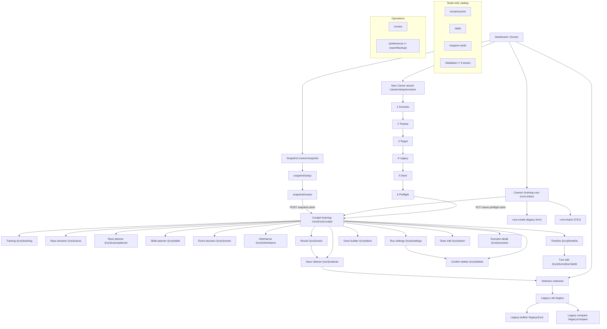

# UI/UX Application Context Brief — Trainer Desk (`umamusume-laravel13`)

| Field | Value |
| --- | --- |
| Purpose | Give an external reviewer (ChatGPT) a repository-grounded mental model of the application's UI/UX, IA, navigation, user flows, domain concepts, screen responsibilities, interaction patterns, and known usability issues. |
| Method | Static repository inspection (routes, controllers, models, Vue pages/components/layouts, config, migrations, tests) plus the repository's own UX audits. No application code was modified. |
| Date of writing | 2026-11-13 |
| HEAD at writing | `f6845083` (`fix(career): ship the career length from its server-side owners (plan 3.6, walk 8 sub-finding 2)`) |
| Last refresh | 2026-11-13, HEAD `f6845083` — §17 is the current-state addendum; §1–§16 are retained as historical. |
| Branch | `master` |
| Working tree at writing | Clean except untracked image/audit directories now gitignored (`.scratch-audit/`, `docs/audits/**/screens/`, `docs/audits/**/screenshots/`) and source/doc changes (`KNOWN-ISSUES.md`, `SCREEN_SPEC.md`, `docs/framework-ui-ux/_audit-prompt.md`, `docs/research/ui-ux-application-context-brief.md`, `tests/browser/career-trainee-select.spec.ts`). Branch ahead of `origin/master` by 3. |
| Reading conventions | Every claim is labelled **CONFIRMED** (read from code/routes/persistence/tests), **DOCUMENTED** (authoritative doc), **HISTORICAL** (audit/older claim), **INFERRED** (reasoned, not directly proven), or **PROPOSED** (design/plan, not built). Line numbers are accurate only at the time of writing. |

---

## 1. Executive overview

**CONFIRMED.** Trainer Desk is a local-only, single-Trainer Laravel 13 application for the Global English release of *Umamusume Pretty Derby*. It runs on loopback, has no auth surface and no deploy path, and stores everything in one SQLite file (`database/database.sqlite`). The web surface is Inertia + Vue 3 (TypeScript, Tailwind v4, Vite); Blade survives only as the `resources/views/app.blade.php` shell and error pages. There is a read-only JSON surface under `/api/v1`. (`AGENTS.md` §1; `routes/web.php`.)

**CONFIRMED.** The application is organized around **career runs** (`training_runs`). A run is one Trainer's playthrough of one trainee in one scenario. The user's core loop is:

1. Start a career (six-step setup wizard, or snapshot an in-progress career, or import a CSV).
2. Enter the career workspace: a **Cockpit** hub plus run-scoped decision screens (training, races, skills, events, inheritance).
3. Record turns, make planning decisions, plan races, plan skills.
4. Finish the career: read the **Result** screen, save a **Veteran** (a permanent record of the finished career).
5. Reuse Veterans in the **Legacy Lab** (record the ancestry/parents used at the start of a new career) and compare them.

**CONFIRMED.** Beside the career loop sit three read-only catalog surfaces — trainees, skills, support cards — plus a Database hub of **nine** areas (four fetched tables, four transcribed/config references, one source ledger), a Review queue for the fetch pipeline's ambiguous matches, a Help screen, and a Preferences screen carrying export and backup.

**CONFIRMED.** A read-only JSON API (`/api/v1`) exposes trainees, training runs and support cards: six `GET` routes, with `{data, pagination}` for lists, `{data}` for detail, and a centrally-applied `{error: {code, message}}` envelope for every non-2xx. It is not a write path and not an auth surface.

**CONFIRMED.** There are effectively **two "homes"**:
- the **Dashboard** (`/`, `home`), the Trainer Desk 2.0 front door (`ADR-0020` §1), which shows the newest active career, recent Veterans, quick actions and data status; and
- the **Cockpit** (`/training-runs/{run}/cockpit`, `runs.cockpit`), the run's own workspace.

**CONFIRMED.** The single most important navigation fact for a newcomer: the old run-record screen is retired. `GET /training-runs/{run}` (`runs.show`) is a **redirect to the Cockpit** (`routes/web.php:132`; `TrainingRunController::redirect()`), not a screen. Everything the old record screen owned now lives in the Cockpit or a run-scoped decision screen.

---

## 2. Repository and evidence guide

### 2.1 Stack (CONFIRMED)

| Concern | Value | Evidence |
| --- | --- | --- |
| Framework | Laravel 13 | `composer.json`; `AGENTS.md` §1 |
| Language | PHP 8.5 | `AGENTS.md` §1; audit headers |
| Database | SQLite (WAL, `busy_timeout`), file `database/database.sqlite` | `AGENTS.md` §1 |
| Frontend | Inertia.js + Vue 3 + TypeScript, Tailwind v4, Vite | `resources/js/`; `AGENTS.md` §1 |
| Tests | Pest 4 (feature-first), Playwright (browser) | `tests/`; `AGENTS.md` §9 |
| Static analysis | PHPStan level 6, Pint (`laravel` preset) | `AGENTS.md` §7, §9 |
| Scale at writing | 65 Vue pages, 117 Vue components (25 top-level plus 92 in ten area folders), 3 layouts; 249 Feature test files, 11 Unit test files, 120 browser specs; 91 named routes in `routes/web.php` plus 6 read-only in `routes/api.php` | measured on this tree |

### 2.2 Evidence hierarchy used in this brief

Per the task's own ordering, strongest first:

1. **Requirements / designated authoritative docs** — `PRD.md`, `SCREEN_SPEC.md`, `ARCHITECTURE.md`, accepted ADRs.
2. **Actual routes, backend logic, persistence, and current frontend implementation** — `routes/web.php`, `app/Http/Controllers/**`, `app/Models/**`, `database/migrations/**`, `resources/js/**`.
3. **Automated tests and verified browser behavior** — `tests/Feature/**`, `tests/browser/**`.
4. **UX audits, reconciliation, screenshot research** — `docs/audits/**`, `docs/research-scratch/**`.
5. **Proposals, design concepts, historical notes, assumptions** — `docs/proposals/**`, `docs/research-scratch/**`.

Where (2) and (1) disagree, this brief reports the disagreement rather than silently choosing one (see §9, R2-01).

### 2.3 Authoritative document map (CONFIRMED existence)

| Document | Owns | Authority |
| --- | --- | --- |
| `PRD.md` | users, stories, FR-A..FR-E, NFRs, §6 non-goals | Product truth |
| `ARCHITECTURE.md` | schema, pipeline, API contract, security, testing strategy | System design |
| `SCREEN_SPEC.md` | screen inventory, per-screen states, §8 authority table | Screen behavior |
| `DESIGN.md` | tokens, components, surfaces, motion | Visual system |
| `KNOWN-ISSUES.md` | live defect register `KI-nn` (through KI-153) | Defect register |
| `config/scenarios.php` | the **only** place scenario names enter the layout path | Scenario composition |
| `AUDIT-AND-VERIFICATION.md` §rice-shower-unity-cup-ux-walk.md | first browser walk (Round 1) | HISTORICAL evidence |
| `AUDIT-AND-VERIFICATION.md` §rice-shower-unity-cup-ux-walk-2.md | second browser walk (Round 2) | HISTORICAL evidence |
| `docs/audits/rice-shower-unity-cup-ux-walk-3.md` | third browser walk (Round 3) | HISTORICAL evidence |
| `AUDIT-AND-VERIFICATION.md` §rice-shower-unity-cup-round2-reconciliation.md | R2-01..R2-21 classification vs code | HISTORICAL evidence |
| `docs/audits/rice-shower-unity-cup-round3-reconciliation.md` | R3-01..R3-29 classification vs code | HISTORICAL evidence |
| `docs/audits/rice-shower-unity-cup-round4-reconciliation.md` | round 4 reconciliation | HISTORICAL evidence |
| `docs/audits/rice-shower-unity-cup-round5-reconciliation.md` | round 5 reconciliation | HISTORICAL evidence |
| `docs/audits/rice-shower-unity-cup-round6-reconciliation.md` | R6-01..R6-54 (current findings) | HISTORICAL evidence |
| `docs/audits/rice-shower-unity-cup-ux-walk-4.md` | fourth browser walk | HISTORICAL evidence |
| `docs/audits/rice-shower-unity-cup-ux-walk-5.md` | fifth browser walk | HISTORICAL evidence |
| `docs/audits/rice-shower-unity-cup-ux-walk-6.md` | sixth browser walk (untracked) | HISTORICAL evidence |
| `AUDIT-AND-VERIFICATION.md` §AUDIT-SUPPORT-CARDS-UIUX-2026-11-05.md | support-card surfaces audit (AUD-20261105-001) | HISTORICAL evidence |
| `AUDIT-AND-VERIFICATION.md` §rice-shower-unity-cup-ux-walk-resolutions.md | remediation record | HISTORICAL evidence |
| `docs/UMAMUSUME_REFERENCE.md` | source-cited mechanics corpus (2786 lines) | Reference (not a spec) |
| `docs/research/SYSTEM-FLOWS.md` + `flows-*.md` | the companion flow set: 11 documents covering navigation, career creation, the career workspace, veterans/legacy, catalogs, the database hub, review, preferences, the fetch pipeline, `/api/v1`, and Help | Implementation-level flow description |

**Not authoritative / do not cite as a spec:** `docs/deprecated/**` (retired legacy PDFs; display text must never be copied), `PRODUCT.md` (generator-owned), the `docs/design-research/` prototypes, and the folded root stubs `CONSTRAINTS.md` and `PLAN.md` (their content moved into `docs/research-scratch/GOVERNANCE.md` and `docs/research-scratch/PROCESS-PLANS.md`).

### 2.4 Code map (CONFIRMED)

| Layer | Location | Note |
| --- | --- | --- |
| Routes | `routes/web.php` (browser), `routes/api.php` (JSON, read-only) | all browser routes named |
| Controllers | `app/Http/Controllers/` + `app/Http/Controllers/Career/` + `Api/V1/` | thin; logic in Actions/Services |
| Models | `app/Models/` (catalog + trainer-data + support-card) | incl. `TraineeGoal`, `TurnEntry` (energy band), `DeckSlot` |
| Domain | `app/Domain/Career/CareerPosition.php`, `app/Domain/Training/StatCeilings.php` | position + ceilings arithmetic |
| Enums | `app/Enums/` (TitleCase cases; DB stores the backed value) | incl. `TraineeGoalType`, `TurnChoice` |
| Services | `app/Services/` (`ScenarioCaps`, `SkillSpendCoverage`, `Career/SetupDraft`, `Advisor/TrainerAdvisor`, `Advisor/NextDecision`, `Career/{RaceStrip,ScenarioSection,TeamPanel,TrackblazerPanel}Builder`, ...) | shared arithmetic/ownership |
| Layouts | `resources/js/layouts/AppLayout.vue`, `CareerLayout.vue`, `SetupLayout.vue` | three navigation shells |
| Pages | `resources/js/pages/` (65 Vue files) | grouped by area, incl. `Career/Cockpit/Panels/` (8 panel files) |
| Components | `resources/js/components/` (117 Vue files) | 25 top-level plus ten area folders |

---

## 3. Information architecture and navigation map

### 3.1 Primary navigation — `AppLayout.vue`

**CONFIRMED.** The sidebar carries **ten live destinations in four groups** (`AppLayout.vue:183-221`). There are zero "not built" (named-absence) items now. The groups are the HFW's own (`shell.js` `NAV`): Play, My data, Library, System.

| Group | Label | Route target | Mobile slot (`inBar`) | Prefetches |
| --- | --- | --- | --- | --- |
| Play | Dashboard | `/` (`home`) | Home | yes |
| Play | New Career | `/career/setup/scenario` (`career.scenario`) | — | **no** |
| My data | Careers | `/training-runs` (`runs.index`) | Career | yes |
| My data | Legacy Lab | `/legacy` (`legacy.index`) | Legacy | yes |
| My data | Veterans | `/veterans` (`veterans.index`) | — | yes |
| My data | Review | `/review` (`review.index`) | — | yes |
| Library | Support Cards | `/support-cards` (`support-cards.index`) | Deck | yes |
| Library | Skills | `/skills` (`skills.index`) | — | yes |
| System | Database | `/database` (`database.index`) | — | yes |
| System | Settings | `/preferences` (`preferences.edit`) | — | yes |

**CONFIRMED.** Mobile uses a bottom bar of four `inBar` slots + a native `
` "More" disclosure carrying the other six (`:655-...`); the bar's five slots are `flex-1 min-w-0`, not `shrink-0`, so they divide 320 px instead of overflowing. The desktop rail collapses to marks only; the choice is stored in `localStorage` key `trainer-desk.nav-rail` (`:258-275`) — a **browser** preference, not a stored `Preference` row, because `Preference::KEYS` is exactly `theme`, `failure_estimate`, `settings`. Active state uses prefix matching after stripping the query string (`isCurrent()`, `:113-117`), so `/legacy/12` still highlights Legacy Lab and a filtered list keeps `aria-current="page"`.

**CONFIRMED.** Only **New Career** declines hover-prefetch, because Inertia caches a prefetched response for about 30 s and the wizard's steps render session-draft state: a reused prefetch would show the choice from before the save that just changed it.

**DOCUMENTED / minor breach.** The ten-item count exceeds the frontend plan's "at or under eight" guideline; the grouping is the HFW's own ruling for that breach (annotation 4 on `index.html`), recorded in the code comment rather than silently merged.

### 3.2 Career shell — `CareerLayout.vue`

**CONFIRMED.** Run-scoped screens render inside `AppLayout` plus a career bar showing trainee, scenario and status, with a `{trainee} · {scenario} · {screen}` crumb and doors to the Cockpit and the Dashboard. It also carries `CareerSectionNav.vue`, the **nine-section stepper**: Cockpit, Training, Races, Skills, Events, Inheritance, Deck, Timeline, Result — hrefs built from the run URL base (`runUrl.replace(/\/cockpit$/, '')`).

**CONFIRMED (reachability rule).** With a known terminal status (`Completed` / `Retired`) the `result` step becomes live and `training` does not (`The career has ended, so no turns are left to decide`); with an absent or blank status every section stays reachable, which is the safe default because a wrongly disabled tab hides a live screen. Unreachable steps are named in prose as well as disabled (`CareerSectionNav.vue:72-98`).

The run's URL is provided by the server as `run_url`, which is always `route('runs.cockpit', $run)`; no browser file addresses `runs.show` literally (enforced by `tests/Feature/NoStaleRunRecordLinksTest.php`).

### 3.3 Setup shell — `SetupLayout.vue`

**CONFIRMED.** The six-step wizard renders a step rail: **Scenario → Trainee → Target → Legacy → Support deck → Preflight** (`SetupLayout.vue:33`). Every step writes to a **session draft** (`app/Services/Career/SetupDraft.php`), not to a run; the run is created once, at Preflight.

### 3.4 Route / navigation map (CONFIRMED)

### 3.5 Global vs run-scoped

**CONFIRMED.** Global (not tied to a run): Dashboard, Careers list, catalog (trainees/skills/support cards), Database hub, Review, Preferences, Veterans, Legacy Lab index/compare, and the setup wizard (draft state). **Run-scoped** (require `{run}`): Cockpit, Training, Race decision, Race planner, Skills planner, Event decision, Inheritance, Timeline, Result, Save Veteran, and the run-scoped Deck builder. **Legacy Lab builder** is run-scoped (`/legacy/{run}`) but reads a run only as the anchor for recording ancestry.

### 3.6 Navigation dead ends and cross-screen links (CONFIRMED)

- **The run-scoped Deck builder (`/training-runs/{run}/deck`, `runs.deck`) has two doors now**: the Cockpit's `deck_url` (R2-17) and the career stepper's `Deck` section. `Support/Builder.vue` *is* that screen, and its only other self-reference is a same-page reload for filter/page/equip.
- **`TrainingDetail.vue` no longer links to `/career/setup/deck`** (`e2889ff`). The deck door at run scope uses `props.run.deck_url`.
- **v3.0.0 added three doors that replace retired inline Cockpit disclosures**: `runs.settings` (run identity), `runs.team` (team state, gated on `composesPanel('team_rank_ladder')` and redirecting with a sentence when the scenario records no team), and `runs.scenario-detail` (the scenario board suite, including the `ADR-0026` career-goals panel). All three are **reads**; every field writes through `runs.update`.
- **`runs.confirm-delete`** is a read with a required checkbox; the DELETE stays on `runs.destroy`, which refuses without `confirmed`.
- **`runs.turns.edit`** gives the turn correction a page of its own; the form PUTs to `runs.turns.update`.
- `runs.show` is a redirect, not a screen. No browser file addresses it (`NoStaleRunRecordLinksTest`).
- **KI-144 (CLOSED 2026-11-01)**: the cockpit's `
` disclosure hosted v2.1.0 write surfaces with no door of their own. The four doors above were built first (`C6b.1`–`C6b.3`), then the disclosure was **deleted entirely** at `06a65aef` (`C6b.11`). `grep -c career-tools resources/js/pages/Career/Cockpit.vue` returns 0; the controller's `correction` prop is now the leftover, declared and posted but unread by the page.

---

## 4. Complete screen inventory

The table below covers the significant user-facing surfaces. "States" is condensed; the authoritative per-screen state list is `SCREEN_SPEC.md`. Absent/unsupported features are marked.

### 4.1 Global screens

| Screen | Route (name) | Purpose | Entry points | Primary actions | Data owner | UX concerns / evidence |
| --- | --- | --- | --- | --- | --- | --- |
| Dashboard | `/` (`home`) | Front door: active career, recent Veterans, quick actions, data status | Sidebar; logo; any "Home" | Open active career; start new; browse | `DashboardController`; `TrainingRun` (newest `Active`), `Veteran` | Multiple runs supported; shows newest Active only (CONFIRMED, `DashboardController`). |
| Careers list | `/training-runs` (`runs.index`) | List/manage runs | Sidebar "Careers" | Open, delete, create, import | `TrainingRunController::index` | No clickable inbound link existed before 2.0; now the sidebar owns it (`AppLayout.vue:69-71`). |
| Create run (legacy form) | `/training-runs/create` (`runs.create`) | Pre-2.0 one-combobox create | Catalog page carrying a chosen trainee | Create run | `TrainingRunController::store`; `StoreTrainingRunRequest` | Transitional; not the primary path (the wizard is). |
| Import runs (CSV) | `/training-runs/import` (`runs.import`, `.store`, `.preview`) | Import historical runs from CSV | Careers list | Preview, confirm commit | `ImportHistoricalRun` action | Confirm step once always failed in-browser (KI-64, **CLOSED** `851ed51`). |
| Catalog index/detail (trainees) | `/umamusume`, `/umamusume/{slug}` (`catalog.index`, `.show`) | Browse trainee catalog | Sidebar/Database | View; start a career with a chosen trainee | `CatalogController`; `Umamusume`, `UmamusumeProfile`, `CharacterCard` | Artwork via `ArtworkSlot.vue` + loopback `artwork.show`. |
| Skills catalog | `/skills`, `/skills/{skill}` (`skills.index`, `.show`) | Browse skills | Sidebar/Database | View | `SkillController`; `Skill` | Read-only. |
| Support cards | `/support-cards`, `/support-cards/{card}` (`support-cards.index`, `.show`) | Browse support cards | Sidebar/Database | View | `SupportCardController`; `SupportCard`, `SupportEffect` | Read-only. |
| Review queue | `/review` (`review.index`, `review.resolve`) | Resolve ambiguous fetch matches | Sidebar | Resolve candidate | `ReviewController`; `MatchCandidate` | Pipeline-facing, not career-facing. |
| Preferences | `/preferences` (`preferences.edit`, `.update`, `.export`, `.backup`) | Three preference keys; data export/backup | Sidebar "Settings" | Change theme, failure estimate, settings blob; export JSON; back up | `PreferenceController`; `Preference` (`theme`, `failure_estimate`, `settings`) | Restore/Reset deliberately absent (destructive, owner-scoped). Six on-screen sections: Layout width, Target defaults, Data, Theme, Language, Dashboard. |
| Database hub | `/database` + 9 areas (`database.*`) | Read-only reference tables | Sidebar "Database" | Browse 9 areas | `DatabaseController`, plus `CatalogController`/`SupportCardController`/`SkillController` for 3 ported areas | Nine areas: trainees, supports, skills, races, scenarios, events, shop-items, sparks, sources. The four live tiles print a **scoped** count beside the raw one; transcriptions print a tag word instead of a number no table can corroborate. |
| Help | `/help` (`help`) | Product loop, keyboard map, tag meanings, where a number came from | Topbar `?` on every screen | Read | `HelpController` (no props) | Deliberately absent from the rail; eight recorded `HFW-OVERRIDE`s in the page script. |

### 4.2 Career setup screens

| Screen | Route (name) | Purpose | Inputs | Output | Evidence |
| --- | --- | --- | --- | --- | --- |
| Step 1 Scenario | `/career/setup/scenario` (`career.scenario`) | Choose scenario | scenario key | session draft | `ScenarioSelectController`; `ScenarioSelect.vue` |
| Step 2 Trainee | `/career/setup/trainee` (`career.trainee`), profile `career.trainee.profile` | Choose trainee | umamusume id | session draft | `TraineeSelectController`, `TraineeProfileController` |
| Step 3 Target | `/career/setup/target` (`career.target`) | Enter build target | target stats (clamped to ceilings) | draft `build_target` | `BuildTargetController`; `StoreBuildTargetRequest`/`StoreDraftBuildTargetRequest` |
| Step 4 Legacy | `/career/setup/legacy` (`career.legacy`) | Record ancestry/parents | legacy selection + parents | draft `legacy_selection`, `legacy_parents` | `LegacySelectController`; `StoreLegacySelectionRequest`/`StoreDraftLegacyRequest` |
| Step 5 Deck | `/career/setup/deck` (`career.deck`) | Configure six-slot support deck + owned/rented flag | 6 positions, card, ownership | draft `deck` | `DeckSelectController`; `StoreDeckRequest`/`StoreDraftDeckRequest` |
| Step 6 Preflight | `/career/setup/preflight` (`career.preflight`) | Review contract; **Start Career** (the wizard's one write) | — | creates the run | `PreflightController`; `StartCareerRequest` |
| Snapshot entry/setup/review | `/career/snapshot`, `/career/snapshot/setup`, `/career/snapshot/review`, `POST /career/snapshot` (`career.snapshot*`) | Record an in-progress career in one pass | position + current state | creates the run | `SnapshotController` |

### 4.3 Run-scoped screens (the career workspace)

| Screen | Route (name) | Purpose | Write | Evidence |
| --- | --- | --- | --- | --- |
| Cockpit | `/training-runs/{run}/cockpit` (`runs.cockpit`) | Run hub: header, stats and state (with the cap footer), identity, advisor, race strip, scenario section, Performance, Where-to-go doors, Delete-this-run footer | **reads only** since `06a65aef`; every write goes through the doors below | `CockpitController::show`; `Cockpit.vue`; panels under `Career/Cockpit/Panels/` |
| Run settings | `/training-runs/{run}/settings` (`runs.settings`) | Run identity: status, scenario, period, rarity, potential level, growth rate, stat targets, opponent team state | `runs.update` (four `useForm`s, all `put`) | `CockpitController::settings`; `RunSettings.vue` |
| Team edit | `/training-runs/{run}/team` (`runs.team`) | Team state; gated on `composesPanel('team_rank_ladder')`, else redirect to the Cockpit with a sentence | `runs.update` | `CockpitController::teamEdit`; `TeamEdit.vue`; `UnityCupEditor.vue` |
| Scenario detail | `/training-runs/{run}/scenario` (`runs.scenario-detail`) | The scenario's own board suite, incl. the `ADR-0026` career-goals panel | none | `CockpitController::scenarioDetail`; `ScenarioDetail.vue` |
| Turn edit | `/training-runs/{run}/turns/{turn}/edit` (`runs.turns.edit`) | Turn correction on its own page; reached from the Timeline row | `runs.turns.update` | `TrainingRunController::editTurn`; `TurnEdit.vue` |
| Confirm delete | `/training-runs/{run}/delete` (`runs.confirm-delete`) | What will be lost, behind a required checkbox | `runs.destroy` (DELETE, refuses without `confirmed`) | `TrainingRunController::confirmDelete`; `ConfirmDelete.vue` |
| Training decision | `/training-runs/{run}/training` (`runs.training`) | Guided turn entry / detail; energy band now editable and prefillable on create (R2-16) | posts to `runs.turns.store` | `TrainingDecisionController` |
| Race decision | `/training-runs/{run}/races` (`runs.races.decision`) | Run's race calendar | posts to `runs.races.store` | `RaceDecisionController` |
| Race planner | `/training-runs/{run}/races/planner` (`runs.races.planner`) | Whole calendar grouped (obligations, ahead, reached-unrecorded, rivals) | `runs.races.store` | `RacePlannerController` |
| Skills planner | `/training-runs/{run}/skills` (`runs.skills.planner`) | Skill coverage vs build target; empty priority list refused (R2-10) | `runs.build-target.update` (priorities live there) | `SkillsPlannerController`; `SkillSpendCoverage` |
| Event decision | `/training-runs/{run}/events` (`runs.events.decision`, `.store`) | Record event choices | `runs.events.store` | `EventDecisionController` |
| Inheritance event | `/training-runs/{run}/inheritance` (`runs.inheritance`, `.store`) | Record-only inheritance event; grandparent Sparks counted, grandparent ranks added (R3-02, R3-09) | `runs.inheritance.store` | `InheritanceEventController` |
| Timeline | `/training-runs/{run}/timeline` (`runs.timeline`) | Flattened ordered rail of turns/races/events | none | `TimelineController` |
| Result | `/training-runs/{run}/result` (`runs.result`) | Finished-run summary | none | `ResultController` |
| Save Veteran | `/training-runs/{run}/veteran` (`runs.veteran`, `.store`) | File a finished career as a Veteran | `runs.veteran.store` | `SaveVeteranController`; `RecordVeteran` |
| Deck builder | `/training-runs/{run}/deck` (`runs.deck`) | Run-scoped support deck editor; now reachable via a Cockpit door (R2-17) | posts to `runs.deck.sync` | `TrainingRunController::deck`; `Support/Builder.vue` |
| Run record | `/training-runs/{run}` (`runs.show`) | **Retired** — redirects to Cockpit | — | `routes/web.php:132` |

### 4.4 Legacy Lab and Veterans

| Screen | Route (name) | Purpose | Evidence |
| --- | --- | --- | --- |
| Legacy Lab index | `/legacy` (`legacy.index`) | Browse recorded ancestries | `LegacyController` |
| Legacy builder | `/legacy/{run}` (`legacy.builder`, `legacy.update`) | Record ancestry for a run | `LegacyController`; `LegacySelectionPayload` |
| Legacy compare | `/legacy/compare` (`legacy.compare`) | Compare recorded ancestries | `LegacyController` |
| Veterans index | `/veterans` (`veterans.index`) | Library of finished careers | `VeteranController`; `ListVeterans` |
| Veteran detail | `/veterans/{veteran}` (`veterans.show`) | One Veteran | `ShowVeteran`; `VeteranRow` |
| Veterans compare | `/veterans/compare` (`veterans.compare`) | Compare Veterans | `VeteranController` |

**CONFIRMED (record-only boundary).** The Legacy Lab computes no inheritance, affinity payout, star-roll chance, or recommended combination; it records what the Trainer entered and aligns stored rows. Grandparent rank fields were added to the ancestor nodes (R3-09, `3e136a0`); grandparent Sparks are counted in the Predicted Sparks total (R3-02, `2470a4c`). The boundary is a shared constant — `LegacyController::RECORD_ONLY_NOTICE` — rendered on the library index, the library compare, the Legacy index, the Legacy builder and the Legacy compare, so five surfaces cannot word it five ways. Row limits: `VeteranCompareRequest::MAX_VETERANS = 6`, `LegacyCompareRequest::MAX_RUNS = 4`.

**Not present / unsupported (CONFIRMED by absence):** no public deploy/hosting, no auth/login, no multi-user, no image uploads (only tool-fetched artwork, `ADR-0021`), no race-outcome prediction, no simulation, no dual storage (PRD §6).

---

## 5. End-to-end user journeys

Each journey gives: (1) observed UI behavior, (2) backend behavior, (3) persistence/ownership, (4) documented intent, (5) discrepancies.

### A. Start a new career (wizard)

1. **UI.** Sidebar "New Career" → `career.scenario`. Steps 1–5 write to the session draft; each step's PUT returns to its own screen with a flash. Step 6 Preflight composes the draft into one contract and offers **Start Career**.
2. **Backend.** `ScenarioSelectController`/`TraineeSelectController`/`BuildTargetController`/`LegacySelectController`/`DeckSelectController` each `PUT` into `SetupDraft` (session). `PreflightController::store()` re-runs each step's Form Request via `StartCareerRequest`, then creates the run in one write, including the six `deck_slots` rows with their `ownership` flag.
3. **Persistence.** Session draft until Preflight; then `training_runs` + `deck_slots` (+ ancestry, target) rows. `SetupDraft` is the only owner of pre-run state (`app/Services/Career/SetupDraft.php`).
4. **Documented.** `SCREEN_SPEC.md` SCR-CAR-002..009; `routes/web.php:40-93`; plan §8 D2–D7.
5. **Discrepancies.** R2-02 (legacy save appeared to vanish in the audit) is **not reproducible in code**; the persistence path is covered and passes (see §9). Cause of the browser observation is **unidentified** (HISTORICAL, preserved). R2-06 deck-ownership copy is now **committed** (see §9); the reconciliation slice log still lists it as next action at the older tree but the fix has landed (`dd179ba` and siblings).

### B. Continue an existing career

1. **UI.** Dashboard shows the newest `Active` run; Careers list shows all. Opening a run goes to the Cockpit.
2. **Backend.** `TrainingRunController::redirect()` sends `runs.show` → `runs.cockpit`. `CockpitController::show()` composes header, identity, state, advisor, race strip, scenario section, Performance, the Where-to-go doors and `correction`; `turnEvents` is loaded only when the scenario actually reads them.
3. **Persistence.** Reads `training_runs`, `turn_entries`, `turn_events`, `deck_slots`, `race_entries`, `scenario_slots`, `trainee_goals`.
4. **Documented.** `SCREEN_SPEC.md` SCREEN-009 / SCR-CAR-011.
5. **Discrepancies.** R2-01/R2-04 are resolved for snapshot mode and by design for wizard careers. R2-13 and R2-14 are fixed **but the surfaces moved**: the identity form is on `runs.settings` and the team editor on `runs.team` (`06a65aef`), so a citation pointing at the Cockpit for those forms is stale. R2-16 (energy band editable and readable) and R2-17 (deck door) still hold. The controller's `correction` prop is now unread by the page — a leftover of the same retirement.

### C. Record a training turn

1. **UI.** Guided entry on `/training-runs/{run}/training` (posts to `runs.turns.store`). Correction is its own page now — `/training-runs/{run}/turns/{turn}/edit` (`runs.turns.edit`), reached from a Timeline row's `edit_url` — and it PUTs to `runs.turns.update`.
2. **Backend.** `TrainingRunController::storeTurn()` / `updateTurn()`; validated by the one `StoreTurnEntryRequest` (five stats required and bounded by `ScenarioCaps::forRun()`; `energy` 0..100 with `energy_state`/`energy_band`; `mood` from the five client tiers; `stage`/`choice`/`outcome`/`penalty_kind` demanded only on a staged submit; `previewed` demanded on confirm).
3. **Persistence.** `turn_entries` (+ a `Failure` event when the chosen outcome is one, + a `Scenario` event carrying a `PerformancePayload` when the turn recorded one). `storeTurn` writes all of it in one transaction and takes the `decision_snapshot` **before** the create. `destroyTurn` deletes the row and its failure event together, in one transaction, and deliberately leaves `Scenario` events alone.
4. **Documented.** plan §9.6 ruling 2 (arbitrary-turn correction).
5. **Discrepancies.** The two write doors (guided create, correction) still share one Form Request, which is the mitigation against divergence. **R6-12 is open**: the Timeline reads `after`/`after.sp` while the server sends `actual`, and has no band projection.

### D. Use a scenario planner or Cockpit

1. **UI.** The Cockpit renders scenario-specific widgets (config-driven) and a scenario section; the advisor shows one recommendation with reasons, an alternative and a risk. The panel suite itself is on `runs.scenario-detail` — the Cockpit links there and the scenario strip shows the headline facts.
2. **Backend.** `CockpitController::show()` reads the run's scenario key, resolves widgets/panels from `config/scenarios.php`, composes the advisor (`app/Services/Advisor/TrainerAdvisor.php`), and builds `$team` **once** for both the header rank and the scenario section. `ScenarioSectionBuilder` folds in objectives, alerts, milestones, duel, pre-final, grade, shop, epithet and rival sections, each gated on `composesPanel('...')`.
3. **Persistence.** Stored scenario state (`scenario_slots`, scenario counters on `training_runs`, `turn_events` payloads); the panel renders stored values read-only where no input exists.
4. **Documented.** `SCREEN_SPEC.md` SCREEN-009; plan §8 D8.
5. **Discrepancies.** R2-09 (stat denominators) is fixed (`44a7b13`). Team state now has its own page (`runs.team`), writing through `runs.update` (R2-14), rather than the retired inline editor. **Open:** R6-08 (a literal spark note beside a derived counter, and the Cockpit and Inheritance tile count different scopes); R6-48 (the team copy names a rank path no form provides); R6-04 (the Cockpit caption asserts a scenario ceiling over entered-bounded bars).

### E. Plan and record races

1. **UI.** Race decision (`/races`) is the run's calendar; Race planner (`/races/planner`) groups the whole calendar into obligations, races ahead, reached-and-unrecorded, and the rival set.
2. **Backend.** Both read `race_entries`/`race_catalog_slots`/`scenario_races`; the one write is `runs.races.store` (no second race-write route).
3. **Persistence.** `race_entries`.
4. **Documented.** `SCREEN_SPEC.md` SCREEN-011/SCREEN-017.
5. **Discrepancies.** R2-12: the planner is dense with repeated `N/A` for placeholder races lacking catalog data (data-completeness, not a UI defect). **HISTORICAL / open as a known limitation.**

### F. Review, complete, abandon, or revisit a career

1. **UI.** Status is changed from the Cockpit header (`statusForm` → `runs.update`). Finished careers surface on `/result`; Save Veteran files them. Abandoned/finished runs remain in the Careers list and the Dashboard's recent Veterans.
2. **Backend.** `RunStatus` transitions; `ResultController`; `SaveVeteranController` → `RecordVeteran`.
3. **Persistence.** `training_runs.status`; `veterans`.
4. **Documented.** `SCREEN_SPEC.md` SCREEN-019/020/021.
5. **Discrepancies.** None confirmed at writing. The identity-form gap (§6.5) is closed — rarity, potential, growth-rate, and entered caps now post through `runs.update` (R2-13 fixed).

### G. Navigate between overlapping or legacy screens

1. **UI.** The retired run record redirects to the Cockpit. The pre-2.0 `runs.create` form still exists and is reached from a catalog page carrying a chosen trainee. The wizard's deck step (`/career/setup/deck`) and the run-scoped builder (`/training-runs/{run}/deck`) are two different deck surfaces.
2. **Backend.** Both deck surfaces share `StoreDeckRequest`/`StoreDraftDeckRequest`, so a draft value and a saved one obey the same dictionary (`routes/web.php:72-85`).
3. **Persistence.** Wizard deck → session draft until Preflight; run-scoped deck → `deck_slots` via `runs.deck.sync`.
4. **Documented.** `routes/web.php`; `SCREEN_SPEC.md` SCREEN-007 / SCR-CAR-009.
5. **Discrepancies.** The `TrainingDetail.vue` deck link is fixed (now uses `props.run.deck_url`, R2-17); the run-scoped builder has a Cockpit door but still has no inbound link from any page **other than the Cockpit** (§3.6). **CONFIRMED defect (limited).**

---

## 6. Core domain concepts and data ownership

### 6.1 Models (CONFIRMED)

| Concept | Model | Created/edited by | Read by |
| --- | --- | --- | --- |
| Career run | `TrainingRun` | Preflight, snapshot, import, `runs.create`, `runs.update` | Dashboard, Careers, Cockpit, all run-scoped screens, Legacy Lab |
| Trainee (catalog) | `Umamusume`, `UmamusumeProfile`, `CharacterCard`, `UmamusumeAlias` | fetch pipeline (engine-owned) | Catalog, wizard, Cockpit |
| Trainee career goal | `TraineeGoal` | sourced import | Cockpit career-goals panel |
| Support card | `SupportCard`, `SupportEffect` | fetch pipeline | Support Cards, deck surfaces |
| Deck slot | `DeckSlot` | Preflight (`store`), `runs.deck.sync` | Cockpit, deck builder, analysis |
| Turn record | `TurnEntry` | `runs.turns.store`/`update` | Cockpit, Timeline, Result |
| Turn event | `TurnEvent` (+ `TurnEvents/*` payloads) | `runs.events.store`, `runs.inheritance.store` | Cockpit, Event/Inheritance decision, Timeline |
| Skill acquisition | `RunSkill`, `Skill` | `runs.skills.sync`, build target | Skills planner, Result |
| Race entry | `RaceEntry`, `RaceCatalogSlot`, `ScenarioRace` | `runs.races.store` | Race decision/planner, Timeline, Result |
| Scenario slot | `ScenarioSlot`, `Scenario` | run lifecycle | Cockpit scenario panel |
| Veteran | `Veteran` | `runs.veteran.store` | Veterans library, Legacy Lab |
| Preferences | `Preference` | `preferences.update` | shell, planner |

### 6.2 Lifecycle and position

- **CONFIRMED.** `RunStatus` enum drives status; the Cockpit header form writes it via `runs.update`.
- **CONFIRMED.** `app/Domain/Career/CareerPosition.php` + `CareerPositionCast.php` model "where in the career" the run is (year/phase/turn). `TrainingRun::careerPosition()` returns the stored position when there is one, else derives one from `max(turn)` on the turn log, and returns **null** below turn 1 or above `CareerCalendar::TURNS_PER_CAREER`. `hasImportedPosition()` is simply `career_position !== null`, which is the distinction the review screen and the header print as "named" versus "derived". `CockpitController::show()` builds it once (`:266`) and the same value feeds the header, `careerPosition` and `scenarioCountdown`.
- **R2-01/R2-04 resolved** (per Round 3). An audit walked a *source* describing an existing career but created a *new* career through the wizard; the UI correctly showed Turn 1. The mismatch is a methodology/documentation issue, not a code defect. The snapshot path carries and reads the imported position (verified by `SnapshotCockpitTest` and `dashboard.spec.ts`).

### 6.3 Stat denominators (CONFIRMED)

- **CONFIRMED.** `app/Domain/Training/StatCeilings.php` and `app/Services/ScenarioCaps.php` own per-stat ceiling arithmetic; `ADR-0015` makes `ScenarioCaps` the single owner.
- **CONFIRMED.** R2-09 is **fixed**: each screen names its own denominator — Cockpit `current / target`, Event decision `current / cap` — with a `denominatorLabel` distinguishing them (`44a7b13`). The same stat no longer shows different denominators without a distinguishing label.

### 6.4 Deck ownership semantics (CONFIRMED)

- `DeckSlot::POSITIONS` is the one owner of "what a deck is"; `DeckSlot::OWNERSHIP` bounds the two words (owned/rented).
- `deck_slots.ownership` is a nullable column (migration `2026_10_09_120000_add_ownership_to_deck_slots_table.php`; `ADR-0023` D3). Both writers record it: Preflight carries the draft flag onto the slot row; `runs.deck.sync` writes it per slot.
- A slot with no card carries no flag (renders `N/A`, never "Owned").
- **Domain distinction to preserve.** In the Rice Shower Unity Cup source material, Super Creek occupies the **Friends (rented) slot** (Slot 6), while **Haru Urara** is the Unity Cup scenario-linked support card (Slot 5). They are not interchangeable.
- **R2-06 deck-ownership copy is now committed.** Copy corrected on all surfaces (wizard step 5, Preflight, run-scoped builder, slot component); cites `ADR-0023` D3.

### 6.5 Identity, team, and Unity Cup state — UI write paths (CONFIRMED)

`StoreTrainingRunRequest` is the one validator for these columns. Its full key set is: `umamusume_id`, `character_card_id`, `scenario`, `status`, `mode`, `inheritance_parent_a_id`, `inheritance_parent_b_id`, `notes`, `trainee_rarity` (1..3), `potential_level` (1..5), `growth_rate.*` (0..30), `team_name`, `team_motto`, `team_league_placement` (1..99), `team_preseason_wins` (0..4), `team_stat_grades.*` (`G F E D C B A S`), `unity_trainings_count`, `spirit_bursts_count`, `extreme_bursts_count`, `current_objective_index`, `shop_resets_in`. `TrainingRunController::update()` persists `$request->validated()` through `runs.update`.

**CONFIRMED — the surface moved.** R2-13 and R2-14 were fixed on the Cockpit, but `06a65aef` (C6b.11) deleted the `Career tools` disclosure that hosted those forms. The identity form now lives on **`runs.settings`** (`RunSettings.vue`, four separate `useForm`s — status, scenario, period, identity — all `put`ting to `props.run.update_url`), and the Unity Cup team editor lives on **`runs.team`** (`TeamEdit.vue` renders `UnityCupEditor.vue`). Both still write through the one `runs.update` route and the one `StoreTrainingRunRequest`; no second identity-write route exists. A citation to `Cockpit.vue:662-747` for these forms is stale at this tree.

Facility level is **not** a column and not a validated input anywhere. `TrainingRun::facilityLevel(?string $rank)` derives it by mapping a **team-rank letter** through `config('scenarios.scenarios.<key>.team_rank_ladder')`; `TeamPanelBuilder:509` feeds it that rank. The per-turn facility levels recorded on `turn_entries` (`facility_speed` … `facility_wit`) are a different fact and are never aggregated into a run-level number (round-6 §11.2).

---

## 7. Scenario-specific UI/UX comparison

**CONFIRMED** from `config/scenarios.php` (1198 lines; baseline `ura_finale`; `verified_at` `2026-09-27`; source `GameTora scenarios.json`; `stale => false`). Four `[Global]` scenarios are modelled; a fifth guide (`docs/scenarios/08`) is `[JP-Only]` and must not be imported. Each entry carries `cap_bonus`, `widgets`, `steps`, `panels`, `card_tags`, `facility_level_source`, `ruleset_version`, `live_on_global`, `metadata`, plus per-scenario tables (`training_tables`, `shop`, `grade_objectives`, `team_rank_ladder`, `risk_absence` …).

There is **no `metadata.ruleset` key** in the config. Two separate facts stand in its place, and the R2-05 split exists to keep them apart: `ruleset_version` (the dated instant a source pins the scenario's numbering to, its launch or rework) and `facility_level_source` (how a facility level rises — the fact `ScenarioSelectController::ruleFamilyLabel()` humanises into the card's `rule_family`).

| Scenario key | Label | Widgets | `facility_level_source` (rule family) | Panels ON | `live_on_global` |
| --- | --- | --- | --- | --- | --- |
| `ura_finale` | URA Finale | turn, energy, fans | `repetition` → Repetition | race_calendar, career_goals | 2025-06-26 |
| `unity_cup` | Unity Cup | turn, energy, fans, **team_rank**, **spirit_bursts** | `team_rank` → Team rank | race_calendar, team_race, team_rank_ladder, career_goals | 2025-11-06 |
| `trackblazer` | Trackblazer | turn, energy, fans, **grade_points**, **shop_coins** | `repetition_plus_purchases` → Repetition + purchases | grade_objectives, shop, epithet_routes | 2026-03-12 |
| `our_grand_concert` | Our Grand Concert | turn, energy, fans | `repetition` → Repetition | career_goals | 2026-07-22 |

Every other panel key is explicitly `false` in each entry, so a scenario cannot gain another's rows by omission (gate G-33). `card_tags` is a separate, curated two-item list for the scenario card (the wireframe draws two), not a derived "first two".

**CONFIRMED.** Widget and panel labels are config-driven (`widget_labels`, `panel_labels`): Turn, Energy, Fans, Team Rank, Spirit Bursts, Grade Points, Shop Coins; Race calendar, Team races, Grade Point objectives, Pro Shop, Epithet routes, Team Rank ladder, Career goals. A scenario panel is registered per scenario (`components/scenario/ScenarioPanel.vue` plus Ura/UnityCup/Trackblazer/Our Grand Concert renderers, `components/scenario/` at 16 files and `pages/Career/Cockpit/Panels/` at 8), and the Cockpit forwards the panel bundle untouched. The scenario section is built by `ScenarioSectionBuilder`, injected by `CockpitController`.

**CONFIRMED.** `config/scenarios.php` is the **only** place scenario names enter the layout path. Scenario-driven components take the resolved label from the server as a required prop with no default; a scenario name hardcoded in a page is a defect (`AGENTS.md` §7).

**R2-05 (fixed).** The Unity Cup card once printed two different facts under one heading `Ruleset`. Fixed at `9777531`: grid heading `Ruleset version` (tool-wide, null by ruling) vs block heading `Rule family` (the scenario's own `facility_level_source`). Pinned by `ScenarioMetadataTest` and `tests/browser/career-scenario-select.spec.ts`.

**Residual (CONFIRMED, not covered by R2-05).** `components/scenario/ScenarioPanel.vue` still heads the tool-wide version row plain `Ruleset version:` on the Cockpit's scenario strip, with an `AbsenceValue` marker carrying the reason, and a separate `Scenario ruleset date:` row beneath it when the scenario states one. R3-13 classifies the asymmetry as **Known limitation** — two headings, two facts, both correct. The Cockpit's `correction` prop (turn correction) is also still declared and routed in the controller while `Cockpit.vue` no longer reads it: `C6b.6` moved the form to `runs.turns.edit`, reached from the Timeline row, so the prop is a leftover.

---

## 8. Cross-screen consistency and UX findings

**Confirmed current behavior / defects at HEAD `67a4830` (CONFIRMED unless marked):**

1. **R3-31 — trainee-step keyboard flash.** `career-trainee-select.spec.ts` keyboard case may fail to find the one-shot flash line even though the visit completes. **Confirmed, open.**
2. **R3-17 — window title fallback.** The title settles only after first re-render on some arrivals. **Cosmetic, unverified.**
3. **R2-12 — race planner dense with empty details.** Repeats `N/A` for placeholder races lacking catalog data. **Known limitation (data gap).**

**Fixed at this tree (CONFIRMED):**

- **R2-09 — stat denominators.** Fixed (`44a7b13`): each strip names its own denominator via `denominatorLabel`.
- **R2-10 — skills planner empty priority set.** Fixed (`d95da07`): refuses to price a priority list that does not exist.
- **R2-13 — rarity/potential/growth/cap inputs.** Fixed (`8e51b9f`): Cockpit identity form writes all through `runs.update`.
- **R2-14 — Unity Cup team state.** Fixed (`d8fb234`): `UnityCupEditor.vue` writes team state through `runs.update`.
- **R2-16 — energy band editable.** Fixed (`c3583f0`, `d21fcc1`): both guided create and Cockpit correction post `energy_state`/`energy_band`; strip reads the band (`3a1ba9b`).
- **R2-17 — deck builder door.** Fixed (`5d26b49`): Cockpit links to the run-scoped deck builder.
- **R3-01 — Energy band strip read.** Fixed (`3a1ba9b`): strip reads `energy_band` alongside `energy`; `CockpitEnergyBandDisplayTest` pins it.
- **R3-02 — Grandparent Spark count.** Fixed (`2470a4c`): `predictedSection()` now includes `ancestors_sparks`.
- **R3-03 — Deck-slot query lag.** Fixed (`d7f41dc`): query tracks retarget in the same render.
- **R3-04 — Correction save feedback.** Fixed (`3a1ba9b`): correction form carries `recentlySuccessful` line.
- **R3-06 — Costume picker.** Fixed (`f08ac63`): costume form selector added.
- **R3-09 — Grandparent rank fields.** Fixed (`3e136a0`): rank inputs on ancestor nodes.
- **R3-16 — Accessible names.** Fixed (`e02537e`): band select named; Legacy `Target` selects already named.
- **R3-30 — Definition-list provenance fix.** Fixed (`f6f393f`): read date inside its `dd`.
- **R3-32 — Inertia DevTools fatal.** Mitigated (`696f444`): DevTools disabled in browser role.
- **R3-08 / R3-12 / R3-26.** Re-verified on current build as **does not reproduce**.

**Consistency that holds (CONFIRMED):**

- Deck ownership copy matches persistence on every surface — R2-06 fix is now **committed** (see §9).
- Scenario labels are server-resolved and never hardcoded in pages (`config/scenarios.php`).
- No browser file addresses the retired `runs.show` route or renders a `Run record` label (`NoStaleRunRecordLinksTest`).

**Interaction conventions (CONFIRMED):** design tokens only (no `dark:` utilities); every data view renders empty/loading/error states (`ADR-0007`); unrecorded values render `N/A` with a `title`, never a default or a dash; advisory recommendations are separate from enforced constraints; minimum 44px (11 Tailwind units) target sizes on interactive controls; flash `role="status"` for success; a refused write focuses an alert (WCAG 2.2 SC 3.3.1).

---

## 9. Known defects, resolved findings, and open questions

### 9.1 Round-2 reconciliation status at this tree (`67a4830`)

Source: `AUDIT-AND-VERIFICATION.md` §rice-shower-unity-cup-round2-reconciliation.md, with Round 3 findings classified in `docs/audits/rice-shower-unity-cup-round3-reconciliation.md`. Status below reflects the **code at writing**.

| ID | Finding | Status at this tree | Evidence |
| --- | --- | --- | --- |
| R2-01 | Existing-career position rendered as Turn 1 | **Resolved.** Doc-vs-UI mismatch, not a code defect. R3-11. | `CockpitController` reads `careerPosition` when `hasImportedPosition()`. |
| R2-02 | Legacy selections appeared to vanish in the wizard | **Not a code defect.** Persistence path read end-to-end and passes; browser cause **unidentified** (preserved). | `CareerLegacyDeckStepsTest` R2-02 case. |
| R2-03 | Preflight permits a contract with unresolved warnings | **Confirmed known limitation.** Warnings inform; they do not block. | `CareerPreflightTest`. |
| R2-04 | Snapshot state conflated with subsequent turn state | **Same as R2-01** (wizard creates a new career). R3-11/R3-19. | `SnapshotTrainingDecisionTest`. |
| R2-05 | Scenario card printed duplicate `Ruleset` rows | **FIXED** at `9777531`. R3-13 classifies the residual asymmetry as known limitation. | `ScenarioMetadataTest`; browser spec. |
| R2-06 | Deck-ownership copy contradicted persisted behavior | **FIXED and committed** (`dd179ba` and siblings). Copy corrected on all surfaces; cites `ADR-0023` D3. | `DeckSelect.vue`, `Preflight.vue`, `SupportSlot.vue`; `SupportDeckBuilderTest`. |
| R2-07 | Retired run-record references remained visible | **Addressed.** No `run record` labels or `runs.show` in the browser surface. | `NoStaleRunRecordLinksTest`. |
| R2-08 | Target save confirmation is misleading | **Fixed, residual UX ambiguity** ("saved" vs "configured"). | `CareerBuildTargetTest`. |
| R2-09 | Stat denominators disagree across screens | **FIXED** (`44a7b13`): each strip names its own denominator via `denominatorLabel`. | `StatDenominatorConsistencyTest`. |
| R2-10 | Skills planner over empty set | **FIXED** (`d95da07`): refuses to price a priority list that does not exist. | `CareerSkillsPlannerTest`. |
| R2-11 | Hint discounts discrepancy | **Known limitation (intentional).** `ADR-0011` and `ADR-0014` withdrew the ladder; corrected citation from R3. | resolution record; R3-15. |
| R2-12 | Race planner dense with empty details | **Known limitation (catalog data gap).** R3-27 partially represented. | `RacePlannerTest`. |
| R2-13 | Run identity incomplete (rarity/potential/growth/caps) | **FIXED** (`8e51b9f`): Cockpit identity form writes all through `runs.update`. | `TraineeRarityPotentialTest`; `career-cockpit-forms` spec. |
| R2-14 | Unity Cup scenario state incomplete | **FIXED** (`d8fb234`): `UnityCupEditor.vue` writes team state through `runs.update`. | `CockpitTeamPanelTest`, `CockpitUnityCupCountersTest`, `UnityCupSurfacesTest`. |
| R2-15 | Dashboard + active career context | **Known limitation (multi-run by design).** Dashboard now surfaces a multi-active-career count. | `DashboardController`; `b0c536f`. |
| R2-16 | Energy band not editable/displayed | **FIXED** (`c3583f0`, `d21fcc1`, `3a1ba9b`): both guided create and Cockpit correction post and read `energy_state`/`energy_band`. | `CockpitEnergyBandDisplayTest`, `EnergyReadingConsistencyTest`. |
| R2-17 | Deck builder undiscoverable from Cockpit | **FIXED** (`5d26b49`): the Cockpit now links to the run-scoped deck builder. | `SupportDeckBuilderTest`. |
| R2-18-R2-21 | (as in round-2 register) | See round-3 reconciliation for current status; several closed as does-not-reproduce or known limitation. | R3 register. |

### 9.2 Round-3 reconciliation findings at this tree

Source: `docs/audits/rice-shower-unity-cup-round3-reconciliation.md`. The register classifies 29 walk-3 observations (R3-01..R3-29) plus three pass findings (R3-30..R3-32).

| ID | Finding | Status | Evidence |
| --- | --- | --- | --- |
| R3-01 | Recorded Energy band has no read display on strip/event screen | **FIXED** (`3a1ba9b`): the strip now reads the band alongside the numeric energy; `CockpitEnergyBandDisplayTest` pins it. The advisor already read the band. | `CockpitController.php:301,385`; `EventDecisionController.php:125`; `CockpitEnergyBandDisplayTest`. |
| R3-02 | Predicted Sparks excludes grandparent Sparks | **FIXED** (`2470a4c`): `InheritanceEventController::predictedSection()` now includes `ancestors_sparks`. | `InheritanceEventController.php:182-205`; `GrandparentRanksTest` (15 passed). |
| R3-03 | `?deck_slot=N` lags the picker by one click | **FIXED** (`d7f41dc`): the query now tracks the retarget in the same render. | `DeckSelect.vue:199-203`; `DeckSelectController.php:114-117`. |
| R3-04 | Correction save gives no success feedback | **FIXED** (`3a1ba9b`): correction form now carries a `recentlySuccessful` line. | `Cockpit.vue:676-686`. |
| R3-05 | Catalogue aptitudes disagree with source document | **Known limitation** — GameTora export is authoritative. | `ADR-0004`. |
| R3-06 | Run's own costume form is unnamed | **FIXED** (`f08ac63`): costume picker added. | `TraineeCardFormTest` (4 passed). |
| R3-07 | No-target state stated several ways | **Partially fixed** (`44a7b13`); residual wording. | `CareerStatePanel.vue:82-110`; `StatDenominatorConsistencyTest`. |
| R3-08 | `UG` off the rank suggestion set | **Does not reproduce** (re-verified on current build). `UG` is in `RANK_LETTERS`. | `LegacySelectionPayload.php`. |
| R3-09 | Grandparents take Sparks but no rank field | **FIXED** (`3e136a0`): rank fields added to ancestor nodes. | `LegacySelect.vue`; `GrandparentRanksTest` (4 passed). |
| R3-10 | Spark table is ~35 one-row editors | **Unrepresented workflow.** | `LegacySelect.vue:368-372`. |
| R3-11 | Run position inexpressible from wizard | **Known limitation, by design** — wizard creates new career; snapshot carries position. | `TrainingRun::hasImportedPosition()`. |
| R3-12 | Rarity/Potential Level not editable | **Does not reproduce** (re-verified on current build). Fixed at `8e51b9f`. | R2-13. |
| R3-13 | Scenario cards asymmetric | **Known limitation** — two headings are two facts. | `ScenarioSelect.vue:193,225`. |
| R3-14 | New Career starts beside Active career | **Known limitation** — multi-run support intended. | `DashboardController`. |
| R3-15 | Hint-discount ladder disclaimed | **Known limitation** — `ADR-0011`/`ADR-0014`. | `SkillsPlanner.vue:227-232`; corrected from `ADR-0001`. |
| R3-16 | Controls render without accessible names | **FIXED** (`e02537e`): band select named and asserted. Legacy `Target` selects already named. | `TrainingDetail.vue`; `career-cockpit-forms.spec.ts`. |
| R3-17 | Window title falls back to `Trainer Desk` | **Cosmetic, unverified.** | Inertia title race. |
| R3-18 | Run's own caps have no home | **Unrepresented source data.** | `ScenarioCaps::forRun()`; `CockpitController.php:369`. |
| R3-19 | Run's position year/month unexpressed from wizard | **Known limitation** — see R3-11. | As R3-11. |
| R3-20 | Rarity ★3 / Potential Level 2 | **Does not reproduce** — see R3-12. | R2-13. |
| R3-21 | Costume identity | **Unrepresented** — see R3-06 (fixed). | As R3-06. |
| R3-22 | Four grandparents' ranks | **FIXED** — see R3-09. | `3e136a0`. |
| R3-23 | Spark table volume not entered | **Not a gap** — fields accept the full table. | `ancestors_sparks`/`sparks`. |
| R3-24 | Owned-skill list absent | **Unrepresented source data.** | Skills planner reads build target priorities only. |
| R3-25 | Card client levels / limit breaks | **Deferred, owner-gated.** | `ADR-0014`; `PRD` §6.9. |
| R3-26 | Scenario §1.8 team identity has no input | **Does not reproduce** (re-verified). `UnityCupEditor.vue` is rendered. R2-14. | `Cockpit.vue:626`. |
| R3-27 | Race-day card going/cadence | **Partially represented** — fan gate and payout exist; going does not. | `RaceFacts`/`RaceCard`. |
| R3-28 | Cleared goals / active Arima Kinen goal | **Known limitation** — `KI-34` (goal races unrecorded). | KI-34. |
| R3-29 | Hint-discount ladder as figure | **Known limitation** — see R3-15. | As R3-15. |
| R3-30 | Provenance line breaks training card `<dl>` | **FIXED** (`f6f393f`). | `TrainingCard.vue:242-253`. |
| R3-31 | Trainee-step keyboard flash absent | **Confirmed, open, browser-only.** | `career-trainee-select.spec.ts`. |
| R3-32 | Inertia DevTools cache makes first request fatal | **Confirmed, environmental, mitigated.** DevTools disabled in browser role (`696f444`). | `storage/inertia-devtools`.

### 9.3 Relevant `KI-nn` entries (from `KNOWN-ISSUES.md`, which now runs through **KI-160**)

The register is far larger than this list and is authoritative; the entries below are the ones a reader of this brief would otherwise trip over. **KI-107 through KI-160 are not summarised here** — before citing any of them, read `KNOWN-ISSUES.md` directly.

- **KI-60** — dev DB migrations vs the `:memory:` test DB (partially remediated; prevention half open).
- **KI-61** — D7 wizard halves landed red (browser-spec gate missing at commit time).
- **KI-63** — Inertia's NProgress `role="bar"` invalid ARIA (axe WCAG 2.2 A 4.1.2); replaced by the teleported `VisitProgressBar`.
- **KI-69** — browser suite has no fixture-data contract.
- **KI-70** — four shared files edited by concurrent sessions in one worktree (process hazard).
- **KI-82** — Our Grand Concert finale title unchanged (owner decision owed).
- **KI-84** — owner ruling on deletions owed.
- **KI-87** — Cockpit finale read via two queries not reconciled.
- **KI-91** — orphaned skills planner route.
- **KI-92** — cockpit 44px sweep collapsed-disclosure failure.
- **KI-99** — Legacy builder rank loss.
- **KI-100** — objectives the tool cannot read.
- **KI-101–KI-105** — workflow guardrails: session-private artifacts, DB readiness, safe staging, failure classification, pre-flight probe.
- **KI-106** — citation ratchet left red by the stub fold (`CONSTRAINTS.md` / `PLAN.md` deleted).
- **KI-122** — CLOSED, does-not-reproduce; refutes a proposed filter of the shared URA Finals rounds, not the observation that a Unity Cup screen can read one.
- **KI-140** — `FilterContractTest` pinned a support-card page size the controller had stopped passing.
- **KI-142** — the pager renders two range wordings; the dash form slips past the copy gate that bans it.
- **KI-144** — CLOSED 2026-11-01. The cockpit's `Career tools` disclosure hosted v2.1.0 write surfaces with no door of their own; the four doors now exist (`runs.settings`, `runs.team`, `runs.turns.edit`, `runs.confirm-delete`) and the disclosure was then deleted entirely at `06a65aef` (`C6b.11`).
- **KI-153** — the CRLF working-copy hazard: a pass that normalises line endings can leave the working copy on CRLF while the index normalises to LF, so anchored-pattern tests (`/^…$/m`) go red against content that has no diff. Pinned by `LineEndingGuardTest`.

### 9.4 Disagreements preserved

- **R2-13/R2-14** — the round-2 register stated the UI write path was missing for identity/team/Unity-Cup fields. The code now has the write paths (`8e51b9f`, `d8fb234`); the reconciliation's "previously fixed" referred to columns and rendering only. Both readings were true of different halves; both are now resolved.
- **R3-01** — the audit's full claim ("Advisor says there is no band to read") does not reproduce; the advisor already reads the band. Only the strip and event-screen display half is a confirmed defect.
- **R2-11 citation** — the round-2 register attributed the hint-ladder withdrawal to `ADR-0001`. R3-15 corrects this: `ADR-0011` and `ADR-0014` own it. `ADR-0001` lifts the Energy guidance non-goal only.
- **R2-02** — the audit observed data loss; the code path is correct and passes. The cause is unidentified and no reproduction was demonstrated.

---

## 10. Screenshot corpus and research references

**CONFIRMED.** The repository carries a large screenshot corpus and a structured screenshot registry:

| Artifact | Count / location | What it establishes | What it does NOT establish |
| --- | --- | --- | --- |
| Game screenshots | `docs/game-screenshots/` (1159 files) | In-game client frames the tool mirrors | Application behavior, persistence, routing |
| Screenshot registry | `docs/research-scratch/screenshot-registry/` (batched evidence, `inventory.jsonl`, `refs-index.jsonl`, `dispositions.jsonl`, `notes-index.jsonl`) | 1,159-frame corpus with 10 batches, disposition tracking, and a 296-line findings index | Current implementation status |
| Research notes | `docs/research-scratch/screenshot-notes/` (11 files incl. `PHASE-B-REPORT.md`, CSVs) | Grouped analysis of the corpus | Current implementation status |
| Design research images | `docs/vibe_images/` (9) | Visual references | Shipped UI |
| Source walk doc | `docs/[Rosy_Dreams]Rice_Shower_Unity-Cup.md` | 67 `[Global]` client frames (2026-10-03) | Tool behavior |

**Method used here:** the reduced notes/index were used rather than manually processing >1000 images, per the task's efficiency rule. The screenshot registry (`tools/screenshots.py`) is serialized per KI-77; `inventory.jsonl` is not parallelized. Screenshots supplement, never replace, code inspection. A screenshot alone cannot prove persistence, validation, routing, or current implementation status.

---

## 11. Testing and verification map

**CONFIRMED counts at HEAD `f6845083`:** 249 Feature test files, 11 Unit test files, 120 browser specs. A file count, not a case count: several files carry a dozen `it()` cases, and the suite total is what `php artisan test --compact` reports, not this table.

| Journey | Primary coverage | Notes |
| --- | --- | --- |
| A. New career (wizard) | `CareerScenarioSelectTest`, `CareerLegacyDeckStepsTest`, `CareerPreflightTest`, `TraineeCardFormTest`, `TraineeGoalTest`/`TraineeGoalReaderTest`/`TraineeGoalLadderStateTest`/`TraineeGoalGrainTest`/`TraineeGoalLadderStateTest`/`TraineeGoalsPanelTest`/`TraineeGoalsFetchTest` | Backend-heavy; browser specs exist per step. |
| B. Continue career | `CockpitRunIdentityTest`, `CockpitTeamPanelTest`, `CockpitUnityCupCountersTest`, `SnapshotCockpitTest`, `CockpitEnergyBandDisplayTest`, `CockpitObjectivesTest`, `UnityCupSurfacesTest`, `UraFinaleSurfacesTest` | Cockpit identity/team/counter/energy-band rendering. |
| C. Record a turn | `StoreTurnEntry` tests, `TurnEntryUpdateTest`, `TurnChoiceTest`, `CockpitAlertScopeTest`, `EnergyReadingConsistencyTest`; `SnapshotTrainingDecisionTest` | Correction and guided paths share the Form Request; energy band now posted on both. |
| D. Scenario cockpit | `ScenarioMetadataTest`, `ScenarioPanelTest`, `ScenarioIsolationTest`, `ScenarioCapParityTest`, `RulesetVersionVocabularyTest`, `TrackblazerCockpitTest`/`TrackblazerPanelTest`/`TrackblazerPlanningTest`, `GrandConcertPanelTest` | Config-driven composition. |
| E. Races | `RacePlannerTest`, `CareerRacePlannerTest`, race decision tests | Placeholder-data density is a data gap, not a UI test. |
| F. Lifecycle | Result/SaveVeteran/Veteran tests, `VeteranLibraryTest`/`VeteranLibraryScreenTest`/`VeteranCompareTest`, `UmaBackupTest` | — |
| G. Legacy/overlap | `NoStaleRunRecordLinksTest`, `SupportDeckBuilderTest`, `CareerLegacyDeckStepsTest`, `LegacyLabPageTest`, `GrandparentRanksTest` | Pins the retired-route, deck-copy, and ancestor-field invariants. |
| Advisor / NextDecision | `NextDecisionTest` | Turn-choice contract. |

**Verification actually performed in preparing this brief (CONFIRMED, in-memory SQLite only):** static reads at `f6845083` — `git log`/`git diff --stat`/`git show` for the commit delta since `25eea0e1` (123 commits); `git ls-tree` + `glob` recounts; template/grep checks for every surface named; `config/scenarios.php` re-parsed (1302 lines); `KNOWN-ISSUES.md` re-read for KI statuses (through KI-160). **Not run for this addendum:** the Pest suite, the browser suite (needs a session-private port + scratch DB per KI-73/KI-80/KI-105), `migrate:status` on the dev DB, and Pint/PHPStan/typecheck (no code changed). No destructive command was run.

**Evidence gaps / not verified:**
- Browser rendering of a current `npm run build` for the Phase 2 re-verification of R3-08/R3-12/R3-26 (round-3 notes these were expected to close as does-not-reproduce on a current build, pending a browser run).
- The keyboard-path flash failure R3-31 remains open (confirmed on a quiet box).
- `runs.create` (legacy form) end-to-end UX.

---

## 12. Implementation maturity and legacy/transition boundaries

**CONFIRMED at HEAD `67a4830`.**

| Area | Maturity |
| --- | --- |
| Dashboard, Careers, catalog, Database hub, Review, Preferences | Shipped 2.0 (Inertia/Vue). |
| Setup wizard (6 steps) + Snapshot | Shipped; both create runs; the wizard writes session-draft state. |
| Cockpit + run-scoped decision screens | Shipped; the Cockpit is now a **read** — `06a65aef` (`C6b.11`) deleted the `Career tools` disclosure. Every write it hosted has a door: `runs.settings` (identity), `runs.team` (team state), `runs.turns.edit` (turn correction), `runs.confirm-delete` (delete run), plus `runs.scenario-detail` for the panel suite. |
| NextDecision / turn choice | Shipped (`b9e53cb`); `NextDecision.vue` + `Advisor/NextDecision.php`. |
| Trainee goals | Shipped; sourced objectives imported and read by a career-goals panel. |
| Scored objective ladder | Shipped; per-race marks on the strip and planner. |
| Result / Save Veteran / Veterans library | Shipped; Veterans render in the form their career was trained in. |
| Legacy Lab | Shipped but **record-only** by design. |
| Run record (`runs.show`) | **Retired** — redirect to Cockpit. |
| `runs.create` (one-combobox form) | **Transitional/legacy**; kept and reachable from a catalog page. |
| CSV import | Shipped; confirm step fixed (KI-64). |
| Deck surfaces | **Two**: wizard step 5 (session `deck` draft) and the run-scoped builder (persisted `deck_slots`); the latter has a Cockpit door and a stepper section. |
| Skill catalogue picker | Shipped; planner links to the skill detail page (`63d5d4e`). |

**Boundaries an editor must respect:** `config/scenarios.php` owns scenario names; `ScenarioCaps` owns ceiling arithmetic (`ADR-0015`); `DeckSlot::POSITIONS`/`OWNERSHIP` own deck shape; `SetupDraft` owns pre-run state; the Legacy Lab records but never computes; `docs/adr/0026` owns trainee career objectives (sourced, not computed).

### 12.1 Concurrent workstream at writing (CONFIRMED)

The working tree is **clean except two untracked audit artifacts**: `docs/audits/RS-UC-2026-10/` (the walk-6 screenshot directory) and `docs/audits/rice-shower-unity-cup-ux-walk-6.md` (the walk itself). Both belong to the audit workstream, not to this brief, and **this pass did not touch either**.

The earlier 12-file Dashboard/Veterans workstream and the untracked `implementation-backlog-2026-10-17.md` proposal are gone from the tree: the first landed, the second was consolidated into `docs/research-scratch/PROCESS-PLANS.md` and deleted on 2026-10-21. The R2-06 deck-ownership fix is committed (`dd179ba`). Do not `git add` the two untracked audit paths.

This brief's own change is `docs/research/` only — the eleven flow documents beside it (`SYSTEM-FLOWS.md` plus `flows-*.md`) were written in the same pass and are the companion set for §4 and §5.

---

## 13. Priorities and dependencies for future UI/UX work

Ordered by the round-6 reconciliation's proposed slices (§15.1 Phase 1–5), which supersede the Round-3 ordering below. The Round-3 list is retained as **HISTORICAL**.

**Open at this tree:**

1. **R3-31 — Trainee-step keyboard flash.** `career-trainee-select.spec.ts` keyboard case may fail to find the one-shot flash line even though the visit completes. **Confirmed on a quiet box.**
2. **R2-12 — Race planner density.** Repeats `N/A` for placeholder races lacking catalog data. **Known limitation (data gap).**
3. **R3-17 — Window title fallback.** Title settles only after first re-render on some arrivals. **Cosmetic, unverified.**
4. **R3-18 — Run's own caps composition.** Sparks/support Max-Stat composition inputs are not asked for anywhere. **Unrepresented source data.**
5. **R3-24 — Owned-skill list absent.** The skills planner reads build target priorities; no per-run owned-skill inventory. **Unrepresented source data.**
6. **R3-25 — Card client levels / limit breaks.** `ADR-0014` declined `user_support_cards`; `PRD` §6.9 outstanding. **Deferred, owner-gated.**
7. **R3-27 — Race-day card going/cadence.** Fan gate and payout exist; the going and per-place payout ladder do not. **Partially represented; owner call.**
8. **R3-28 — Cleared goals / active Arima Kinen goal.** `KI-34` goal-race gap. **Known limitation.**
9. **KI-106 — Citation ratchet red.** `CONSTRAINTS.md`/`PLAN.md` root stubs folded at `1e84b0c`; 270 citations dead. **Open.**

**Landed in the current tree (no further action needed):**

R2-06 (deck-ownership copy, `dd179ba`), R2-09 (stat denominator labels, `44a7b13`), R2-10 (empty priority refusal, `d95da07`), R2-13 (identity writes, `8e51b9f`), R2-14 (Unity Cup editor, `d8fb234`), R2-16 (energy band edit + read, `c3583f0`/`3a1ba9b`), R2-17 (deck door on Cockpit, `5d26b49`), R3-01 (Energy band strip read, `3a1ba9b`), R3-02 (Grandparent Spark count, `2470a4c`), R3-03 (deck-slot query lag, `d7f41dc`), R3-04 (Correction save feedback, `3a1ba9b`), R3-05/R3-11/R3-13/R3-15/R3-19/R3-28/R3-29/R3-32 (reclassified or mitigated), R3-06 (costume picker, `f08ac63`), R3-08/R3-12/R3-26 (does not reproduce on current build), R3-09 (grandparent rank fields, `3e136a0`), R3-16 (accessible names, `e02537e`), R3-30 (definition-list fix, `f6f393f`).

**Dependencies / constraints:** any schema change travels with a digest + PRD citation + ADR; `pint --dirty` is forbidden in this shared tree (K**I-75**, closed but the rule remains in `AGENTS.md` §9); browser runs need session-private port + scratch DB (K**I-73**/**KI-80**); the suite cannot see the dev database (K**I-60**); workflow guardrails (session-private artifacts, DB readiness, safe staging) are filed as KI-105; `CONSTRAINTS.md` and `PLAN.md` root stubs were folded into `docs/research-scratch/` at `1e84b0c`, leaving KI-106 (citation ratchet red) — do not cite the deleted files.

---

## 14. Concise ChatGPT handoff context

> **Current state (2026-11-06, HEAD `67a4830`).** This handoff is the 2026-10-17 snapshot, retained for continuity. Current findings: round-6 reconciliation — 26 confirmed defects, 13 known limitations, 8 unrepresented source data, 6 does-not-reproduce, 1 source conflict (§15.1). Support-card audit AUD-20261105-001 (4 in-fence fixes). Known issues through KI-144 (§15.3). Counts refreshed in §2.1. The 2026-10-17 handoff text follows.
>
> **What this is.** Trainer Desk (`umamusume-laravel13`) is a local-only, single-Trainer Laravel 13 + Inertia/Vue 3 tool for Global *Umamusume Pretty Derby*. SQLite, loopback, no auth, no deploy. Its job is to plan and record **career runs** and to keep a **Veterans** library of finished careers that feed a record-only **Legacy Lab**.
>
> **Two homes.** Dashboard (`/`) is the 2.0 front door (newest active career, recent Veterans, quick actions, multi-active-career count). The **Cockpit** (`/training-runs/{run}/cockpit`) is the run workspace. The old run-record screen (`runs.show`) is retired and **redirects to the Cockpit**.
>
> **Navigation.** Sidebar has 10 destinations in 4 groups (Play: Dashboard, New Career; My data: Careers, Legacy Lab, Veterans, Review; Library: Support Cards, Skills; System: Database, Settings); mobile uses 4 slots + a native More disclosure; only New Career declines hover-prefetch. Run-scoped screens carry a nine-section stepper (Cockpit, Training, Races, Skills, Events, Inheritance, Deck, Timeline, Result), where a terminal status makes Result live and Training dead. The 6-step **New Career wizard** (Scenario → Trainee → Target → Legacy → Deck → Preflight) writes a **session draft** (`SetupDraft`) and creates the run only at Preflight. A **Snapshot** path records an in-progress career in one pass. A CSV import exists.
>
> **Run-scoped screens.** Cockpit (read: header, state, advisor, race strip, scenario section, Where-to-go doors; its write surfaces are now four doors of their own), Training (energy band editable on create), Race decision, Race planner, Skills planner (refuses an empty priority set), Event decision, Inheritance (grandparent Sparks counted), Timeline (carries the turn-correction door), Result, Save Veteran, the run-scoped Deck builder, Run settings (`runs.settings`), Team edit (`runs.team`, gated on the scenario composing a team ladder), Scenario detail (`runs.scenario-detail`, hosting the career-goals panel), Turn edit (`runs.turns.edit`) and Confirm delete (`runs.confirm-delete`). The cockpit's old `Career tools` disclosure was deleted at `06a65aef` (KI-144 closed).
>
> **Critical terminology / ownership.** `config/scenarios.php` is the only source of scenario names (now 1198 lines, four `[Global]` scenarios). `ScenarioCaps` is the only owner of stat-ceiling arithmetic (`ADR-0015`); per-run entered ceilings are stored (`ADR-0025`). `DeckSlot::POSITIONS`/`OWNERSHIP` define decks; `deck_slots.ownership` is a real nullable column (`ADR-0023` D3). `SetupDraft` owns pre-run state. `TraineeGoal` owns sourced career objectives (`ADR-0026`). The Legacy Lab **records** ancestry and computes nothing. Root stubs `CONSTRAINTS.md` and `PLAN.md` were folded into `docs/research-scratch/` at `1e84b0c` — do not cite the deleted files (KI-106 tracks the citation ratchet).
>
> **Scenarios (4 Global).** `ura_finale` (baseline: race_calendar + career_goals; rule family Repetition), `unity_cup` (adds team rank + spirit bursts; race_calendar, team_race, team_rank_ladder, career_goals; rule family Team rank), `trackblazer` (grade points + shop coins; grade_objectives, shop, epithet_routes; rule family Repetition + purchases), `our_grand_concert` (career_goals only; Performance input). Every other panel key is explicitly `false` per scenario. Config-driven widgets/panels; labels come from the server, never hardcoded. There is no `metadata.ruleset` key: `ruleset_version` (a dated instant) and `facility_level_source` (the rule family) are two separate facts.
>
> **Fixed at HEAD `67a4830`.** R2-05 (ruleset label split), R2-06 (deck-ownership copy, committed), R2-07 (retired run-record copy), R2-08 (target save confirmation), **R2-09** (stat denominators now named per strip, `44a7b13`), **R2-10** (empty priority set refused, `d95da07`), R2-11 (hint ladder, `ADR-0011`/`ADR-0014` not `ADR-0001`), **R2-13** (rarity/potential/growth/caps now editable, `8e51b9f`), **R2-14** (Unity Cup team state now writable, `d8fb234`), **R2-16** (energy band editable and readable, `c3583f0`/`d21fcc1`/`3a1ba9b`), **R2-17** (deck door on Cockpit, `5d26b49`), R3-02 (grandparent Sparks counted, `2470a4c`), R3-03 (deck_slot query in step with picker, `d7f41dc`), R3-04 (correction save confirmed, `3a1ba9b`), R3-06 (costume picker, `f08ac63`), R3-09 (grandparent rank fields, `3e136a0`), R3-16 (band select named, `e02537e`), R3-30 (definition-list fix, `f6f393f`), R3-32 (Inertia DevTools disabled in browser role, `696f444`).
>
> **Still open.** R3-31 (keyboard-path trainee flash absent in one browser case — confirmed on a quiet box, not timing). R2-12 (race planner density — data gap). R3-17 (window title fallback — cosmetic). R3-18 (run caps composition — unrepresented source data). R3-24 (owned-skill list — unrepresented source data). R3-25 (card client levels — deferred, owner-gated). R3-27 (race-day card going — partially represented). R3-28 (cleared goals — known limitation). KI-106 (citation ratchet red after the stub fold).
>
> **Active workstream / protected files.** At `67a4830` the tree is clean except **two untracked audit artifacts** (`docs/audits/RS-UC-2026-10/` and `docs/audits/rice-shower-unity-cup-ux-walk-6.md`), which belong to the audit workstream. Do not `git add` them; do not run `pint --dirty` in this shared tree.
>
> **Key references.** `SCREEN_SPEC.md` (screen authority), `PRD.md`, `ARCHITECTURE.md`, `DESIGN.md`, `KNOWN-ISSUES.md` (through KI-153), `config/scenarios.php`, `routes/web.php`, the walks and reconciliations under `docs/audits/` (rounds 1–6), `AUDIT-AND-VERIFICATION.md` §AUDIT-SUPPORT-CARDS-UIUX-2026-11-05.md, `docs/research-scratch/screenshot-notes/PHASE-B-REPORT.md`, and the companion flow set in this directory — `SYSTEM-FLOWS.md` as the index plus `flows-navigation.md`, `flows-career-creation.md`, `flows-career-workspace.md`, `flows-veterans-legacy.md`, `flows-catalogs.md`, `flows-database-hub.md`, `flows-review.md`, `flows-preferences.md`, `flows-fetch-pipeline.md`, `flows-api.md`, `flows-help.md`.
>
> **Assumptions ChatGPT must NOT make.** That the run-record screen still exists. That a "previously fixed" label means a UI write path exists (columns/rendering ≠ input — the earlier R2-13/R2-14 reading was true of different halves, and both now have write paths at this tree). That the wizard and the snapshot create equivalent careers (wizard = new; snapshot carries imported position). That Super Creek and Haru Urara are interchangeable (Super Creek is the rented Friends-slot card, Haru Urara the scenario-linked card). That the Legacy Lab computes inheritance (it records only). That the browser suite is green (it was not run for this brief). That `CONSTRAINTS.md` and `PLAN.md` exist (folded into `docs/research-scratch/` at `1e84b0c`). That `ADR-0001` withdrew the hint ladder (R3-15 corrects: `ADR-0011`/`ADR-0014` own it; `ADR-0001` is Energy guidance only).

---

## 15. Current-state addendum (2026-11-06, HEAD `67a4830`)

**CONFIRMED.** This brief was last substantively rewritten against `dfef6c7` (2026-10-17). The tree has since advanced through walks 4–6 and a support-card audit. The round-2/round-3 registers in §9.1–§9.2 remain as **HISTORICAL** evidence; the current findings are summarised below and full detail lives in the cited registers.

### 15.1 Walk 6 / round-6 reconciliation (current findings)

Source: `docs/audits/rice-shower-unity-cup-ux-walk-6.md` (untracked) and `docs/audits/rice-shower-unity-cup-round6-reconciliation.md` (tracked), read commit `3f295e80`. 54 findings (17 F, 14 E, 23 U):

| Status | Count | Rows |
| --- | --- | --- |
| Confirmed defect | 26 | R6-02, -03, -04, -05, -07, -08, -09, -10, -11, -12, -15, -16, -17, -18, -19, -20, -21, -22, -23, -24, -25, -27, -28, -30, -48, -53 |
| Known limitation | 13 | R6-13, -14, -26, -31, -33, -35, -36, -37, -38, -40, -43, -49, -51 |
| Unrepresented source data | 8 | R6-32, -34, -39, -41, -42, -46, -47, -50 |
| Does not reproduce | 6 | R6-01, -06, -29, -44, -45, -54 |
| Source conflict / open | 1 | R6-52 |
| Confirmed fixed | 0 | (this pass repairs nothing) |

**Highest-impact confirmed defects (data loss / silent divergence):**
- **R6-05** — manual parent `name` discarded on every write (`StoreLegacySelectionRequest.php:100` accepts it; rebuilt record omits it). Blocking.
- **R6-11** — wizard commit drops every `card_level` (Preflight creation writes three keys only). Blocking.
- **R6-12** — Timeline reads `after`/`energy` but server sends `actual`/numeric energy; band has no representation. Two independent defects.
- **R6-03** — trainee-picker filter redirect loses the query string; three aptitude facets dropped.
- **R6-04** — Build-target total labels the sum "scenario caps" but reads run (entered) caps; Cockpit caption asserts scenario ceiling over entered-bounded bars.
- **R6-15** — `Hint Lvl Hint Lvl 1` duplicated prefix (`SkillsPlanner.vue:590`).
- **R6-24** — Dashboard counts all support cards (559) while picker filters Global-released (251); unpaginated list.

**Known limitations / unrepresented (owner-gated or design projects):** wizard path is new-career only (R6-13); run caps composition (R6-18/R6-38); owned-skill list absent (R6-24→R6-34); card client levels/limit breaks deferred (`ADR-0014`, R6-40); race-day going/cadence partial (R6-27); notes field write-only app-wide (R6-53, PRD §6 contract violation); fan class/gap display removed by recorded override (R6-43, prop dangling).

**Fence findings (unnumbered, out of the 54 rows):** `CockpitIdentityCard.vue` dead code; two declared-and-unread props (`careerPosition`, `scenarioCountdown`) — *refined 2026-11-06: `scenarioCountdown` is plumbed and tested but has no inlet and no renderer, so it is a pipe with no source rather than a dead one; see `flows-career-workspace.md` §1.4*; stale browser assertion in `career-cockpit.spec.ts:829`; `UnityCupEditor` renders no `form.errors` and `Saved.` lacks `role="status"`; trainee-picker filter labels name a family not a letter; scenario card date reads as a run date.

**Proposed slice order** (from round-6 register §8): Phase 1 data loss (R6-05, R6-11, R6-12); Phase 2 silent divergence (R6-03, R6-04, R6-02, R6-24); Phase 3 copy (one assertion each); Phase 4 a11y/structure; Phase 5 held (schema/design/corpus-open).

### 15.2 Support-card audit (AUD-20261105-001)

Source: `AUDIT-AND-VERIFICATION.md` §AUDIT-SUPPORT-CARDS-UIUX-2026-11-05.md. M2 screen + M3 flow audit over `SupportCardCatalog`, `CardPicker`, `CardCompare`, `DeckSummary`, `SupportSlot`, `Index`, `Show`, `DeckSelect`. Rendered evidence TRUE (18/19 browser spec pass; 1 pre-existing page-size failure).

In-fence fixes: compare checkbox accessible name (WCAG 4.1.2/2.5.3, `SupportCardCatalog.vue:347-353`); two `N/A` values in `SupportSlot.vue` gained required `title` (house copy rule); `CardCompare.vue` gained `role="dialog"` + `aria-labelledby`. Unmeasured: dark-theme contrast beyond one span; CardPicker/CardCompare target sizes and reflow; CardCompare focus trap/return.

### 15.3 Current known issues

`KNOWN-ISSUES.md` now runs through **KI-153**. It is a large register and is authoritative; §9.3 above is a short reading aid, not a summary of it. Entries worth naming because they touch a flow this brief describes:

| Entry | Subject |
| --- | --- |
| KI-122 | CLOSED, does-not-reproduce. Refutes a proposed filter of the shared URA Finals rounds, not the observation. |
| KI-140 | `FilterContractTest` pinned a support-card page size the controller had stopped passing. |
| KI-142 | The pager renders two range wordings; the dash form slips past the copy gate that bans it. |
| KI-144 | CLOSED. `Career tools` disclosure; superseded by the four doors and then deleted at `06a65aef`. |
| KI-153 | The CRLF working-copy hazard: a normalising pass can leave the working copy on CRLF while the index normalises to LF, so `/^…$/m` tests go red against content with no diff. Pinned by `LineEndingGuardTest`. |

### 15.4 Current counts (refreshed)

- Vue pages: 65; components: 104 (36 top-level + 78 across ten area folders); layouts: 3; cockpit panels: 8; `components/scenario/`: 16.
- Feature test **files**: 251; Unit test files: 11; browser specs: 110. File counts, not case counts.
- Routes: 91 in `routes/web.php`, 6 in `routes/api.php`; `php artisan route:list` totals 104 including framework and tooling routes.
- `config/scenarios.php`: 1198 lines.
- Migrations clean (`migrate:status` Ran through `2026_11_05_084524_add_match_key_ja_to_skills_table`).
- Lore gate at `3f295e80`: 555 hits / 75 exempt (docs mode); 313 hits (code mode). Re-measured this pass at `67a4830`: unchanged (555 / 75 and 313).
- Working tree: clean except the two untracked audit artifacts named in §12.1.

### 15.5 Corrections this pass made to the earlier text

Recorded rather than silently rewritten, because a reader may have quoted the older sentences:

| Earlier claim | Measured at `67a4830` |
| --- | --- |
| `Cockpit.vue:662-747` hosts the identity form; the Unity Cup editor renders in the Cockpit | Both moved: `runs.settings` (`RunSettings.vue`) and `runs.team` (`TeamEdit.vue` → `UnityCupEditor.vue`). `Cockpit.vue` contains no `useForm` at all |
| The `Career tools` disclosure still hosts the v2.1.0 write surfaces | Deleted at `06a65aef` (`C6b.11`); `grep -c career-tools` on `Cockpit.vue` returns 0 |
| `metadata.ruleset` is `'Team'` on Unity Cup, `null` elsewhere | No `metadata.ruleset` key exists. The config carries `ruleset_version` (a dated instant) and `facility_level_source` (rendered as `rule_family`) |
| Unity Cup panels: `team_rank_ladder` alone; Trackblazer: grade/shop/epithet; URA: six panels | Measured panel map: URA `race_calendar` + `career_goals`; Unity Cup `race_calendar` + `team_race` + `team_rank_ladder` + `career_goals`; Trackblazer `grade_objectives` + `shop` + `epithet_routes`; Grand Concert `career_goals` only |
| `config/scenarios.php` is 1145 lines | 1198 |
| `StoreTrainingRunRequest` validates `facility_level` and `spirit_gauge_state` | Neither key exists. `facility_level` is derived from a team-rank letter; the per-turn columns are separate |
| 196 Feature tests / 8 Unit tests / 65 browser specs | 251 / 11 / 110 **files** |
| Database hub has eight areas | Nine (sources is the ninth) |
| The working tree carries 12 uncommitted files plus a proposal | Clean except two untracked audit artifacts |
| `KNOWN-ISSUES.md` runs through KI-106 | Through KI-153 |

### 15.6 Fidelity read against the Global client, verified item by item (2026-11-06)

A third-party fidelity note compared these flow documents at `67a4830` against the published Global-client model and the 67-frame Rice Shower capture, and closed with six repository checks rather than conclusions because it read only documentation. **All six were run. Five hold, one is partly wrong, and one of the five is a contract change rather than a fix.** Full detail lives in `flows-career-workspace.md` §1.4–§1.7 and §2.2, §5.

| # | The check | Result at `67a4830` |
| --- | --- | --- |
| 1 | Any career-extent or finale-length field in `config/scenarios.php`? | **No.** No `career_extent` / `finale_turns` / `finale_length` key in `config/` or `app/`. Blocks are `training_tables`, `shop`, `team_race`, `finale` (Trackblazer only, `points_league` over three races). The one related constant is `TrainerAdvisor::FINALE_TURNS_AHEAD = 5`, an advice look-ahead, not a career length |
| 2 | `StoreTurnEntryRequest` unbounded on `turn`; any test pinning >72? | **Confirmed unbounded** (`min:1`, no `max`), while `StoreTurnEventRequest.php:38` and `StoreInheritanceEventRequest.php:32` both cap at 72. No test pins a turn above 72; `CareerCalendarTest` instead **refuses** 73 by name (`A career turn index is 1 to 72; [73] is not.`) |
| 3 | A rule type for `scenarioCountdown`, and what the renderer showed | **No rule accepts it, and there is no renderer.** Every `fromTurnIndex()` caller passes one argument; `CreateSnapshotRun` omits it; `StoreTrainingRunRequest` validates no such key. `Cockpit.vue` declares it and never reads it. `R6-34`'s "dead pipe" is half right: the read path is plumbed **and tested** (`SnapshotScenarioCountdownTest`, 4 cases); the **inlet and the renderer** are what is missing — see workspace §1.4 |
| 4 | Burst bands, payout month, league ladder in config | **Partly wrong in the note.** Bands **are** there (`spirit_burst_bands`: 4–6/7–9/10–12/13+, the note's own numbers) and the month **is** there (`burst_payout_timing` = `Senior Year, Late November`). The **league-placement ladder is absent** from config and from every surface, while its input `team_league_placement` is stored |
| 5 | Any surface showing a league bonus | **None.** `team_league_placement` is stored and surfaced as a prop; no ladder, no bonus, no renderer. The client prints one (`+30` at 8th) |
| 6 | Is the six-card roster derivation asserted by a test? | **Yes** — `CockpitRosterTest`, two cases (`test_derives_the_roster_from_the_six_deck_cards`, `test_names_the_absence_when_no_deck_is_equipped`). Replacing it with a member roster changes a pinned contract |

**Two corrections the note's framing needs, recorded so a reader does not carry them forward.** First, R6-48's premise — that Team Rank is recorded through a turn's team-race event — does not match the client, which presents rank as a **derived status** on a panel that also prints the five per-stat grades, both burst counters and the member count. The app's rank inputs already exist as run-level columns, so what is missing is the **roster** to derive from, not a form, and the additive `deltas` remedy the note rejects is the right thing to reject. Second, the note treats the roster gap and R6-48 as parallel; they are sequential (§1.7).

**What the note got right and is worth keeping.** Its three "already agree" calibrations check out against the tree: `TURNS_PER_CAREER` = `TURNS_PER_YEAR` (24) × `YEAR_SENIOR` (3) = 72, the three inheritance milestones are turns 1 / 31 / 55, and the `energy_state` three-way of exact/band/unknown matches a client that prints a bar and a warning line but no number. Its `S+` observation is also correct and worth stating explicitly: `TeamRankPayload::LETTERS` includes `S+` while `team_rank_ladder` tops out at `S`, and that is right rather than inconsistent, because S+ is the overall rank and grants a hint, not a facility level.

---

## 16. Current-state addendum (2026-11-10, HEAD `25eea0e1`)

**CONFIRMED.** Written against `25eea0e1` with the working tree carrying only untracked audit/proposal artifacts (see §16.7). §1–§15 above are the 2026-11-06 text at `67a4830`, retained verbatim; this addendum re-measures what changed. 163 commits separate `67a4830` from `25eea0e1`; `routes/web.php` is untouched between the two (91 named routes, unchanged), and `routes/api.php` is untouched (6 `GET` routes; the file's 7 `->name(` matches include the group prefix name).

### 16.1 Round 7 (the dominant change since the last refresh)

Source: `docs/audits/rice-shower-unity-cup-round7-reconciliation.md` (tracked) and `AUDIT-AND-VERIFICATION.md` §rice-shower-unity-cup-round7-owner-calls.md. Round 7 read the app again (walk 7 + a snapshot-door walk, both tracked now: `rice-shower-unity-cup-ux-walk-7.md`, `rice-shower-unity-cup-ux-walk-7-snapshot-door.md`), classified **99 rows** (`R7-01`…`R7-99`: 38 F, 24 E, 19 U, 18 extended), and landed **20 repair slices** (`S0`…`S22`), closing at `d8f75849`.

| Status (§4, frozen at `8a3cf21c`) | Count |
| --- | --- |
| `Confirmed defect` | 53 |
| `Known limitation` | 22 (one discoverability, per C3) |
| `Unrepresented source data` | 10 |
| `Does not reproduce` | 8 |
| `Source conflict / open` | 3 (`R7-02`, `R7-64`, `R7-70`) |
| `Ruled out` (sanctioned variant, C15) | 2 (`R7-07`, `R7-18`) |
| `Walk-artifact + Confirmed defect` (variant, C15) | 1 (`R7-34`) |

The §12 landing record moves **21 rows** `Confirmed defect` → `Confirmed fixed` (several rows are groups: `R7-82/R7-22/R7-25/R7-61` at `27a3d374`, `R7-84/R7-85/R7-88/R7-89` at `3f260461`, `R7-33/R7-34/R7-80` at `d487b83e`, `R7-27/R7-28/R7-32` at `dba72d62`+`bd5c769c`, and others). §13's close-out names the still-open facets: `R7-66`'s wizard-run null caps column (a schema item), `R7-22`'s current-run alert half, `R7-36`(b)/`R7-68`'s unrepresented ancestor vocabulary, `R7-87`'s seven undecodable condition keys, and a pre-existing `career-timeline.spec.ts` 44px case. **Round 7 supersedes round 6 as the current findings register**; §15.1's round-6 tally is HISTORICAL, and its "confirmed defects" list is largely the set round 7 re-measured and fixed.

**The round's named pattern (§13):** five defects were *built-and-hidden* — editors behind closed `
` rendering none of their contents (`R7-57` preview readings, `R7-36` parent spark editor, `R7-68` four grandparent editors, plus two). `cdd0083a` opened them.

### 16.2 Repairs a reader of §1–§15 must un-learn

Corrections table — earlier claim (this brief, at `67a4830`) | measured at `25eea0e1`:

| Earlier claim | Measured at `25eea0e1` |
| --- | --- |
| R6-05 manual parent name discarded (§15.1, blocking) | **Fixed** at `279381b5` (S1.3): `StoreLegacySelectionRequest` copies the name into the payload |
| R6-11 wizard commit drops `card_level` (§15.1, blocking) | **Fixed** at `417315d6` (S1.2): Preflight carries all six levels |
| R6-12 Timeline reads `after`/`after.sp`, no band (§5C, §15.1) | **Fixed** at `698d0fe4` (S1.1): Timeline projects each turn's own Energy reading and SP |
| R6-03 picker filter redirect loses the query (§15.1) | **Fixed** at `e5e38468` (R7-01): the search term survives the pick (`/search=Rice/`) |
| R6-04 build-target total mislabels the sum (§15.1) | **Fixed** at `e55f5458` (S2.3) and re-fixed `da61a04f` (R7-05): labels name the ceiling they print |
| R6-08 literal spark note beside a derived counter (§15.1) | **Fixed** at `c70240cf` (S3.4) + `10576535` (S3.6, grandparent sparks in the tile) |
| R6-15 `Hint Lvl Hint Lvl 1` (§15.1) | **Fixed** at `847e4cdb` (S3.1) |
| R6-09/R6-10 Preflight form/parent count | **Fixed** at `b4731784` (S3.3) |
| R6-23 `Pal slot` label | **Fixed** at `569f47e3` (S3.2): slot six says `Friends` |
| Round-6 register = current findings (§15.1) | Round 7 is current; round 6 is re-measured in its §4.5 (17 rows) and superseded |
| `career-trainee-select.spec.ts` keyboard flash open (R3-31) | **Still open as an open browser case**, but the spec gained a click-path flash case pinned at line 486 (`renders the same success flash when the card is clicked (R3-31)`); the keyboard-path absence itself is unchanged |
| `KNOWN-ISSUES.md` runs through KI-153 (§9.3, §15.3) | Through **KI-158**. KI-154 (Spirit Bursts widget hardcoded absent, `5e39a1f0`), KI-155 (+30 is league placement, `990bdc7d`), KI-156 (band caveat vs corpus, `0166b23e`), KI-157 (bare `N/A` title, `ad3d94f3`), KI-158 (`UraPanelTest` pinned the superseded `missed` state, `fdf6452f`) — all five RESOLVED 2026-11-10. KI-60/KI-106 remain OPEN; KI-34 no longer matches in the register text |
| The `correction` prop "declared and posted but unread" (§3.6, §7) | **Still true at this tree**: `CockpitController.php:318` builds `correction`, `Cockpit.vue:238` declares it, and the template never reads it. The correction disclosure now opens from the `?edit_turn=<id>` query string, but the prop remains a leftover |

### 16.3 Scenario detail — the visual overhaul arc (S-RS-VISUAL-1)

**CONFIRMED.** The scenario board suite moved from list panels to a card grid, on `runs.scenario-detail` and in `ScenarioPanel.vue` (which the Cockpit forwards untouched):

- New `resources/js/components/scenario/ScenarioCardGrid.vue` (247 lines) renders seven new card components under `resources/js/components/scenario/cards/`: `BurstBandsCard`, `GoalGroupCard`, `ProgressCard`, `SpecialTrainingCard`, `SpiritCard`, `StatGradesCard`, `TeamCard`. Component totals move accordingly (§16.6).
- `ScenarioPanel.vue`'s empty-strip gate changed: it used to read `onPanels.length === 0` (introduced `6a74f857`); the F-01 fix (`f16ffbe7`) gates the strip's `emptyText` on `onPanels.length` so a scenario with no panels gets an honest absence line.
- KI-154–KI-157 all arise from, and were resolved in, this arc: the Spirit Bursts widget now sources run data (`5e39a1f0`, then merged into Burst bands as Move 3, `64c37c4f`); the `+30` bonus is attributed to league placement with a `ProvenanceBadge` (`990bdc7d`); the burst-band caveat matches the corpus (`0166b23e`); the stat-grade absence uses the shared disclosure (`ad3d94f3`).
- `tests/browser/scenario-detail-order.spec.ts` (new, the 111th spec) pins the card order; `ba7ea3d0` fixed the last red browser case (`ura-panel.spec.ts` asserted the superseded `Missed` state; a past objective with no entry is `not_reached` per `27a3d374`).
- A **collision record** (`round7` register §14): a sibling session built a parallel composer (`UnityCupComposer.vue` + six `UnityCup*Card.vue`) in the same worktree; this session's implementation survived, the sibling's files were retired (bytes preserved under `.scratch-uma/S-RS-VISUAL-1/collision/`), and two measurable defects in the sibling's composer are named (it rendered nothing at HFW positions 4–5; it dropped the `+30` provenance).
- The scenario page banner rule sentence was relocated per owner ruling W.3=C (`1f73875f`, `ScenarioSectionBuilder`).

**PROPOSED (not built, awaiting owner ruling).** `PROCESS-PLANS.md` §2026-11-09-scenario-detail-upgrade.md (untracked) and `AUDIT-AND-VERIFICATION.md` §RS-UC-SCENARIO-DETAIL-2026-11-09.md + `.md/` screenshot dir (untracked) propose a further upgrade; its §0 pre-flight reads settle several audit findings against `ADR-0025` and the strip's git history. Do not cite it as built.

### 16.4 Other structural changes since `67a4830`

- **`resources/js/lib/career/turnDisplay.ts` (new)** — the one derivation of "which turn is this run on" for undo labels and next-turn prefill (R7-27/R7-32). Four screens had spelled it four ways; `TrainingRun::nextTurnNumber()` is the server's matching owner.
- **`app/Support/FormCount.php` (new)** — the single owner of the "N form(s)" sentence (R7-02), splitting `character_cards` on Global release date so picker (Global-only) and profile/catalog (all confirmed) counts stop reading as a contradiction.
- **`TrainingRun::facilityLevel(?string $rank, ?string $stat = null)`** — now branches on `facility_level_source` (`f83fcfdd`) and falls back to latest recorded per-turn facility purchases; the per-turn columns are still never aggregated silently.
- **`SeedRunSkills` action** — the wizard's deck door now seeds card skills, matching the legacy door (`39804efe`).
- **Spark target picker** — `resources/js/components/legacy/SparkTargetPicker.vue` (new, 288 lines) wired into the run-scoped Builder and the four grandparent editors (S-A-P02.2/S-A-P02.3); the target list filters to the Global catalogue (S-A-P02.1) and searches by the Japanese name it prints (`662a0a42`, then Phase 7 `ef245171`); ancestor rank-star inputs are bounded to the spark ceiling (`36e010c1`, R7-06).
- **Career-goals panel per scenario** — the goal ladder composes only for scenarios that ask for it; Unity Cup no longer shows URA goals (`955ff4f2`, S-A-P01.1). Config measured: `panels` true only `race_calendar` + `career_goals` (URA), `race_calendar` + `team_race` + `team_rank_ladder` + `career_goals` (Unity Cup), `grade_objectives` + `shop` + `epithet_routes` (Trackblazer), `career_goals` (OGC) — the §7 panel map is unchanged.
- **Card starting stats** — the Cockpit shows the card's starting stats as a labelled reference (S-A-P01.3), backed by **ADR-0030** (accepted 2026-11-02; code landed; open items: re-fetch to populate existing rows, dev-DB application needs owner approval). `AGENTS.md` §2's binding-decisions row still ends at `0025` — the row is stale, the ADRs on disk run to `0030`.
- **Skills planner** — reads the run's own SP and pool (`3f260461`); decodes a skill condition instead of printing the raw predicate (`6af4555c`); `1 skills` pluralisation fixed (`3f260461`).
- **Snapshot door** — snapshot review renders trainee and scenario (`3aefce57`, R7-99); recorded races appear on Timeline (`598a4282`, R7-83); the off-calendar defaults and undo labels share the `turnDisplay` owner.
- **Seeder** — `UraFinaleRunsSeeder` imports **all seventeen** URA Finale tracker runs (`8a3cf21c`); `TrackerVeteransSeeder` carries the corresponding eight veterans; `docs/imports/ura-finale-runs.md` documents the import contract.
- **Record primaries** — both record primaries (event/inheritance) stay disabled until required fields are filled (`99d17545`, R7-31/R7-35); skipped targets read `Skipped` (`d2c15ca8`, R7-14); preflight names the scenario and trainee in its read-back.

### 16.5 Documentation-set movement

- `docs/audits/` gained (tracked): walks 7 + 7-snapshot-door, the round-7 reconciliation + owner calls, `round6-slice-audits.md`, and four screenshot directories (`RS-UC-2026-10/`, `RS-UC-2026-11-snapshot-door/`, `RS-UC-2026-12/`, `RS-UC-SCENARIO-DETAIL-2026-11-09/`). 17 `.md` files are tracked there now; walk-6 and the round-6 reconciliation, untracked at the last refresh, are **committed** (`3fb9c5f0`, `142bb171`).
- The support-card audit `AUDIT-AND-VERIFICATION.md` §AUDIT-SUPPORT-CARDS-UIUX-2026-11-05.md was **folded**: it no longer exists as a file; its content lives in `docs/research-scratch/AUDIT-AND-VERIFICATION.md`. Cite the master, not the deleted path (§2.3's row for it is stale).
- `PROCESS-PLANS.md` §PLAN_SLICES_6_7.md deleted (consolidated); `docs/imports/ura-finale-runs.md` + a `.bak` backup added; framework audits (batches A–C) landed in the round-7 slice audits.
- The eleven companion flow documents in this directory are unchanged and still current (they were written at `67a4830`; the delta since is recorded here rather than edited into them).

### 16.6 Current counts (measured 2026-11-13 at `f6845083`; §15–§16 retained as HISTORICAL, superseded by §17)

| Measure | Prior figure | Measured now |
| --- | --- | --- |
| Vue pages | 65 | 65 (unchanged) |
| Vue components | 113 | **117**: 25 top-level + 92 in ten area folders |
| Layouts | 3 | 3 |
| Cockpit panels | 8 | 8 |
| `components/scenario/` | 23 | 23 (unchanged) |
| Feature test **files** | 251 | **249** (recursive count) |
| Unit test files | 11 | 11 |
| Browser specs | 111 | **120** |
| Named routes `routes/web.php` | 91 | 91 (unchanged; `route:list` total 104) |
| `routes/api.php` | 6 | 6 |
| `config/scenarios.php` | 1227 lines | **1302** lines |
| ADRs on disk | 0030 latest | **0030** latest (`AGENTS.md` §2 row stale at 0025) |
| `KNOWN-ISSUES.md` | through KI-158 | through **KI-160** (KI-158 SUPERSEDED; KI-159/KI-160 OPEN) |
| Migrations | clean through `2026_11_05_084524` | unchanged |

### 16.7 Working tree at this refresh

`git status --short`: source/doc changes only (`KNOWN-ISSUES.md`, `SCREEN_SPEC.md`, `docs/framework-ui-ux/_audit-prompt.md`, `docs/research/ui-ux-application-context-brief.md`, `tests/browser/career-trainee-select.spec.ts`); one deletion (`docs/research-scratch/rice-shower-unity-cup-capability-matrix.md`); one untracked markdown (`docs/audits/rice-shower-unity-cup-capability-matrix.md`). Image-only audit directories are now gitignored (`.scratch-audit/`, `docs/audits/**/screens/`, `docs/audits/**/screenshots/`). Branch `master`, ahead of `origin/master` by **3** (was 119 at `25eea0e1`).

### 16.8 Lore gate (measured this pass)

`composer lore`: **583 hits / 75 exempt** (docs mode). `composer lore-code`: **319 hits**. Both advisory, exit 0; the figures moved +28/+6 from the round-7 close-out's recorded 558/318 (`08f63c22` reconciled that figure), consistent with the corpus growth, not a regression signal. No ruling owed from this pass: the addendum's own text was written to avoid the banned families.

### 16.9 Verification performed for this addendum

All claims above are static reads at `25eea0e1`: `git log`/`git diff --stat`/`git show` for the 163-commit delta; `git ls-tree` + `glob` recounts for §16.6; template/`grep` checks for every moved surface named in §16.2–§16.4; `config/scenarios.php` re-parsed for the panel maps; `KNOWN-ISSUES.md` re-read for KI statuses; the round-7 register read for the status tally (§16.1's table is its own measured §2.4 tally, quoted not re-derived); lore gates run live (§16.8). **Not run for this addendum:** the Pest suite, the browser suite (needs a session-private port + scratch DB per KI-73/KI-80/KI-105), `migrate:status` on the dev DB, and Pint/PHPStan/typecheck (no code changed). No destructive command was run.

---

## 17. Current-state addendum (2026-11-13, HEAD `f6845083`)

**CONFIRMED.** This addendum re-measures the tree against HEAD `f6845083` (`fix(career): ship the career length from its server-side owners (plan 3.6, walk 8 sub-finding 2)`), three commits ahead of `origin/master` (`ad3f8f40` → `f6845083` via `b9837da7`…`f6845083`). §1–§16 are retained as HISTORICAL; §17 supersedes them.

### 17.1 Dominant changes since `25eea0e1`

123 commits separate `25eea0e1` from `f6845083`. Key clusters:

- **Walk 8 (career fixes):** `f6845083` ships `career_length` from server-side owners (`ScenarioCaps`/`CareerCalendar`), `ed1487bf` fixes passed-deadline ordering, `a5b5a493` fixes Type/Hints filters on the skills pool (F-29), `bc0d3ff9` fixes separator segments/pluralisation and a 44px edit door, `8176ff52` disables Event decision undo matching its three siblings, `9cc21b8f` moves the add-skill writer onto the open page (F-12), `6fe5e2ad` names why the target section is absent on preflight.
- **Scenario/catalog fixes:** `c0321408` labels `va_en` as romanisation not English VA, `302dd58b` lands peer UC-1 burst-band work, `3ec0dee9` derives Trackblazer variant track from trainee aptitudes, `4ba014bf` prints the finale name the client renders, `30c21cfa` prints publisher's Result Points, `f080bb99` clears UI-hygiene violations unblocking the career journey.
- **UX close-outs (S-RS-COMPLETE-1 / S-RS-REMAINING-1):** `08a1c69b` KI-145 lint re-measure (202 findings vs 209 baseline), `d8f3a2f1` names scenario on Preflight chip, `275a016a` cuts permanent N/A sample-build row, `694bfdb7` states Wit cap as fact, `e4db6619` drops duplicated 'selected' in savebar, `feffa1eb` states two turn readings without changelog, `9410e573` pins separated starting stats.
- **KI closures:** `274eadfc` closes KI-133 (Spirit proxy two-halves), `efdbb88d` closes KI-161 after Spirit proxy deployment, `fa7ee796` closes KI-82 after catalogue title fix, `3253b8ea` records KI-76 `.env.example` half closed.
- **New KI entries:** KI-159 OPEN (deck-step `title=` x6, `SupportSlot.vue:173/:240`, `DeckAnalysis.vue`), KI-160 OPEN (cockpit 88px overflow at 640px, Races 59px at 320px, proven pre-existing).
- **Docs consolidation:** `1fbb7e61`/`0dbc5425` Round 27/28 post-commit evidence notes, `dca1b6a0` consolidates seven research/audit/inspection records, `33c85c54` consolidates Trainer Desk 3.x Phase-0 records into `PLANS-AND-BRIEFS.md`.
- **Lore gate (this pass):** `composer lore`: **583 hits / 75 exempt** (docs mode); `composer lore-code`: **319 hits**. Unchanged from `25eea0e1`.

### 17.2 Corrections table — earlier claim (this brief, at `25eea0e1`) vs measured at `f6845083`

| Earlier claim | Measured at `f6845083` |
| --- | --- |
| `config/scenarios.php` is 1227 lines | 1302 lines |
| `KNOWN-ISSUES.md` runs through KI-158 | Through KI-160 (KI-158 SUPERSEDED; KI-159/KI-160 OPEN) |
| 111 browser specs | 120 specs |
| 113 components | 117 components |
| 251 Feature test files | 249 Feature test files |
| Branch ahead of `origin/master` by 119 | Ahead by 3 |

### 17.3 Scenario landscape (unchanged from §7/§16.3)

Four `[Global]` scenarios remain modelled in `config/scenarios.php`: `ura_finale`, `unity_cup`, `trackblazer`, `our_grand_concert`. The scenario board suite (`ScenarioCardGrid.vue` + seven card components under `components/scenario/cards/`) remains on `runs.scenario-detail`. The panel map is unchanged: URA `race_calendar` + `career_goals`; Unity Cup `race_calendar` + `team_race` + `team_rank_ladder` + `career_goals`; Trackblazer `grade_objectives` + `shop` + `epithet_routes`; Grand Concert `career_goals` only.

### 17.4 Key references (current)

`SCREEN_SPEC.md` (screen authority), `PRD.md`, `ARCHITECTURE.md`, `DESIGN.md`, `KNOWN-ISSUES.md` (through KI-160), `config/scenarios.php` (1302 lines), `routes/web.php` (91 named routes), `routes/api.php` (6 GET routes), the walks and reconciliations under `docs/audits/` (rounds 1–8), `docs/research/` (this brief + eleven companion `flows-*.md` documents).

### 17.5 Assumptions ChatGPT must NOT make

- That the run-record screen still exists (`runs.show` redirects to Cockpit).
- That `CONSTRAINTS.md` and `PLAN.md` root stubs exist (folded into `docs/research-scratch/` at `1e84b0c`).
- That the wizard and the snapshot create equivalent careers (wizard = new; snapshot carries imported position).
- That Super Creek and Haru Urara are interchangeable (Super Creek is the rented Friends-slot card; Haru Urara is the scenario-linked card).
- That the Legacy Lab computes inheritance (it records only).
- That `ADR-0001` withdrew the hint ladder (`ADR-0011`/`ADR-0014` own it; `ADR-0001` is Energy guidance only).
- That the browser suite is green (not run for this addendum).

---
